# Ability Tech CRM — User Manual & Support Knowledge Base

**System:** Ability Tech CRM (`https://crm.ability-tech.com`)
**Interface language documented:** English (`/en/` routes). An Arabic interface is available from the language switcher.
**Discovery date:** 12–15 November 2026
**Account used for discovery:** `support.ability` (role: Administrator), development environment
**Document version:** 5.0 (full use-case coverage)

> **How to read this manual**
> - Every task is a self-contained answer under a question-style heading, so a chatbot can return it directly.
> - Screenshots sit right after the step they illustrate. **Red frames** mark the field or button to use in that step.
> - Items marked **⚠️** are important cautions (for example, actions that cannot be undone). Issues found while testing in the development environment are listed only in Appendix C, not in the steps.
> - Button, field and menu names are written exactly as they appear on screen, in **bold**.
> - All images are in the `images/` folder next to this file. Keep the folder with the file when importing.

---

## Table of Contents
<!-- tabs: general -->

1. [Glossary](#1-glossary)
2. [Introduction and System Overview](#2-introduction-and-system-overview)
3. [Getting Started](#3-getting-started)
4. [Complaints & Suggestions](#4-complaints--suggestions)
5. [Dashboard](#5-dashboard)
6. [Tickets (including CTS)](#6-tickets-including-cts)
7. [Inquiries](#7-inquiries)
8. [Customers](#8-customers)
9. [Unit](#9-unit)
10. [Services](#10-services)
11. [Rental](#11-rental)
12. [Invoices](#12-invoices)
13. [Reports](#13-reports)
14. [Definition (Master Data)](#14-definition-master-data)
15. [Users](#15-users)
16. [Roles](#16-roles)
17. [Document Library](#17-document-library)
18. [Settings (System Configuration)](#18-settings-system-configuration)
19. [Troubleshooting and FAQ](#19-troubleshooting-and-faq)
20. [Appendix A — Validation Messages Reference](#20-appendix-a--validation-messages-reference)
21. [Appendix B — Verification Status](#21-appendix-b--verification-status)
22. [Appendix C — Observations for the Product Team](#22-appendix-c--observations-for-the-product-team)
23. [Appendix D — English ↔ Arabic UI Labels](#23-appendix-d--english--arabic-ui-labels)
24. [Appendix E — Statuses and List Values](#24-appendix-e--statuses-and-list-values)

---

## 1. Glossary
<!-- tabs: general -->

| Term | Meaning in this CRM |
|---|---|
| **Complaint** | A customer complaint logged against a unit, assigned to a department and a complaint type, tracked through Pending → In progress → Resolved. |
| **Response** | A written reply added to a complaint, shown with author and time. |
| **Ticket** | A service request for a unit containing one or more priced services. Moves through Created → Paid → Confirmed → Inprogress → Fulfilled → Done (or Rejected). |
| **CTS** | A record under **Tickets** holding a unit's annual fees, contract status and telecom/TV subscriptions (Internet, IP TV, IP Phone, Hotbird, Nilesat, SMA TV). |
| **Inquiry** | A customer question and the answer given. No status workflow. |
| **Unit** | A property (villa, apartment…) identified by a **Unit Number** (e.g. `V001`, `B6-204`). |
| **Customer** | A person linked to a unit as Owner, Renter or Owner Relative, identified by **Customer Code**. |
| **Requester** | The person who actually made a ticket or inquiry request (may differ from the unit's customer). |
| **Department** | Administration, Customer Service, Housekeeping, Engineering, Landscaping, Security, Recreation, Finance, IT. |
| **Service** | A priced item a department offers (e.g. *AC Maintenance*), added to tickets. |
| **Invoice** | A payment record, created from tickets or manually from **Add Invoice**. |
| **Create & Collect** | Creates the record and immediately marks its invoice as collected. |
| **Void / Void Request** | Cancelling an invoice. **Void Request** asks for cancellation; **Void Invoice** cancels directly ("This action cannot be undone"). |
| **EOD / Full EOD** | End of Day / Full End of Day — daily cash-closing views per employee and safe. |
| **Settle** | End of Day button that closes the day's collected and voided invoices after a confirmation; it cannot be undone. |
| **Safe** | Cash drawer/account payments are collected into (e.g. *Ability Main Safe*). |
| **Runner Cashier** | Ticket option for on-site collection; price set in **Settings**. |
| **SLA** | Target handling time for tickets, complaints and ownership management, set in **Settings**. |
| **Delayed** | A ticket that passed the **Tickets Delay** threshold. |
| **Urgent** | A flag set on a ticket at creation. |
| **Request From** | Origin channel: **CRM**, **MyPorto App** or **Walk-in**. |
| **Contact Channel** | How the customer contacted the team: **Call** or **WhatsApp**. |
| **Rental Request** | A request (Broker, Tenant or MyPorto Mobile) to rent a unit, reviewed and Accepted or Rejected. |
| **Reservation / Rental** | An approved rental booking with check-in and check-out dates. |
| **Rental Company** | The company managing a unit for rent (e.g. *Owner*, *Sunrise Stays*). |
| **Sister Company** | A related group company (e.g. *Ability Vacations*); also a payment type in EOD. |
| **SAP Z Code** | Finance code (e.g. `zf03 - رسوم منافع عامة-FM`) linked to invoice types and services. |
| **Media Type** | The record a document belongs to: Complain, Customer, Unit, Rental, Invoice, Ticket, Visit. |
| **Role / Permission** | A role is a named set of module permissions (Read, Add, Edit, Export…) assigned to users. |

---

## 2. Introduction and System Overview
<!-- tabs: general -->

The Ability Tech CRM is the back-office system the community operations team uses to serve residents of a project (the header shows **PROJECT Ability**). It covers:

- **Customer care:** complaints, inquiries, customer and unit look-up.
- **Service operations:** service tickets with SLA tracking, status workflow, comments and documents.
- **Rentals:** rental requests, reservations, broker uploads.
- **Finance:** invoices, collection, voids, End of Day closing, financial reports.
- **Administration:** master data, users, roles and permissions, system settings.

Records can come from the CRM, from the **MyPorto App** (resident mobile app), or as **Walk-in** requests.

### Main navigation map

| Sidebar menu | Sub-items | Page address |
|---|---|---|
| **Dashboard** | Complaints · Statistics · Tickets | `/en/dashboard/...` |
| **Definition** | Department · Invoice Types · Location · Location Type · Positions · Rental Companies · Sister Companies | `/en/definitions/...` |
| **Unit** | — | `/en/units/search` |
| **Customers** | — | `/en/customers/search` |
| **Services** | Add Service · Service Search | `/en/services/...` |
| **Rental** | Add Rental · Broker Attachments · Rental Requests · Search Rentals | `/en/rentals/...` |
| **Tickets** | Add CTS · Add Ticket · Search CTS · Search Tickets | `/en/tickets/...` |
| **Inquiries** | Add Inquiry · Search Inquiry | `/en/inquiries/...` |
| **Complaints & Suggestions** | Add Complaint · Search Complaint | `/en/complaints/...` |
| **Invoices** | Add Invoice · End Of Day · Full End Of Day · Search Invoices | `/en/invoices/...` |
| **Reports** | Daily Invoices · Department Service End Of Day Report · End Of Day Report | `/en/reports/...` |
| **Users** | Add User · Manage Users | `/en/users/...` |
| **Roles** | Add Role · Manage Roles | `/en/roles/...` |
| **DocumentLibrary** | — | `/en/document-library` |
| **Settings** | — | `/en/settings/search` |

> Menus depend on your role's permissions. The list above is what an **Administrator** sees.

---

## 3. Getting Started
<!-- tabs: general -->

### How do I log in to the CRM?

**Keywords:** login, sign in, access CRM, password

1. Open `https://crm.ability-tech.com` in your browser.
2. In **Email**, enter your work email.
3. In **Password**, enter your password. Click the eye icon (**Show password**) to see what you typed.
4. Click **Login**. You land on **Dashboard → Statistics**.

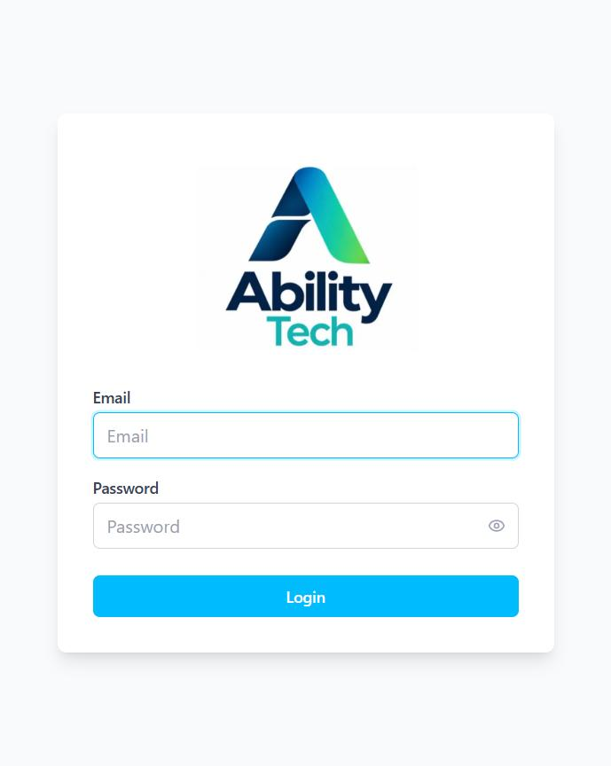

| Field | Type | Required |
|---|---|---|
| Email | Email | Yes |
| Password | Password | Yes |

If you click **Login** with empty fields, the page shows *Email is required* and *Password is required*.

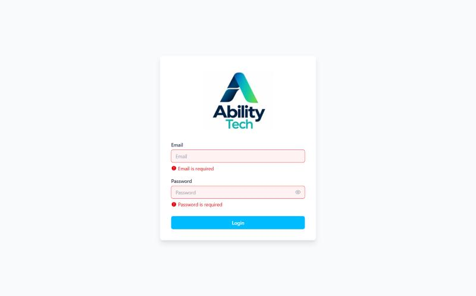

If the email or password is wrong, a red toast appears: *"بيانات تسجيل الدخول غير صحيحة"* ("Login details are incorrect"). Check the email and password and try again.

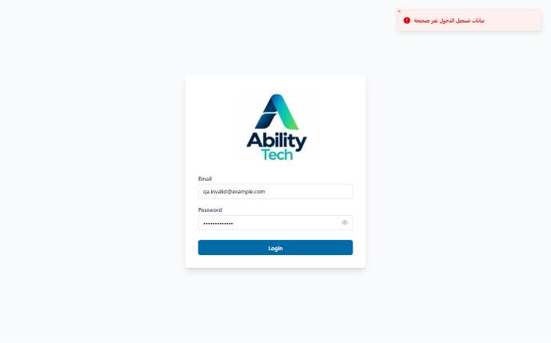

There is no "Forgot password" link; an administrator can send a reset email (see [How do I send a password reset email to a user?](#how-do-i-send-a-password-reset-email-to-a-user)).

**Related questions:** How do I change my password? · How do I log out? · Why can't I see some menus?

---

### How is the screen laid out?

**Keywords:** layout, sidebar, menu, navigation, header

- **Left sidebar:** the main menu. Click a menu with an arrow to expand its sub-items. The button at the top-left collapses/expands the sidebar.
- **Header (top bar):** **Search**, **Notifications** (bell), language (**EN**), and your user name and role.
- **Main area:** the selected page — usually a *search page* (filters + results) or a *details page* (record + action buttons).

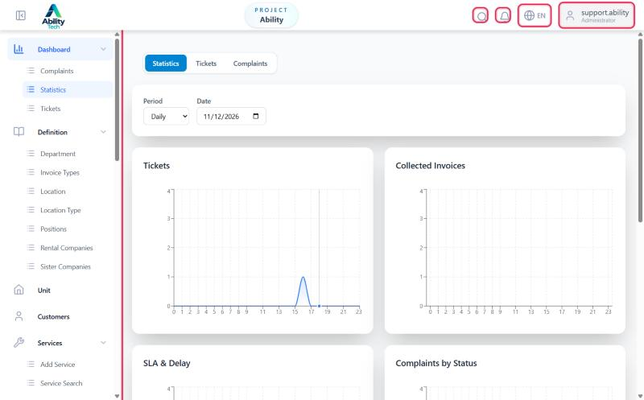

---

### How do I quickly find a customer by phone number?

**Keywords:** global search, quick search, find customer, phone lookup

1. Click the **Search** (magnifying glass) icon in the header.
2. Keep the **By Phone** tab selected.
3. Type the phone number. Results appear as you type under **CUSTOMERS**.
4. Click the customer to open their **Customer Details** page.

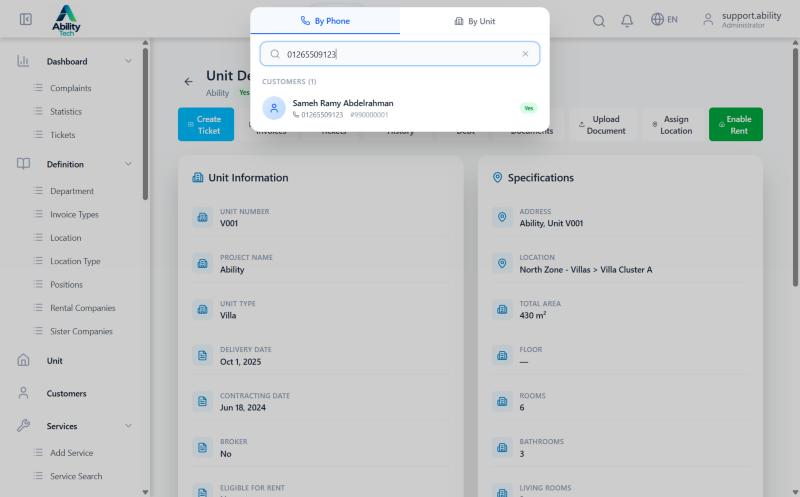

**Related questions:** How do I find a unit quickly? · How do I view a customer's details?

---

### How do I quickly find a unit?

**Keywords:** unit search, find villa, find apartment, quick search unit

1. Click the **Search** icon in the header.
2. Click the **By Unit** tab.
3. Type the unit number (e.g. `V001`). Results appear under **UNITS** with the project, customer and phone.
4. Click the unit to open its **Unit Details** page.

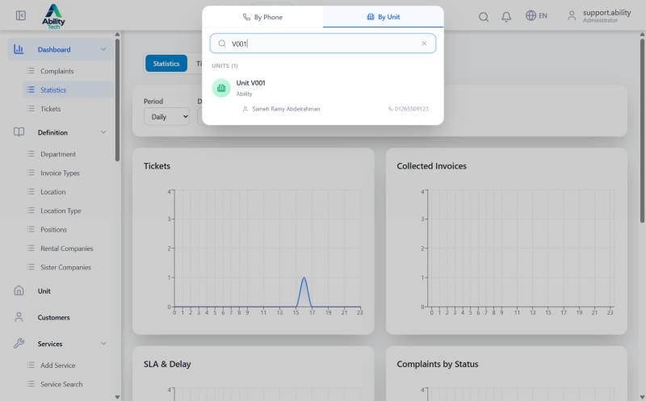

---

### How do I view notifications?

1. Click the **Notifications** (bell) icon.
2. The panel lists notifications, or shows *"No notifications right now"*.

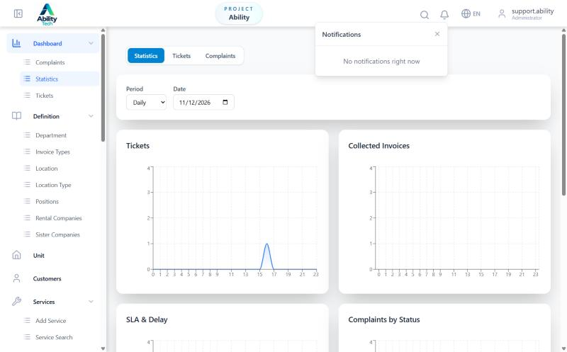

---

### How do I switch the interface language?

1. Click the globe icon (**EN**) in the header.
2. Choose **EN - English** or **ع - Arabic**.

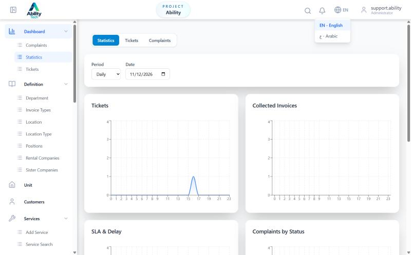

The Arabic interface (`/ar/`) is right-to-left with translated menus and labels. A separate Arabic manual is provided.

---

### How do I change my password or log out?

1. Click your user name in the top-right corner.
2. Choose **Change Password** or **Logout**.

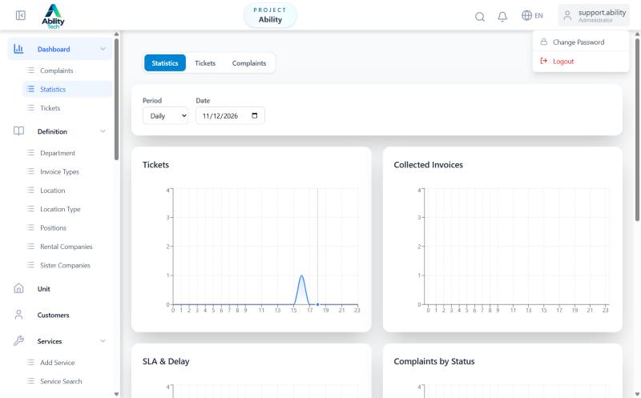

**Change Password**

1. Click your user name, then **Change Password**.

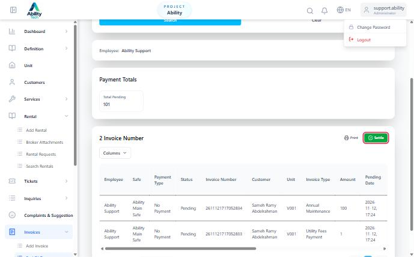

2. Fill in the dialog and click **Save** (or **Cancel**).

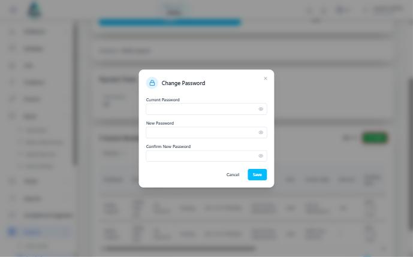

| Field | Type | Required | Rule |
|---|---|---|---|
| Current Password | Password (eye icon shows/hides it) | Yes | Your current password |
| New Password | Password | Yes | At least 8 characters, with an uppercase letter, a lowercase letter and a special character |
| Confirm New Password | Password | Yes | Must match **New Password** |

**Messages:**
- Clicking **Save** with empty fields marks each field red and shows only the field name (*Current Password*, *New Password*, *Confirm New Password*).
- *Password must be at least 8 characters and include uppercase, lowercase, and a special character*
- *Passwords do not match*

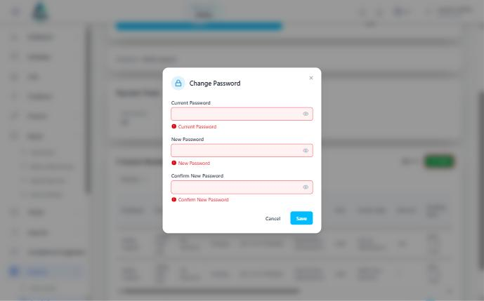

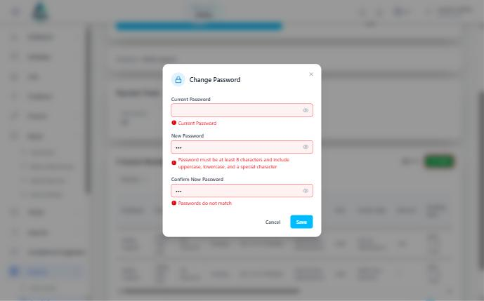

> The validation was tested without submitting a real change, so the success message was not recorded.

**Logout**

Click your user name, then **Logout**. You return to the **Login** page (`/en/login`).

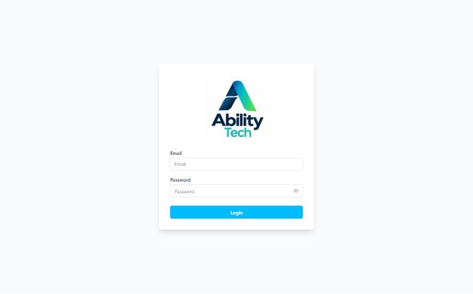

---

### How do the search and list pages work?

**Keywords:** filter, columns, export, pagination, page size, sort

| Control | What it does |
|---|---|
| **Search** | Applies the filters. |
| **Clear** | Resets all filters. |
| **Results (N)** | Number of matching records. |
| **Export to Excel** | Downloads the results as an Excel file named `crm-export.xlsx` (verified). |
| **Columns** | Shows/hides table columns. |
| Column headers with ↑↓ | Click to sort (where the arrows are shown). |
| **Page size** | *10 / 25 / 50 / 100 per page* (some tables also *5 per page*). |
| **Previous / Next / page numbers** | Moves between pages. |
| **All / Active / Inactive** | (Definition pages) filters by status. |

Most dropdowns are **searchable**: click the field, type in **Search options...**, then click the option. Click the **×** inside a dropdown to clear it.

---

## 4. Complaints & Suggestions

**Purpose:** record, follow up and close customer complaints with responses and attachments, so each complaint has an owner department, a status and a history.
**Typical users:** Customer Service agents, department supervisors, managers.
**Menu:** **Complaints & Suggestions → Add Complaint / Search Complaint**, and **Dashboard → Complaints** (live view).

| Field | Values |
|---|---|
| Department | Administration, Customer Service, Housekeeping, Engineering, Landscaping, Security, Recreation, Finance, IT |
| Complaint Type | MyPorto App, Staff Behavior, Late Response, Billing Issue, Cleaning Quality, Garbage Collection, Repeated Breakdown, Water Outage, Power Outage, Landscape Maintenance, Noise Disturbance, Unauthorized Access, Parking Violation, Pool Cleanliness, Beach Services |
| Complaint Status | Pending, In progress, Resolved |
| Request From | CRM, MyPorto App, Walk-in |
| Contact Channel | Call, WhatsApp |

> The Complaint Type list is the same whatever Department you choose.

---

### How do I file a new complaint?
<!-- tabs: Add Complaint -->

**Keywords:** add complaint, new complaint, register complaint, log complaint

1. Go to **Complaints & Suggestions → Add Complaint**.
2. Type the **Unit Number** (or **Unit ID**). Tick **Exact Match** to match the full number only. Click **Search**.

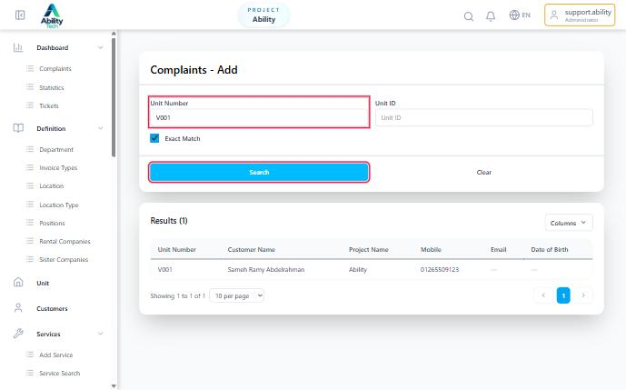

3. In **Results**, click the unit/customer row.

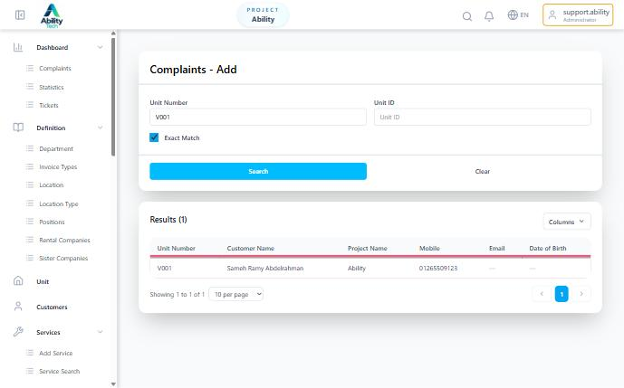

4. The **Complaints - Create Complaint** form opens with Customer Name, Customer Code, Mobile Number, Unit Number and Project filled in (read-only). The required fields are framed below.

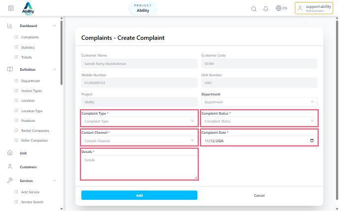

5. Choose the **Department** (optional), **Complaint Type**, **Complaint Status** and **Contact Channel**.
6. Check the **Complaint Date** (defaults to today) and type the **Details**.
7. Click **Add**. *"Created successfully."* appears and you are taken to **Complaints - Search** with the new complaint at the top.

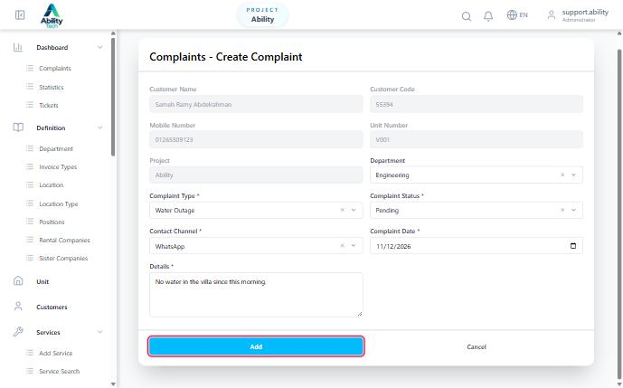

**Form fields**

| Field | Type | Required | Valid values / format |
|---|---|---|---|
| Customer Name / Customer Code / Mobile Number / Unit Number / Project | Read-only | — | From the selected unit |
| Department | Searchable dropdown | No | Department list |
| Complaint Type | Searchable dropdown | **Yes** | See list above |
| Complaint Status | Searchable dropdown | **Yes** | Pending, In progress, Resolved |
| Contact Channel | Searchable dropdown | **Yes** | Call, WhatsApp |
| Complaint Date | Date | **Yes** | Defaults to today |
| Details | Multi-line text | **Yes** | Free text |

**If you click Add with missing fields**, these messages appear:

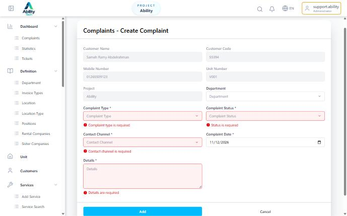

| Message | Fix |
|---|---|
| Complaint type is required | Select a Complaint Type. |
| Status is required | Select a Complaint Status. |
| Contact channel is required | Select Call or WhatsApp. |
| Details are required | Describe the complaint. |

**Related questions:** How do I find a complaint? · How do I add a response? · How do I change a complaint's status?

---

### How do I search for a complaint?
<!-- tabs: Search Complaint -->

**Keywords:** find complaint, complaint list, filter complaints, complaint ID

1. Go to **Complaints & Suggestions → Search Complaint**.
2. Fill any filters: **Department**, **Complaint Type**, **Customer Filter**, **Unit Number**, **Complaint Status**, **Request From**, **Contact Channel**, **Date From**, **Date To**.
3. Click **Search**.

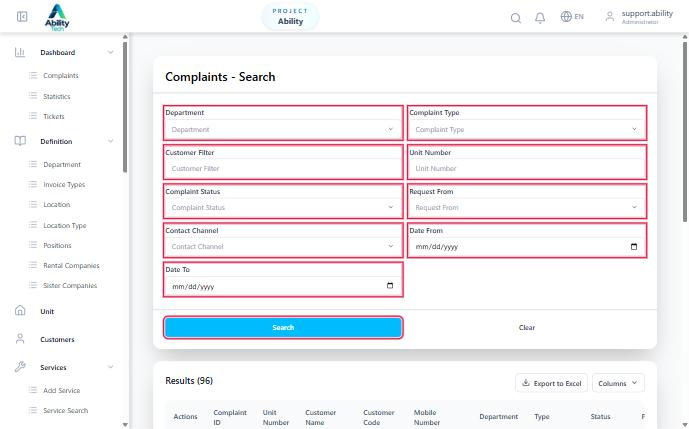

4. Scroll to **Results**. Click any value in a row (e.g. the Complaint ID) to open the complaint. Use the paperclip to see attachments, or **Export to Excel**.

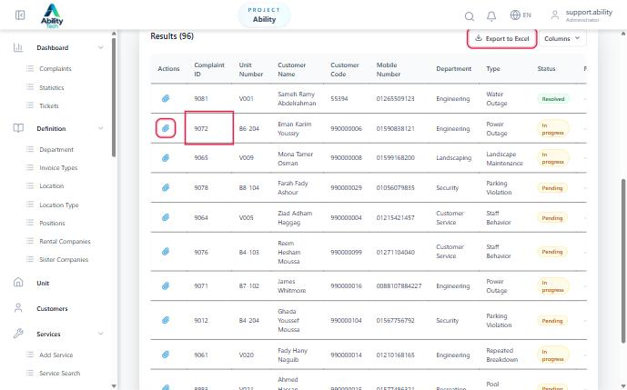

**Results columns:** Actions · Complaint ID · Unit Number · Customer Name · Customer Code · Mobile Number · Department · Type · Status · Project · Request From · Contact Channel · Complaint Date · Details · Responses · Created By.

---

### How do I view a complaint's attachments from the search list?
<!-- tabs: Search Complaint -->

1. In **Search Complaint**, click the paperclip icon (**View Attachments**) in the row.
2. The **Attachments** dialog lists the files, or shows *"No attachments"*. Close it with **×**.

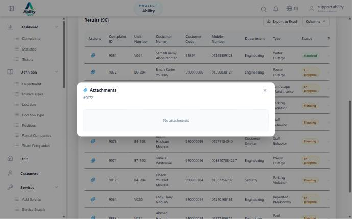

---

### How do I open a complaint's details?
<!-- tabs: Search Complaint -->

**Keywords:** complaint details, view complaint, complaint history

1. Open the complaint from **Search Complaint** or **Dashboard → Complaints**.
2. The top of **Complaint Details #ID** shows the status and the action buttons **Change Status**, **Add Response**, **Upload Document**.

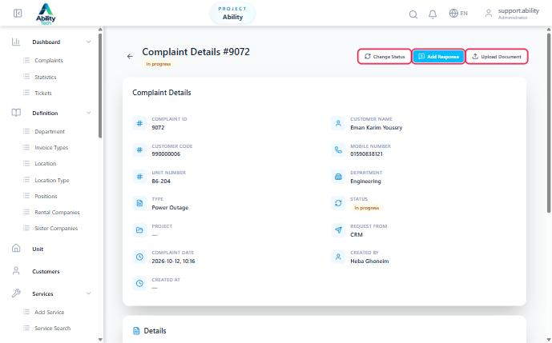

3. Scroll down to see **Details**, **Responses (N)** and **Attachments (N)**.

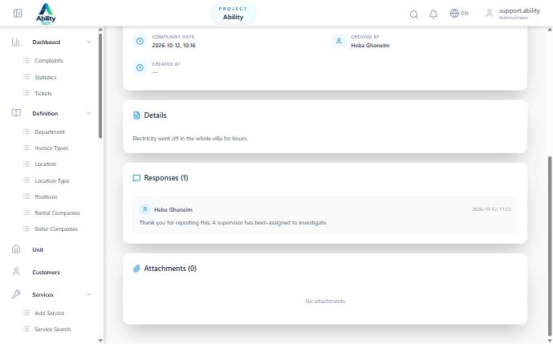

---

### How do I add a response to a complaint?
<!-- tabs: Search Complaint -->

**Keywords:** reply to complaint, respond, complaint comment, follow-up

1. Open the complaint and click **Add Response**.
2. Type your reply in **Response** (required).
3. Click **Save**. The response appears under **Responses** with your name and time.

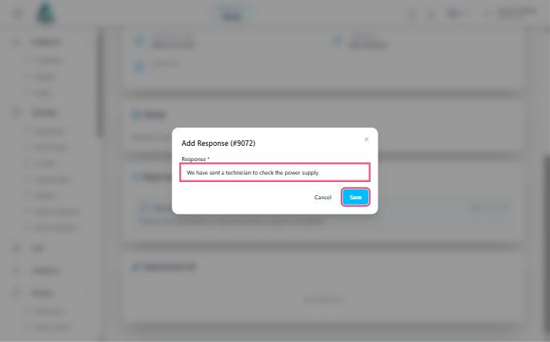

- An empty response is blocked by the browser's required-field prompt.
- No option to edit or delete a response was found.

---

### How do I change a complaint's status (e.g. mark it Resolved)?
<!-- tabs: Search Complaint -->

**Keywords:** resolve complaint, close complaint, update status, in progress

1. Open the complaint and click **Change Status**.
2. Click **Complaint Status**.

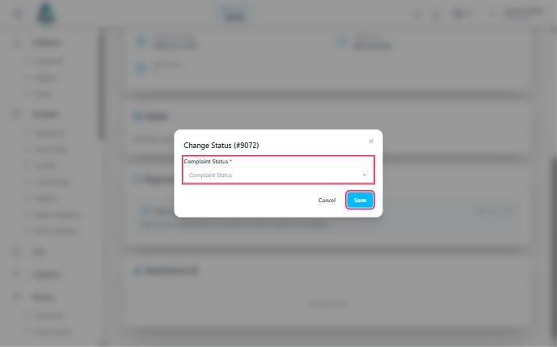

3. Choose **Pending**, **In progress** or **Resolved**.

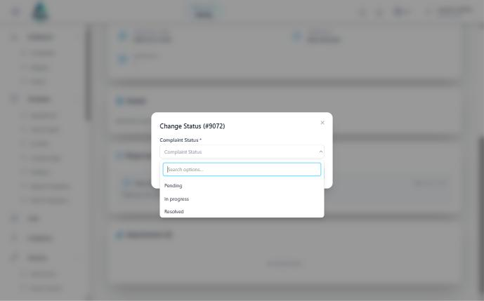

4. Click **Save**. The status badge updates.

- With no status selected the browser shows *"Please select an item in the list."*
- **Important:** once a complaint is **Resolved**, the **Change Status** button disappears. It cannot be re-opened from this page.

---

### How do I attach a document to a complaint?
<!-- tabs: Search Complaint -->

**Keywords:** upload file, attach, complaint attachment, evidence photo

1. Open the complaint and click **Upload Document**.
2. In **File**, drag and drop a file or click to select one (multiple files allowed).
3. Optionally type a **Description**.
4. Click **Upload**.

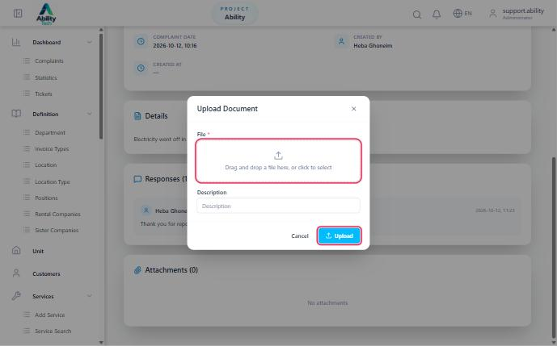

Verified: after **Upload**, *"File uploaded successfully."* appears and the count in **Attachments (N)** goes up (refresh the page if it does not change). ⚠️ File-size/type limits were not tested.

---

## 5. Dashboard

**Purpose:** live overview of open tickets, open complaints and key statistics.
**Typical users:** supervisors, managers, dispatchers.
**Menu:** **Dashboard → Complaints / Statistics / Tickets** (also shown as tabs at the top).

### Where do I see all open (live) complaints?
<!-- tabs: Complaints -->

**Keywords:** live complaints, open complaints, dashboard complaints

1. Go to **Dashboard → Complaints**.
2. The **Live** table lists complaints with status **Pending** or **In progress** (resolved ones are hidden). *"Last update"* shows the refresh time. Columns with ↑↓ can be sorted.
3. Click a row to open the complaint.

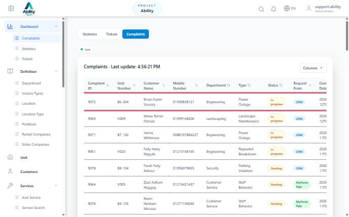

**Columns:** Complaint ID · Unit Number · Customer Name · Mobile Number · Department · Type · Status · Request From · Complaint Date · Created By.

---

### Where do I see live tickets and their SLA status?
<!-- tabs: Tickets -->

**Keywords:** live tickets, SLA, delayed tickets, urgent tickets

1. Go to **Dashboard → Tickets**.
2. Read the indicator columns (framed):
   - **Status:** green eye, or grey crossed-out eye. A newly created ticket that no agent had opened showed the crossed-out eye with an empty **Seen By**.
   - **SLA** and **Delayed:** green check-mark or red warning triangle.
   - **Urgent:** grey triangle, or red triangle for urgent tickets.
3. Click a row to open the ticket.

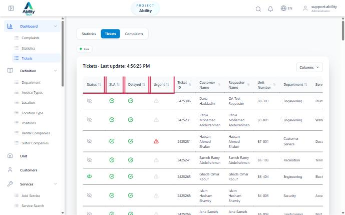

SLA and delay thresholds come from **Settings → Tickets SLA** and **Tickets Delay**.

---

### How do I view statistics charts?
<!-- tabs: Statistics -->

**Keywords:** statistics, charts, KPIs, daily weekly monthly

1. Go to **Dashboard → Statistics** (the page after login).
2. Choose a **Period**: **Daily**, **Weekly**, **Monthly** or **Yearly**, and a **Date**.
3. Review the charts: **Tickets**, **Collected Invoices**, **SLA & Delay**, **Complaints by Status** (New / Resolved), **Tickets by Department**.

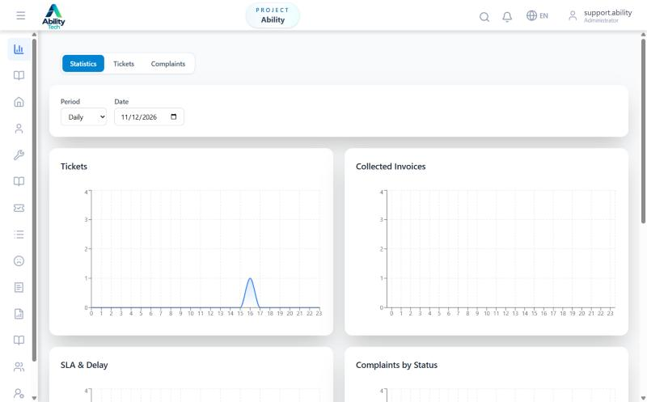

---

## 6. Tickets (including CTS)

**Purpose:** handle residents' service requests from request to completion, with pricing, payment and SLA tracking.
**Typical users:** Customer Service agents, dispatchers, cashiers, department staff.
**Menu:** **Tickets → Add Ticket / Search Tickets / Add CTS / Search CTS**. Also from a customer's page (**Add Ticket**) or a unit's page (**Create Ticket**).

**Status workflow:** `Created → Paid → Confirmed → Inprogress → Fulfilled → Done` (or **Rejected**).

---

### How do I create a new ticket?
<!-- tabs: Add Ticket -->

**Keywords:** add ticket, new service request, maintenance request, work order

1. Go to **Tickets → Add Ticket**. Type the **Unit Number** (tick **Exact Match** if needed), click **Search**, then click the unit row. *(Skip this if you started from a customer or unit page.)*

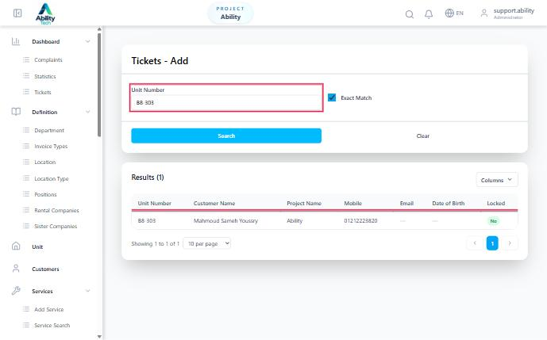

2. The **Tickets - Create Ticket** form opens with Customer Name, Mobile Number, Unit Type, Unit Number, Area and Location filled in.
3. Enter **Requester Name** and **Requester Mobile** (exactly 11 digits) and choose the **Department**.
4. Optionally choose **Contact Channel**, **Arrival Date**, **Arrival Time**, type **Notes**, and tick **Runner Cashier** or **Urgent**.

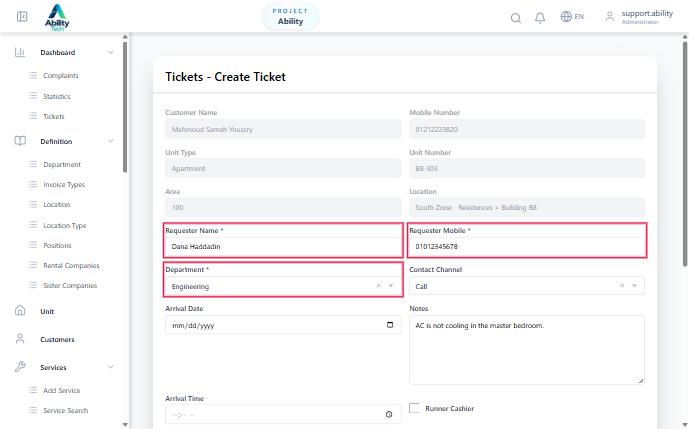

5. In **Services**, pick a service in **Select Services** (the list shows the chosen department's services and prices) and click **Add Service**. Repeat as needed. Use **−/+** to change **Quantity** or the bin icon to remove a line. **Ticket Total** updates.
6. Optionally click **Attach Document**.
7. Click **Add** to create the ticket, or **Create & Collect** to create it and collect payment now (*"Invoice collected successfully."*).

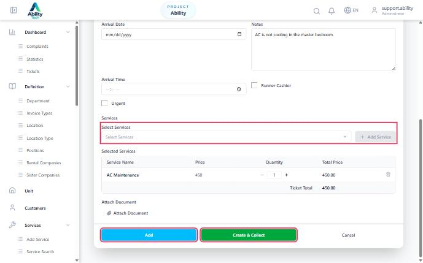

> During discovery, **Add** was shown for a ticket with a total above 0, but was not shown when the only service cost 0 (only **Create & Collect** remained).

**If required fields are missing:**

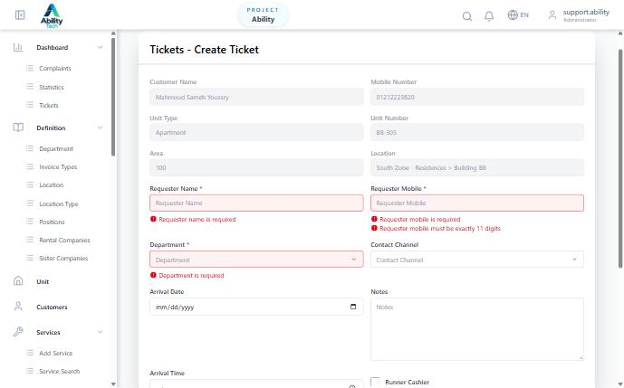

| Field | Type | Required | Rule |
|---|---|---|---|
| Requester Name | Text | **Yes** | |
| Requester Mobile | Text | **Yes** | Exactly 11 digits |
| Department | Searchable dropdown | **Yes** | |
| Contact Channel | Dropdown | No | Call, WhatsApp |
| Arrival Date / Arrival Time | Date / Time | No | |
| Notes | Multi-line text | No | |
| Runner Cashier / Urgent | Checkbox | No | |
| Select Services | Searchable dropdown | **Yes** (at least one) | Services of the chosen department |
| Quantity | Number | — | Minimum 1 |
| Attach Document | File | No | |

**Messages:** *Requester name is required* · *Requester mobile is required* · *Requester mobile must be exactly 11 digits* · *Department is required*.

---

### How do I search for tickets?
<!-- tabs: Search Tickets -->

**Keywords:** find ticket, ticket list, filter tickets, ticket ID

1. Go to **Tickets → Search Tickets**.
2. Fill any filters: **Ticket ID**, **Department**, **Service**, **User**, **Action Taken** (Created, Paid, Confirmed, Inprogress, Fulfilled, Done, Rejected), **Customer Filter**, **Requester Name**, **Unit Number**, **Date From**, **Date To**, **Request From**, **Contact Channel**. Click **Search**.

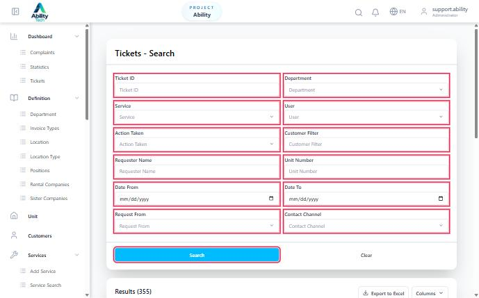

3. In the results, click the ticket values to open it. Use the pencil (**Edit ticket**) or printer (**Print ticket**) icons.

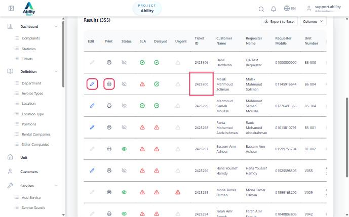

---

### What do the Status, SLA, Delayed and Urgent icons mean?
<!-- tabs: Search Tickets -->

**Keywords:** SLA icon, delayed ticket, urgent ticket, late tickets, seen

In **Search Tickets** and **Dashboard → Tickets**:

| Column | Green check / green eye | Red warning sign | Grey sign |
|---|---|---|---|
| **Status** | Eye: a staff member has seen the ticket (name in **Seen By**) | — | Crossed eye: not seen yet |
| **SLA** | Within the **Tickets SLA** time (Settings) | SLA time exceeded | — |
| **Delayed** | Within the **Tickets Delay** time (Settings) | Delay time exceeded | — |
| **Urgent** | — | The ticket was created with **Urgent** ticked | Not urgent |

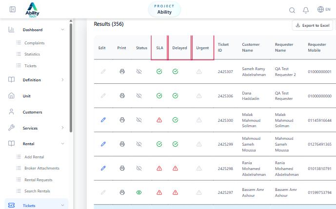

---

### How do I edit a ticket?
<!-- tabs: Search Tickets -->

**Keywords:** modify ticket, change services, update ticket

1. In **Search Tickets**, click the pencil (**Edit ticket**). *It is enabled only while the ticket's last status is **Created** (greyed out otherwise).*
2. In **Edit Ticket #ID**, change **Department**, **Arrival Time**, **Notes** or services.
3. Click **Save**.

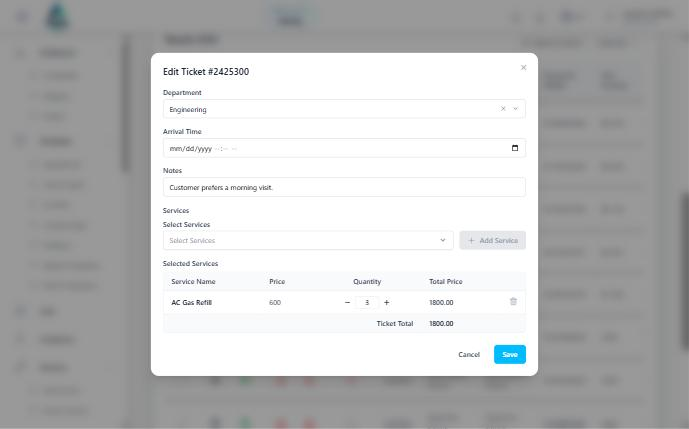

4. *"Updated successfully."* appears and the change is logged in the ticket **Timeline**.

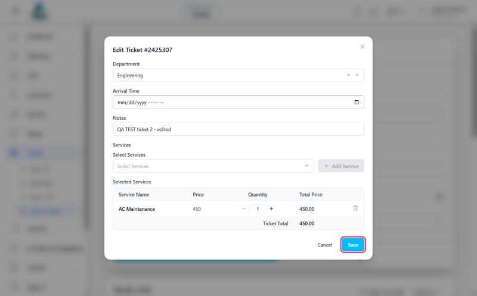

---

### How do I change a ticket's status?
<!-- tabs: Search Tickets -->

**Keywords:** update ticket status, confirm ticket, in progress, fulfilled, done, reject ticket

1. Open the ticket's details page.
2. Click the next status button at the top: **Confirmed**, **Inprogress**, **Fulfilled**, **Done** or **Rejected**. Reached statuses are disabled.
3. The change applies **immediately — no confirmation dialog**. *"Status changed successfully."* appears and the **Timeline** records it.

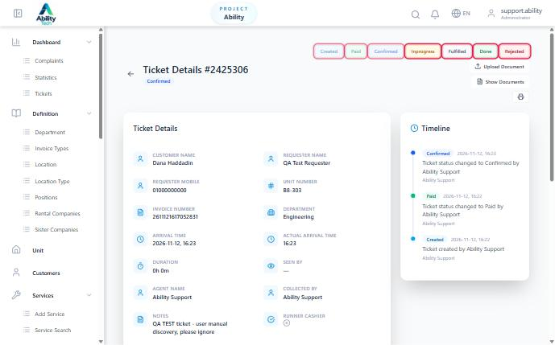

- From **Created**, only **Rejected** is available; the ticket becomes **Paid** automatically when its invoice is collected (see [How do I collect payment for a pending invoice?](#how-do-i-collect-payment-for-a-pending-invoice)).
- Verified path: Paid → **Confirmed** → **Inprogress** → **Fulfilled** → **Done**. Each click shows *"Status changed successfully."*

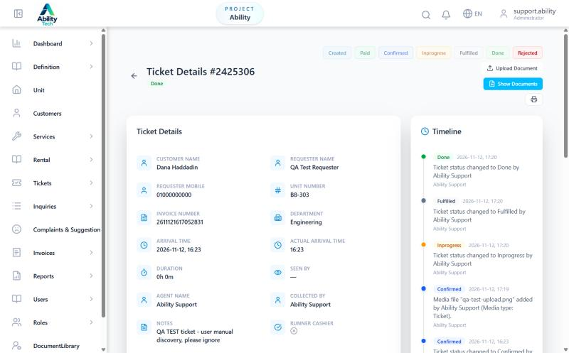

- **Rejected** opens **Reject Ticket #ID** with a required **Reason** (*"This field is required"* if empty). Click **Reject**.

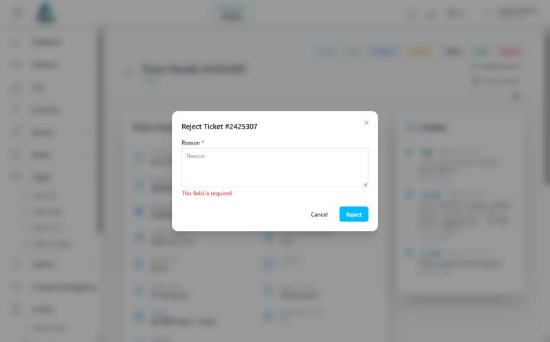

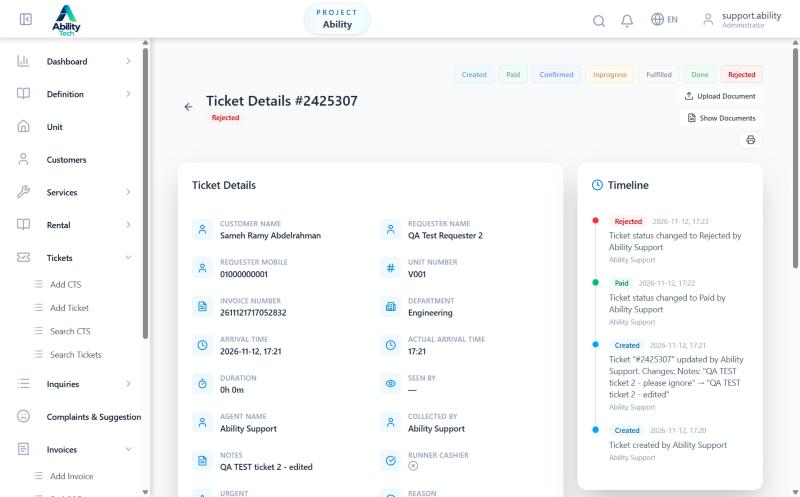

---

### How do I add a comment to a ticket?
<!-- tabs: Search Tickets -->

1. Open the ticket and scroll to **Comments**.
2. Type in **Write a comment...** (up to 1000 characters).
3. Click **Add Comment** (enabled after you type). *"Comment added successfully."* appears.

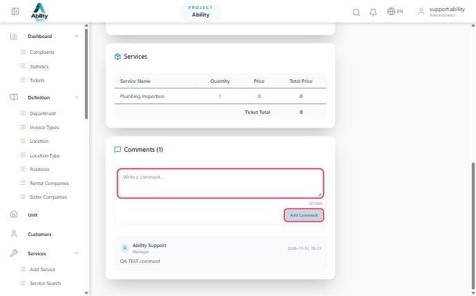

---

### How do I attach documents to a ticket?
<!-- tabs: Search Tickets -->

1. Open the ticket and click **Upload Document**, choose the file, add a description, click **Upload** → *"File uploaded successfully."*
2. The upload is logged in the **Timeline**. Click **Show Documents** to list the files.

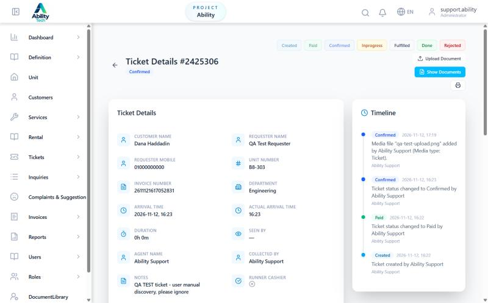

---

### How do I print a ticket?
<!-- tabs: Search Tickets -->

- Click the printer icon in **Search Tickets**, or the printer icon on the ticket details page. The browser's print dialog opens (verified).

---

### How do I create a CTS record?
<!-- tabs: Add CTS -->

**Keywords:** CTS, annual fees, internet, IP TV, IP phone, satellite, SMA TV

1. Go to **Tickets → Add CTS**. Search the **Unit Number** and click the unit row.
2. In **Create CTS Record**, fill **Annual Fees** and **Invoice Types** (required), then any other fields.

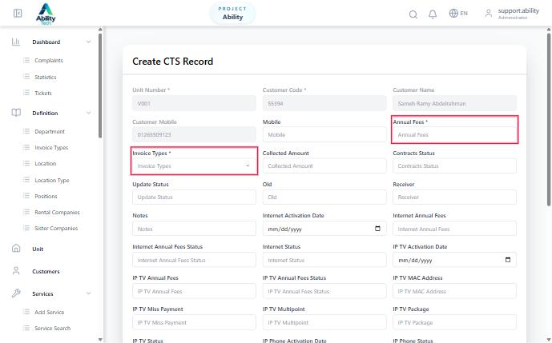

3. Scroll down and click **Submit** to save, or **Create & Collect** to save and collect payment.

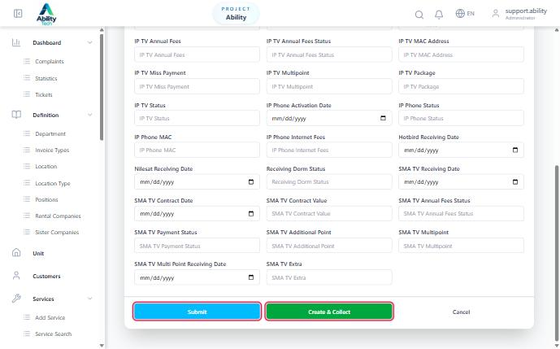

| Group | Fields |
|---|---|
| Main | Unit Number* (read-only), Customer Code* (read-only), Customer Name, Customer Mobile, Mobile, **Annual Fees***, **Invoice Types*** (Utility Fees Payment, Annual Maintenance, Rental Penalty Invoice, Ticket Invoice, Rental File Invoice, Account Statement Payment), Collected Amount, Contracts Status, Update Status, Old, Receiver, Notes |
| Internet | Internet Activation Date, Internet Annual Fees, Internet Annual Fees Status, Internet Status |
| IP TV | IP TV Activation Date, IP TV Annual Fees, IP TV Annual Fees Status, IP TV MAC Address, IP TV Miss Payment, IP TV Multipoint, IP TV Package, IP TV Status |
| IP Phone | IP Phone Activation Date, IP Phone Status, IP Phone MAC, IP Phone Internet Fees |
| Satellite | Hotbird Receiving Date, Nilesat Receiving Date, Receiving Dorm Status |
| SMA TV | SMA TV Receiving Date, SMA TV Contract Date, SMA TV Contract Value, SMA TV Annual Fees Status, SMA TV Payment Status, SMA TV Additional Point, SMA TV Multipoint, SMA TV Multi Point Receiving Date, SMA TV Extra |

**Message:** *Invoice type is required*. After **Submit**, *"Created successfully."* appears and you return to **Search CTS** (verified).

---

### How do I search CTS records?
<!-- tabs: Search CTS -->

1. Go to **Tickets → Search CTS**, enter a **Unit Number**, click **Search**.
2. **Edit record** (pencil) opens **Edit CTS Record #ID** (same fields; Invoice Types is not shown). Change values and click **Save** → *"Updated successfully."*
3. **Print record** (printer) opens the browser's print dialog.

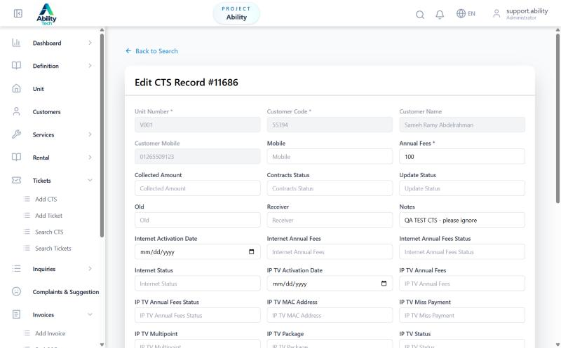

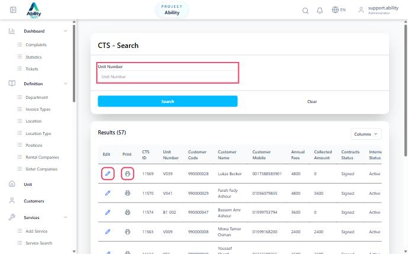

---

## 7. Inquiries

**Purpose:** keep a record of customer questions and answers.
**Menu:** **Inquiries → Add Inquiry / Search Inquiry**.

### How do I log a customer inquiry?
<!-- tabs: Add Inquiry -->

**Keywords:** add inquiry, customer question, record question

1. Go to **Inquiries → Add Inquiry**. Enter the **Unit Number** or **Unit ID**, click **Search**, then click the unit row.
2. The **Add Inquiry** form appears below with **Requester Name** / **Requester Mobile** pre-filled (editable).
3. Choose the **Contact Channel**, type the **Inquiry** and the **Response**.
4. Click **Add** (or **Cancel**).

| Field | Required | Notes |
|---|---|---|
| Requester Name | **Yes** | Pre-filled |
| Requester Mobile | **Yes** | Pre-filled |
| Contact Channel | **Yes** | Call, WhatsApp |
| Inquiry | **Yes** | The question |
| Response | **Yes** | The answer |

**Messages:** *Contact channel is required* · *Inquiry is required* · *Response is required*.

---

### How do I search inquiries?
<!-- tabs: Search Inquiry -->

1. Go to **Inquiries → Search Inquiry**.
2. Filter by **Unit Number**, **Requester Name**, **Requester Mobile**, **Contact Channel**, **Date From**, **Date To**. Click **Search**.

3. Click a row to open **Inquiry Details #ID**.

---

## 8. Customers
<!-- tabs: Search Customer -->

**Purpose:** look up residents and everything linked to them: units, cars, documents, tickets.
**Menu:** **Customers**.

### How do I find a customer?

**Keywords:** search customer, find resident, customer code, ID number

1. Go to **Customers**.
2. Filter by **Name**, **Code**, **ID Number**, **Phone**, **Unit Number** or **Ownership** (Owner, Renter, Owner Relative). Click **Search**.
3. Click the customer row to open their page.

---

### What is on the customer details page?

- Header actions: **Edit Customer**, **Show Documents**, **Upload Document**, **Add Ticket**.
- **Personal Information**, **Contact Information**, **Emergency Contact**, **Notes**, **Units (N)**, **Cars (N)** (Make, Model, Plate Text, Plate Number).

---

### How do I edit a customer's contact details?

1. Open the customer and click **Edit Customer**.
2. Edit **ID Type**, **ID Number** (5–14 characters), **Mobile Number** (11 digits), **Address**, **Email**. **Customer Code** is locked.
3. Click **Save**.

**Validation messages (verified):** *ID number must be between 5 and 14 characters.* · *Mobile number must be exactly 11 digits.* · a browser message if the email has no '@'. **Save** stays disabled until you change something.

> If **Save** shows *"Resource not found"* and the change is not saved, report it to the system administrator.

---

### How do I upload or view a customer's documents?

1. To view: click **Show Documents**; in **Documents**, use **View** (eye) or **Download** (arrow).

2. To upload: click **Upload Document**, choose the **File**, add a **Description**, click **Upload** → *"File uploaded successfully."* (verified).

---

### How do I list all renters, owners or owner relatives?

1. Go to **Customers**. Set **Ownership** to **Owner**, **Renter** or **Owner Relative**.
2. Click **Search**. Use **Export to Excel** for a file.

---

### How do I create a ticket from a customer's page?
<!-- tabs: Search Customer, Add Ticket | require: all -->

1. Open the customer and click **Add Ticket**.
2. Continue from step 3 of [How do I create a new ticket?](#how-do-i-create-a-new-ticket)

---

### How do I review a relative request (accept or reject)?
<!-- tabs: Relative Requests -->

**Keywords:** relative request, owner relative, accept relative, reject relative, family member

1. Go to **Customers → Relative Requests**.
2. Filter by **Request #**, **Owner ID**, **Unit Number**, **Owner Phone Number**, **Relative ID Number**, **Project**, **Status**. Click **Search**.
3. Review the request: **Owner Name**, **Owner Code**, **Unit Number**, **Relative Name**, **Relation**, **ID Type**, **Relative ID #**, **Phone**, **Email**. Click **Show Media** to see the attached documents.
4. Click **Accept** or **Reject**.
5. **Cancel** removes a request that was already accepted (permission **Delete Accept Request**).

**Export to Excel** and **Columns** work as on other search pages.

---

## 9. Unit
<!-- tabs: Unit -->

**Purpose:** search units and see everything about one unit: owners, invoices, tickets, debt, documents and location.
**Menu:** **Unit**. Also from the header **Search → By Unit**.

### How do I search for units?

**Keywords:** find unit, unit list, villa, apartment, eligible for rent, locked unit

1. Go to **Unit**.
2. Filter by **Unit Number** (+ **Exact Match**), **Project**, **Active**, **Locked**, **Furnished**, **Eligible for Rent**, **Rental Company**, **Delivery Date**. Click **Search**.
3. Click a unit row to open **Unit Details**.

**Columns:** Unit Number · Project Name · Sub Project Code · Unit Type · Total Owners · Address · Total Area · Floor · Furnished · Active · Eligible for Rent · Rental Company · Locked · Locked By · Customer Name · Mobile Number · Sign Date.

---

### What can I do on the Unit Details page?

**Keywords:** unit details, unit history, unit invoices, unit tickets, ownership

1. Open a unit. The header shows the action buttons:

| Button | What it does |
|---|---|
| **Create Ticket** | Opens **Tickets - Create Ticket** for this unit. |
| **Show Invoices** | Adds an **Invoices (N)** table to the page. |
| **Show Tickets** | Adds a **Tickets (N)** table. |
| **Ownership History** | Adds **Past Owners (N)**. |
| **Show Debt** | Adds **Unit Debt** and **Unsettled Payments (N)**. |
| **Show Documents** | Adds **Documents (N)** with View/Download. |
| **Upload Document** | Uploads a file to the unit (*"File uploaded successfully."*). |
| **Assign Location** | Sets the unit's location. |
| **Enable Rent** / **Disable Rent** | Marks the unit as eligible / not eligible for rent (with confirmation). |

2. **Unit Information** and **Specifications** show unit number, project, type, delivery/contracting dates, broker, eligibility for rent, address, location, area, floor, rooms, bathrooms, living rooms, balconies, furnished.
3. **Current Owners (N)** lists owners. Switch between **Owners**, **Renters** and **Owner Relatives**.

4. After **Show Invoices** / **Show Tickets**, the tables appear below.

5. After **Show Debt**, see **Unit Debt** and **Unsettled Payments**.

---

### How do I mark a unit as eligible (or not) for rent?

1. Open the unit and click **Enable Rent**.
2. Confirm *Are you sure you want to mark this unit as eligible for rent?* with **Confirm**.

3. *"Unit marked as eligible for rent."* appears, **Eligible for Rent** becomes **Yes**, and the button changes to **Disable Rent**.

4. To reverse it, click **Disable Rent** → **Confirm** → *"Unit marked as not eligible for rent."*

---

### Why can't I add a rental to a unit?

**Keywords:** cannot rent unit, unit not found in Add Rental, eligible for rent, locked unit

**Rental → Add Rental** lists only units that can be rented. If the unit shows *"No units found"*:

1. Open **Unit**, search the unit, and check **Eligible for Rent**. If it is **No**, a user with permission opens the unit and clicks **Enable Rent** (see [How do I mark a unit as eligible (or not) for rent?](#how-do-i-mark-a-unit-as-eligible-or-not-for-rent)).
2. Check **Locked**. A locked unit (for example V048 in testing, which is eligible but locked) is not listed either.

---

### How do I find locked (blocked) units?

In **Unit** search, set **Locked** = **Yes** and click **Search**. The results show **Locked** and **Locked By** (who placed the lock).

> Placing or lifting a lock is done from the block screens (**Add Block**, **Search Block**, **Block History**), which are role permissions that the account used for this manual does not have in its menu.

---

### How do I see a unit's previous owners or renters?

1. Open the unit and click **Ownership History**.
2. **Past Owners (N)** appears under **Current Owners**, with the tabs **Owners**, **Renters**, **Owner Relatives** and the columns **Customer Name**, **Customer Code**, **ID Number**, **Ownership Type**, **Contract**, **Sign Date**, **End Date**, **Status** (*"No ownership history found"* if empty).

---

### How do I upload a document to a unit?

1. Open the unit and click **Upload Document**.
2. Drag the file into **File** (or click to choose), add a **Description**, and click **Upload**.

3. *"File uploaded successfully."* appears. Click **Show Documents** to see it in **Documents (N)**.

---

### How do I assign a location to a unit?

1. Open the unit and click **Assign Location**.
2. In **Select Location**, choose the location (e.g. *North Zone - Villas > Villa Cluster A*).
3. Click **Confirm**.

4. *"Location assigned successfully."* appears and **Location** updates (verified).

---

## 10. Services

**Purpose:** maintain the priced catalogue of department services used in tickets and the mobile app.
**Menu:** **Services → Add Service / Service Search**.

### How do I add a new service?
<!-- tabs: Add Service -->

**Keywords:** create service, service price, service catalogue

1. Go to **Services → Add Service**.
2. Fill the required fields: **English Service Name**, **Arabic Service Name**, **Department**, **SAP Z Code**, **Price**, **Status**. Optionally **Description** and **Start Date**.

3. Choose **Show in Mobile**: **Yes** or **No**. If **Yes**, fill **English Mobile Service Name** and **Arabic Mobile Service Name**.
4. Click **Add** (**Clear** empties the form).

| Field | Required | Values |
|---|---|---|
| English / Arabic Service Name | **Yes** | |
| Department | **Yes** | Department list |
| SAP Z Code | **Yes** | zf01 … zf32 |
| Description | No | |
| Price | **Yes** | Number |
| Start Date | No | |
| Status | **Yes** | Active, Inactive |
| Show in Mobile | — | Yes, No |
| English / Arabic Mobile Service Name | **Yes** when Show in Mobile = Yes | |

**Validation:** *"Please fill out this field."* / *"Please select an item in the list."* After **Add**, *"Created successfully."* appears and you go to **Service Search** (verified).

---

### How do I find, edit, activate or delete a service?
<!-- tabs: Service Search -->

1. Go to **Services → Service Search**. Filter by **Service ID**, **Service Name**, **Department**, **Start Date**, **Active** (Yes/No), **Show in Mobile** (Yes/No). Click **Search**.

2. In the row: pencil = **Edit service** (opens **Services - Save**, which also shows **Service available from / until**); switch = **Status** on/off; bin = **Delete service**.

- **Save** on the edit page → *"Updated successfully."*
- Switching **Status** off asks *Are you sure you want to deactivate the service…? This change will only affect new tickets.* → **Deactivate**.

- **Delete service** asks for confirmation (*This action cannot be undone.*) → **Delete service** → *"Deleted successfully."*

---

## 11. Rental

**Purpose:** manage reservations, rental requests (broker/tenant/app) and bulk broker uploads.
**Menu:** **Rental → Add Rental / Broker Attachments / Rental Requests / Search Rentals**.

**Rental statuses:** Fees Collection Pending · Active · Finished · Canceled · Terminated.
**Request statuses:** Pending · Accept · Reject (*Unit Reserved* also seen in the list).

### How do I add a rental reservation?
<!-- tabs: Add Rental -->

**Keywords:** add rental, book unit, reservation, tenant check-in

1. Go to **Rental → Add Rental**. Enter a full or partial **Unit Number** and click **Search**.
2. In the unit row, click **Add Reservation**. (**View Rental History** opens **Search Rentals** filtered to that unit.)

3. The top summary shows Unit Type, Location, Area and **STATUS AFTER SAVE: Fees Collection Pending**. In **Booking Details**, fill the required fields (framed).

4. Under **Tenant Attachments**, upload the main tenant's documents (required).
5. Optionally expand **Relative Information** → **Add Relative**, and **Vehicle Information** → **Add Vehicle**.
6. Click **Save**.

| Field | Required | Notes |
|---|---|---|
| Rental Company | **Yes** | Owner, Coastline Holiday Rentals, Blue Wave Property Management, Sunrise Stays, Red Sea Homes |
| Tenant Name | **Yes** | |
| Gender | No | Male, Female |
| ID Type | **Yes** | Passport, National ID |
| ID Number | **Yes** | 8–16 characters |
| Email | No | |
| Phone Number | **Yes** | |
| Check-in Date / Check-out Date | **Yes** | |
| Total Tenants Count | **Yes** | Default 1 |
| Access Card Number (Optional) | No | |
| Notes | No | |
| Tenant Attachments | **Yes** | Drag all files at once |
| Relative: Relative Name*, ID Type*, ID Number*, Relative Gender, Email, Phone Number, Relationship, Attachments | Starred required | **Remove** deletes the block |
| Vehicle: Vehicle Brand*, Vehicle Model*, Plate Text - Plate Number*, Attachments | Starred required | **Remove** deletes the block |

**If you click Save with missing data:**

**Messages:** *Rental company is required* · *Tenant name is required* · *ID type is required* · *ID number must be between 8 and 16 characters* · *Start date is required* · *End date is required* · *Upload the main tenant documents here before saving the rental.* · empty Phone Number shows *"Invalid input: expected string, received undefined"* — enter the phone number.
**After a successful Save:**

The toast *"Rental created successfully."* appears. The new rental has the status **Fees Collection Pending** (verified with test tenant "QA Test Tenant" on unit V008).

---

### How do I review a rental request (accept or reject)?
<!-- tabs: Rental Requests -->

**Keywords:** rental request, approve rental, reject rental, broker request

1. Go to **Rental → Rental Requests**. Filter by **Reference Number**, **Unit Number**, **Tenant Name**, **ID Number**, **Source**, **Status**, **Delegate Name**, **Delegate NID**. Click **Search**.

2. Click a request to open **Rental Request Details**. Review the details, then use **Edit**, **Accept** or **Reject**.

3. Check **Tenant Attachments** with **View** / **Download**.

4. **Accept:** click **Accept** and confirm. The toast *"Rental request accepted successfully."* appears, and a rental is created with the source **Walk-in**.

5. **Reject:** click **Reject**, enter the required reason, and confirm. The toast *"Rental request rejected successfully."* appears.

If the details page looks empty after **Accept**, go back to **Rental Requests** to continue. If **Accept** fails with *"Total tenant count does not match number of tenants provided"*, see the note below.

---

### How do I edit a rental request before accepting it?
<!-- tabs: Rental Requests -->

1. Open the request and click **Edit**.
2. Update **Assigned Unit**, **Assigned Rental Company**, tenant details, dates, **Total Tenants Count**, **Access Card Number (Optional)**, **Notes**; use **Add Relative** if needed.
3. Click **Save** (or **Cancel**).

**If Save or Accept shows *"Total tenant count does not match number of tenants provided"*:** the **Total Tenants Count** must match the main tenant plus the relatives listed on the request. Fix the count or the relatives and try again. If it still fails, reject the request and ask the broker to resubmit it, or contact support.

---

### How do I search rentals?
<!-- tabs: Search Rentals -->

1. Go to **Rental → Search Rentals**. Filter by **Unit Number**, **Tenant Name**, **Mobile Number**, **ID Number**, **Project**, **Status**, **Start Date**, **Check-out Date**. Click **Search**.

**Result columns:** Accept Request Date · Check-in Date · Check-out Date · Unit Number · Tenant Name · Tenant Mobile · Request Source · Status. **Export to Excel** downloads the list. Click a row to open the rental.

---

### What is on a rental's details page?
<!-- tabs: Search Rentals -->

**Keywords:** rental details, RNT, rental page, tenant details, rental timeline

1. In **Search Rentals**, click the rental. **Rental Details • RNT-<number>** opens.
2. The top shows the status (for example **Fees Collection Pending**), **Request Creation Date**, and the tenant data: **Tenant Name**, **Tenant Mobile**, **ID Type**, **ID Number**, **Project Name**, **Rental Company**, **Rent Start Date**, **End Date**, **Access Card Number**, **Unit Number**, **Total Tenants**, **Email**, and **Notes**.

3. Below are **Attachments** (with **View** / **Download**), **Invoices**, **Relatives**, **Vehicles** and the **Activity Timeline** (reservation created, invoices issued, check-out or termination details).

**Buttons on the page depend on the status:**

| Status | Buttons shown |
|---|---|
| Fees Collection Pending (before the start date) | **Print RC**, **Edit**, **Create Ticket**, **Issue Invoice**, **Change Reservation** |
| Fees Collection Pending (on or after the start date) | The same, plus **Check-in** |
| Active (before the end date) | **Print RC**, **Edit**, **Create Ticket**, **Issue Invoice**, **Change Reservation**, **Terminate** |
| Active (on or after the end date) | The same, plus **Check-out** |
| Terminated | **Print RC**, **Edit**, **Create Ticket** |

The page shows a hint such as *"Check-in becomes available on or after the rent start date."* or *"Check-out becomes available on or after the end date."*

**Related questions:** How do I check a tenant in? · How do I check a tenant out? · How do I terminate a rental?

---

### How do I edit a rental's details?
<!-- tabs: Search Rentals -->

1. Open the rental and click **Edit**.
2. Change any of: **Tenant Name***, **Tenant Mobile***, **Email**, **ID Type***, **ID Number***, **Rent Start Date***, **End Date***, **Access Card Number**, **Notes**.
3. Click **Save** (or **Cancel**). *"Rental details updated successfully."* appears.

---

### How do I extend a rental (Change Reservation)?
<!-- tabs: Search Rentals -->

**Keywords:** extend rental, change end date, change unit, change reservation

1. Open the rental and click **Change Reservation**.
2. Change **Unit Number***, **End Date***, **Access Card Number** or **Notes**.
3. Click **Save**. *"Reservation updated successfully."* appears.

> The new **End Date** must be later than the current one; otherwise you see *"New end date must be later than the current end date"*. To shorten a rental, use **Edit** (or **Terminate** for an early end).

---

### How do I issue an invoice on a rental?
<!-- tabs: Search Rentals -->

**Keywords:** rental invoice, penalty invoice, rental fees, rental file invoice

1. Open the rental and click **Issue Invoice**.
2. Choose the **Invoice Type***: **Rental Penalty**, **Rental Service Fee**, **Rental Penalty Invoice** or **Rental File Invoice**.

3. Enter the **Amount*** and optional **Notes**.
4. Click **Save** to issue it as **Pending**, or **Create & Collect** to collect it at once. *"Invoice added successfully."* appears.

5. To collect a pending rental invoice later, open it from **Invoices → Search Invoices** (filter by the **Unit Number**), click **Add Payment Method**, choose the **Payment Type**, enter the **Amount** and click **Collect** (see [How do I collect payment for a pending invoice?](#how-do-i-collect-payment-for-a-pending-invoice)).

> The issued invoice appears in the rental's **Activity Timeline** (*Invoice Issued*) and in **Search Invoices**. Empty required fields show the browser message *"Please fill out this field."*

---

### How do I check a tenant in?
<!-- tabs: Search Rentals -->

1. Open the rental. **Check-in** appears on or after the **Rent Start Date**.

2. Click **Check-in**. *"Rental status updated successfully."* appears and the status becomes **Active**. **Check-out** and **Terminate** become available.

> Check-in applies immediately, with no confirmation dialog.

---

### How do I check a tenant out?
<!-- tabs: Search Rentals -->

**Keywords:** check-out, checkout, tenant rating, end of rental, penalty

1. Open an **Active** rental on or after its **End Date** and click **Check-out**.

2. Fill the form:

| Field | Required | Notes |
|---|---|---|
| Penalty Amount | No | Default 0 |
| Invoice Type | No | Default **Rental Penalty** |
| Invoice Amount | No | Amount of the penalty invoice |
| Invoice Notes | No | |
| Tenant Rating | **Yes** | **Excellent**, **Good**, **Fair**, **Poor** |
| Remarks | No | |

3. Click **Save**.

> If **Save** shows *"Invalid request data"*, the check-out was not saved. Report it to support (see Appendix C).

---

### How do I terminate a rental early?
<!-- tabs: Search Rentals -->

**Keywords:** terminate, cancel rental, end rental early, eviction

1. Open an **Active** rental and click **Terminate**.
2. Enter the **Termination Reason*** (required — *"This field is required"* if empty). Optionally add **Penalty Amount**, **Invoice Type**, **Invoice Amount**, **Invoice Notes**.

3. Click **Save**. *"Rental terminated successfully."* appears. The status becomes **Terminated**, the **End Date** becomes the termination date, and the **Activity Timeline** records *Checked Out* with the reason.

⚠️ Termination cannot be undone from the page; only **Print RC**, **Edit** and **Create Ticket** stay available.

---

### How do I print the rental contract (Print RC)?
<!-- tabs: Search Rentals -->

Open the rental and click **Print RC**. If no contract template is set up for the project, the message *"No print documents are configured for this project yet."* appears — ask the system administrator to configure the print documents.

---

### How do I create a ticket for a tenant?
<!-- tabs: Search Rentals, Add Ticket | require: all -->

Open the rental and click **Create Ticket**. **Tickets - Create Ticket** opens with the tenant's name and mobile, unit type, unit number, area and location already filled. Continue as in [How do I create a new ticket?](#how-do-i-create-a-new-ticket).

---

### What is the life cycle of a rental?
<!-- tabs: Add Rental, Search Rentals -->

| Step | Status after it | How |
|---|---|---|
| Booking saved (**Add Rental** or **Accept** on a request) | **Fees Collection Pending** | See [How do I add a rental reservation?](#how-do-i-add-a-rental-reservation) |
| **Check-in** (on or after the start date) | **Active** | Rental page |
| **Check-out** (on or after the end date) | **Finished** | Rental page |
| **Terminate** (any time while Active) | **Terminated** | Rental page |
| — | **Canceled** | Listed as a status filter; the action that sets it was not found on the rental page |

> In testing, collecting the rental's invoice did not change the status; **Check-in** moves it to **Active**.

---

### How do I upload broker rentals in bulk (Broker Attachments)?
<!-- tabs: Broker Attachments -->

1. Go to **Rental → Broker Attachments** (**Rentals Walk-In Upload**).
2. Choose the **Rental Company**.
3. Click **Download Units Template** and **Download Delegates Template** to get the Excel templates.
4. Choose the **Units Excel File** (required name: `rental_company_units.xlsx`) and **Delegates Excel File** (required name: `rental_company_delegate.xlsx`).
5. Click **Save**.

**Template columns**

| Template | Columns |
|---|---|
| `rental_company_units.xlsx` | unit_number, area, unit_id |
| `rental_company_delegate.xlsx` | delegate_national_id, delegate_phone_number, delegate_name |

Each file must have at least one data row under the headers.

**Messages:**
- No company selected → *"Please select a rental company."*
- A file with headers only → *"Units file must contain at least one data row."*

> Tested in development with the empty templates only. A successful upload needs real unit IDs and delegate data, so it was not run.

---

## 12. Invoices

**Purpose:** create and collect payments, handle voids, close the day.
**Menu:** **Invoices → Add Invoice / End Of Day / Full End Of Day / Search Invoices**.

**Statuses:** Pending · Collected · Void · Under Payment Process · Void Requested · Partially Collected · Refunded · Refund Requested · Partially Refund.
**Types:** Utility Fees Payment · Annual Maintenance · Rental Penalty Invoice · Ticket Invoice · Rental File Invoice · Account Statement Payment (ticket invoices show *Service invoice*).

### How do I create a manual invoice?
<!-- tabs: Add Invoice -->

**Keywords:** add invoice, new invoice, charge customer, utility fees

1. Go to **Invoices → Add Invoice**. Search the **Unit Number** and click the unit row.
2. Optionally click **Show Debt** to see the unit's debt.

3. In **Create Invoice**, choose **Invoice Type**, optional **Contact Channel**, enter **Amount** and optional **Notes**.
4. Click **Add**, or **Create & Collect** to collect at once.

| Field | Required | Rule |
|---|---|---|
| Invoice Type | **Yes** | Types list |
| Contact Channel | No | Call, WhatsApp |
| Amount | **Yes** | Greater than 0 |
| Notes | No | |

**Messages:** *Invoice type is required* · *Amount is required* · *Amount must be greater than 0*. After **Add**, *"Created successfully."* appears and the invoice is **Pending** (verified).

---

### How do I search for an invoice?
<!-- tabs: Search Invoices -->

1. Go to **Invoices → Search Invoices**. Use any filters and click **Search**.
2. Click a row to open the invoice, or **Print** in the row. **Print** is enabled only for **Collected** or **Void** invoices and opens the browser's print dialog.

---

### What is on the invoice details page?
<!-- tabs: Search Invoices -->

- Header: status, **Void Request**, **Void Invoice**, **Upload Document**, print icon.
- **Invoice Details**, **Timeline**, **Services**, **Payment Methods**.

---

### How do I collect payment for a pending invoice?
<!-- tabs: Search Invoices -->

**Keywords:** collect invoice, payment method, cash, visa, instapay, pay invoice

1. Open the **Pending** invoice (from **Search Invoices** or the ticket's **Invoice Number**). **Print** is disabled while the invoice is pending.

2. Scroll to **Payment Methods** and click **Add Payment Method**.
3. In the **Payment Methods** dialog, choose a **Payment Type** (Cash, Visa, Online, Sister Company, Cheque, Instapay, Total Estimated Cost Refund) and enter the **Amount**. Use **+ Add Payment Method** to split the payment across types.

4. Check that **Remaining** is **0.00**, then click **Collect**.

5. *"Invoice collected successfully."* appears. The invoice becomes **Collected** and, for a ticket invoice, the ticket becomes **Paid**.

---

### How do I request an invoice void?
<!-- tabs: Search Invoices -->

1. Open the invoice and click **Void Request**.
2. Type the reason (the **Void Request** button stays disabled until you do).
3. Click **Void Request**, or **Cancel**.

4. *"Void request submitted successfully."* appears; status becomes **Void Requested** and a **Void Request Reason** box is shown. Only **Reject Void Request** remains available.

**To reject a void request:** click **Reject Void Request**, type the reason, confirm → *"Void request rejected successfully."* (status returns to **Collected**).

---

### How do I void an invoice directly?
<!-- tabs: Search Invoices -->

1. Open the invoice and click **Void Invoice**.
2. Read *"Are you sure you want to void this invoice? This action cannot be undone."* and type the reason.
3. Click **Void Invoice**, or **Cancel**.

4. *"Invoice voided successfully."* appears; status becomes **Void** (verified). Cannot be undone.

---

### How do I review my End of Day?
<!-- tabs: End Of Day -->

**Keywords:** EOD, end of day, daily closing, cashier closing, settle

1. Go to **Invoices → End Of Day**. Choose the **Date** (required) and click **Search**.
2. Review **Employee** (you), **Cash Payments** (Total Collected, Total Voided, Void Requested, Total Refunded, Partially Refunded, Refund Requested, Net Balance) and **Payment Totals**.

3. Scroll to the invoice list. Use **Print**, and **Settle** to settle the day.

**Print** opens the browser print dialog.

**Settle the day**

1. Pick the **Date** and click **Search**. The page shows the **Employee**, **Cash Payments** totals (Total Collected, Total Voided, Void Requested, Total Refunded, Partially Refunded, Refund Requested, Net Balance), **Payment Totals** (Total Pending), and the invoice list.

2. Click **Settle**.

3. The dialog **Confirm Settlement** asks: *"Are you sure you want to settle the end of day? This action cannot be undone."* Click **Settle** to confirm, or **Cancel**.

4. The toast *"Settlement completed successfully."* appears. Settled (Collected/Void) invoices leave the list; **Pending** invoices stay, so **Settle** is still shown.

⚠️ Settlement cannot be undone. Check the totals before you confirm.

---

### How do I review the Full End of Day for all employees?
<!-- tabs: Full End Of Day -->

1. Go to **Invoices → Full End Of Day**. Choose the **Date** (required), optional **Safe** and **Employee**. Click **Search**.
2. Review **Payment Statistics per Employee** and the invoice list.

---

### How do I request a refund for an invoice?
<!-- tabs: Refund -->

**Keywords:** refund, refund request, money back, return payment, give the customer their money back

1. Go to **Invoices → Refund**.
2. Find the invoice: filter by **Invoice Number**, **Invoice Item Number**, **Status**, **ERP Reference**, **ERP Refund Reference**, **Date From**, **Date To**, and click **Search**.
3. In the invoice's row, click **Refund Request** (shown for invoices that have not been refunded yet).
4. The dialog asks *"Are you sure you want to submit a refund request for this invoice?"* — type the reason in **Enter the reason for requesting this invoice refund...**.
5. Click **Refund Request** to submit, or **Cancel**.
6. The row's **Refund Status** becomes **Refund Requested**, with your name in **Refund Requested By** and your reason in **Refund Request Reason**.

---

### How do I refund an invoice directly?
<!-- tabs: Refund -->

**Keywords:** refund, direct refund, money back, refund immediately

1. Go to **Invoices → Refund**, find the invoice (see the question above) and click **Refund** in its row.
2. Read *"Are you sure you want to refund this invoice? This action cannot be undone."* and type the reason in **Enter the reason for refunding this invoice...**.
3. Click **Refund** to confirm, or **Cancel**.
4. The row's **Refund Status** becomes **Refunded**, with your name in **Refunded By** and your reason in **Refund Reason**.

⚠️ A direct refund cannot be undone. If the refund should be reviewed first, use **Refund Request** instead.

---

### How do I review refund requests?
<!-- tabs: Refund -->

**Keywords:** refund, refund request, approve refund, reject refund, money back

1. Go to **Invoices → Refund**.
2. Filter by **Invoice Number**, **Invoice Item Number**, **Status**, **ERP Reference**, **ERP Refund Reference**, **Date From**, **Date To**. Click **Search**.
3. Each row shows **Invoice Number**, **Invoice Item Number**, **Customer**, **Unit**, **Total Amount**, **Payment Type**, **ERP Reference**, **ERP Refund Reference**, **Refund Status**, **Refund Requested By**, **Refunded By**, **Refund Request Reason** and **Refund Reason**.
4. The **Actions** column depends on the row's state: an invoice with no refund yet shows **Refund Request** and **Refund** (see the two questions above); for a pending request, the actions are **Accept Refund Request** and **Reject Refund Request** (the Refund tab's role permissions).

The related invoice statuses are **Refund Requested**, **Refunded** and **Partially Refund** (see the invoice statuses at the start of this section).

---

## 13. Reports

**Purpose:** financial and operational reports for a date range, printable and exportable.
**Menu:** **Reports**.

### How do I run the Daily Invoices report?
<!-- tabs: Daily Invoices -->

1. Go to **Reports → Daily Invoices**.
2. Enter **Date From** and **Date To** (required). Optionally **Department**, **Unit Number**, **Collected By**, **Invoice Type**.
3. Click **Search**. Use **Print** or **Export to Excel**.

**Columns:** Invoice Number · Customer · Notes · Service · Department · Unit · Quantity · Price · Total Amount · Status · Payment Method · Collected By · Date · Source.

### How do I run the Departmental Services report?
<!-- tabs: Department Service End Of Day Report -->

1. Go to **Reports → Department Service End Of Day Report**.
2. Enter **Date From**, **Date To** (required), optional **Department**. Click **Search**.
3. Review **Summary** (total per department and **Grand Total**) and **Results** (Department, Service, Count, Price, Total Amount).

### How do I run the End Of Day report for a period?
<!-- tabs: End Of Day Report -->

1. Go to **Reports → End Of Day Report**.
2. Enter **Date From** and **Date To**. Click **Search**.
3. Review **Payment Statistics per Employee** (Cash, Visa, Online, Sister Company, Cheque, Instapay, voids, refunds, Net Balance) and the invoice list.

**Export to Excel** downloads `crm-export.xlsx`; **Print** opens the browser print dialog.

---

## 14. Definition (Master Data)
<!-- tabs: Department, ERP Codes, Invoice Types, Location, Location Type, Positions, Rental Companies, Sister Companies, Unit Block Categories -->

**Purpose:** maintain lookup lists used everywhere else.
**Menu:** **Definition**.

Each page has **Search by name...** + **Search**, filter tabs **All / Active / Inactive**, **Add**, and per row **Edit**, **Delete** and an on/off status switch.

| Page | Add/Edit fields (* = required) | Row actions |
|---|---|---|
| **Department** | English Name*, Arabic Name*, Show in Mobile* | Edit, Delete, switch |
| **Invoice Types** | English Name*, Arabic Name*, SAP Z Code*, **Rental** (checkbox), Description | Edit, switch; **Export to Excel** |
| **Location** | English Name*, Arabic Name*, Location Type*, Location Code | **Add Root Location**, **Add Sub-Location**, Edit, Delete, switch |
| **Location Type** | English Name*, Arabic Name* | Edit, Delete, switch |
| **Positions** | English Name*, Arabic Name* | Edit, switch |
| **Rental Companies** | English Name*, Arabic Name*, Commercial Register*, Tax Register*, Description, Attachments | none found |
| **Sister Companies** | English Name*, Arabic Name* | Edit, Delete, switch |

### How do I add a new Definition item (e.g. a Department)?

1. Open the list under **Definition** and click **Add**.
2. Fill the required fields and click **Save**. *"Created successfully."* appears.

Other Add dialogs:

### How do I add a location or sub-location?
<!-- tabs: Location -->

1. Go to **Definition → Location**.
2. Click **Add Root Location** for a top-level location, or expand a root (arrow) and click **Add Sub-Location** in its row.

3. Fill **English Name**, **Arabic Name**, **Location Type**, optional **Location Code**, then **Save**.

### How do I delete a Definition item?

1. Click **Delete** in the row.
2. Confirm in the **Delete** dialog (*Delete "<name>"?*) with **Delete**, or **Cancel**.
3. *"Deleted successfully."* appears.

### How do I edit or deactivate a Definition item?

- **Edit** opens the same fields as Add; change and **Save** → *"Updated successfully."* (verified).
- Use the row's on/off switch. It asks *Mark "<name>" as inactive?* → **Deactivate** → *"Updated successfully."* Use the **Inactive** tab to find it again.

> Note: a deleted name cannot be reused — the system shows *"Record already exists"*.

---

## 15. Users

**Purpose:** create and manage staff accounts.
**Menu:** **Users → Add User / Manage Users**.

### How do I add a new user?
<!-- tabs: Add User -->

1. Go to **Users → Add User**.
2. Fill the required fields (framed) and optional **Manager** and **Email**.
3. Click **Add**.

| Field | Required | Values / rule |
|---|---|---|
| Username, Full Name | **Yes** | |
| Position | **Yes** | Manager, Assistant Manager, Supervisor, Engineer, Technician, Agent, Cashier, Income Auditor, Security Officer, IT Specialist |
| Phone Number | **Yes** | 7–11 characters |
| Department | **Yes** | |
| Employee Type | **Yes** | Master Account, Dispatcher, Agent, community manager, operation manager, Legal Account |
| Safe | **Yes** | e.g. Ability Main Safe |
| Manager | No | Existing users |
| Email | No | |
| Gender | **Yes** | Male, Female |
| Role | **Yes** | Income Auditor, Customer Service, Viewer, Agent, Administrator, Dispatcher |

**Messages:** *Username / Full name / Position / Phone number / Department / Employee type / Safe / Gender / Role is required* · *Phone number must be between 7 and 11 characters* · *Email, User Name, or Phone Number already exists*.

> If **Add** shows *"Internal server error"*, check **Manage Users** before trying again; the user may already have been created.

### How do I find, edit or deactivate a user?
<!-- tabs: Manage Users -->

1. Go to **Users → Manage Users**. Filter by **Username**, **Role**, **Status**. Click **Search**.
2. In the row: pencil = **Edit user**; switch = **Status**; key = **Send password reset email**.

### How do I send a password reset email to a user?
<!-- tabs: Manage Users -->

- In **Manage Users**, click the key icon (**Send password reset email**).

> If this shows *"Internal server error"*, ask IT to check that email sending is configured.

---

### How do I add a legal user?
<!-- tabs: Add Legal Users -->

**Keywords:** legal user, add lawyer, legal employee

1. Go to **Users → Add Legal Users**. The page is titled **Legal Employees - Add**.
2. Enter **Full Name** and **Mobile Number**.
3. Click **Add** (or **Cancel**).

---

### How do I find or edit legal users?
<!-- tabs: Manage Legal Users -->

**Keywords:** manage legal users, edit lawyer, deactivate legal user

1. Go to **Users → Manage Legal Users** (**Legal Employees - Search**).
2. Filter by **Full Name**, **Mobile Number**, **Status**. Click **Search**.
3. The results show **Status**, **Full Name**, **Mobile Number** and **Project**. Click **Edit** in the row to change the user.

---

## 16. Roles

**Purpose:** define what each group of users can see and do.
**Menu:** **Roles → Add Role / Manage Roles**.

### How do I create a role and assign permissions?
<!-- tabs: Add Role -->

1. Go to **Roles → Add Role**. Enter **Role Name (English)** and **Role Name (Arabic)**.
2. Choose a **Module**, then open **Permissions**. The options depend on the module (e.g. *Search Complaint* offers **All** and **Read**).

3. Click the small **+ Add** next to Permissions. The pair appears in **Assigned Permissions** (edit with the pencil, remove with the bin, or remove a single permission with its ×).
4. Repeat for other modules, then click the main **Add**.

**Messages:** *English role name is required* · *Arabic role name is required* · *At least one module with permissions is required*. After **Add**, *"Created successfully."* appears and you go to **Manage Roles** (verified).

### How do I edit or delete a role?
<!-- tabs: Manage Roles -->

1. Go to **Roles → Manage Roles**. Use the pencil (**Edit role**) or bin (**Delete role**).

2. In **Roles - Edit role**, adjust **Assigned Permissions** and click **Save**.

Editing and **Save** → *"Updated successfully."* (verified).

3. To delete, click the bin icon, then confirm in the dialog. The role is removed from **Manage Roles** (verified with "QA Test Role").

---

### Which modules and permissions can a role have?
<!-- tabs: Add Role, Manage Roles -->

The **Module** list on **Add Role** has **All** plus the modules below. Each module offers **All** plus the permissions shown (read from the screen).

| Module | Permissions |
|---|---|
| Positions | Add, Edit, Read |
| Location Type | Add, Delete, Edit, Read |
| Department | Add, Delete, Edit, Read |
| Location | Add, Delete, Edit, Read |
| Sister Companies | Add, Delete, Edit, Read |
| Invoice Types | Add, Delete, Edit, Export, Read |
| Rental Companies | Add, Delete, Read |
| SAP Z Codes | Add, Edit, Read |
| Legal Block Categories | Add, Delete, Edit, Export, Read |
| Search Unit | Edit, Export, Read |
| Service Search | Add, Delete, Edit, Export, Read |
| Add Service | Add |
| Search Customer | Export, Read |
| Relative Requests | Read, Accept, Reject, Delete Accept Request |
| Document Library | Add, Read |
| Add Rental | Add, Delete, Edit, Edit Price, History, Pending Tickets, Read, Read All |
| Search Rentals | Delete, Edit, Export, Read |
| Rental Requests | Edit, Read, Accept, Reject |
| Broker Attachments | Add |
| Add Ticket | Add |
| Search Tickets | Add, Edit, Export, Read |
| Add CTS | Add, Collect Invoice, Edit, Read, Read All |
| Search CTS | Edit, Read |
| Search Complaint | Read |
| Add Complaint | Add |
| Add Invoice | Add |
| Search Invoices | Collect Invoice, Export, Read, Void, Void Requests, Reject Void Request, Refund, Refund Requests, Reject Refund Request, Accept Refund Request, Accept Void Request |
| End Of Day | End Of Day |
| Full End Of Day | FullEnd Of Day |
| Refund | Edit, Read, Refund Requests, Reject Refund Request, Accept Refund Request, Accept Void Request |
| Daily Invoices | Current Work Orders, Read |
| End Of Day Report | Deprecated Assets, Read |
| Department Service End Of Day Report | Read |
| Manage Users | Add, Delete, Edit, Export, Read |
| Add User | Add |
| Add Legal Users | Add |
| Manage Legal Users | Edit, Export, Read |
| Manage Roles | Add, Assign Employee, Delete, Edit, Export, Read |
| Add Role | Add |
| System Settings | Edit |
| Tickets | Read |
| Complaints | Read |
| Statistics | Read |
| Search Inquiry | Read |
| Add Inquiry | Add |
| Search Request | Edit, Export, Read, Close Ownership Request, Invalid |
| Add Request | Add |
| Add Block | Add, Edit, Finance Block, Legal Block |
| Search Block | Edit, Export, Read, UnBlock |
| Block History | Edit, Export, Read, UnBlock |
| Search Logs | Export, Read |

> Some modules (Legal Block Categories, SAP Z Codes, Relative Requests, Add/Manage Legal Users, Search/Add Request, Add/Search Block, Block History, Search Logs) have no menu entry for the account used for this manual, so their screens are not documented. The Refund screen was documented later from super-admin screenshots (2026-11-18).

---

### How do I give someone read-only access?
<!-- tabs: Add Role, Manage Roles -->

Create a role and, for each module the person needs, choose only **Read** (and **Export** if they may download lists). Then select that role on the user (**Users → Manage Users → Edit**). The existing **Viewer** role can also be used.

### Why can't a user see a menu entry or a button?
<!-- tabs: Manage Roles -->

Their role does not include that module or permission (for example **Accept** on **Rental Requests**, or **Void** on **Search Invoices**). An administrator adds it in **Roles → Manage Roles → Edit**, or gives the user another role.

---

## 17. Document Library
<!-- tabs: DocumentLibrary -->

**Purpose:** find every file uploaded anywhere in the CRM.
**Menu:** **DocumentLibrary**.

### How do I find an uploaded document?

1. Go to **DocumentLibrary**.
2. Filter by **Media Type**, **Unit Number**, **File Name**, **Description**, **Customer Name**, **ID Number**, **Mobile Number**, **Customer Code**, **Ticket ID**, **Invoice ID**, **Complaint ID**. Click **Search**.

3. Use **Download** (arrow) or **View** (eye) in the row.

4. **View** opens **Document Preview** with **Open in tab** and **Download**.

> Some file types can't be previewed (*"Inline preview is not available for this file type"*); use **Download** instead. If a document doesn't open or download, report it to IT.

---

## 18. Settings (System Configuration)
<!-- tabs: Settings -->

**Purpose:** system-wide parameters for SLA tracking, runner-cashier pricing and rental rules.
**Menu:** **Settings**.

### How do I change SLA times and other system settings?

1. Go to **Settings** (**System Configuration**).
2. Edit the values and click **Save**.

| Setting | Value seen (test environment) |
|---|---|
| Tickets SLA | 60 |
| Tickets Delay | 180 |
| Runner Cashier Price | 0 |
| Max Tenants Per Unit | 0 |
| Check-in Start Time | 12:00 AM |
| Check-out end Time | 04:00 PM |
| Ownership Management SLA | 2880 |
| Complains SLA | 180 |

**What each setting is used for** (from the field names and where they appear in the system; the screen does not show units — the values suggest minutes):

| Setting | Used for |
|---|---|
| Tickets SLA | Time before a ticket shows the red **SLA** sign |
| Tickets Delay | Time before a ticket shows the red **Delayed** sign |
| Runner Cashier Price | Fee added when **Runner Cashier** is ticked on a ticket |
| Max Tenants Per Unit | Highest **Total Tenants Count** allowed per unit |
| Check-in Start Time | Earliest check-in time for rentals |
| Check-out end Time | Latest check-out time for rentals |
| Ownership Management SLA | Time allowed for ownership requests |
| Complains SLA | Time allowed to resolve a complaint |

> Changes affect all users.

**Validation:** every number must be 1 or more (*Value must be greater than or equal to 1.*). If any field is 0, **Save** is blocked until you correct it.

---

## Unit Blocks

**Purpose:** lock a unit for **finance** or **legal** reasons so it is flagged across the system, and lift the lock when the issue is resolved.
**Menu:** **Unit Blocks → Add Block / Search Block**.

### How do I block a unit (finance or legal block)?
<!-- tabs: Add Block -->

**Keywords:** block unit, lock unit, finance block, legal block, stop unit

1. Go to **Unit Blocks → Add Block**. The page is titled **Block Unit**.
2. Enter the **Unit Number** (or **Unit ID**). Tick **Exact Match** to match the number exactly. Click **Search**.
3. Click the unit row in the results. The **Unit Blocks - Block Details** page opens and shows **Unit Number**, **Project Name**, **Unit Type**, **Customer Name** and **Mobile Number**.
4. Choose the tab for the block type: **Finance** or **Legal**.
5. Enter the **Reason**. Optionally add **Attachments** (**Show Attachments** lists files already attached).
6. Click **Block Unit** (or **Cancel**).

Locked units then appear in **Unit → Search** with the **Locked** filter (see section 9).

---

### How do I find blocked units?
<!-- tabs: Search Block -->

**Keywords:** search block, blocked units, block list, legal blocks, finance blocks

1. Go to **Unit Blocks → Search Block**.
2. Choose a tab:
    - **All**: every unit with its block flags. Filters: **Unit Number**, **Unit ID**, **Block Type**, **Exact Match**.
    - **Finance**: finance blocks. Filters: **Unit Number**, **Unit ID**, **Project**, **Customer Name**, **Customer Mobile**, **From Date**, **To Date**, **Exact Match**.
    - **Legal**: legal blocks. Same filters as Finance plus **Category** and **Assigned Lawyer**.
3. Click **Search**. Use **Clear** to reset and **Columns** to show or hide columns.

| Tab | Main columns |
|---|---|
| All | Unit Number, Blocked, Legal Block, Finance Block, Project Name, Unit Type, Blocked By, Customer Name, Mobile Number, Sign Date |
| Finance | ID, Unit Number, History, Project Name, Reason, Blocked By, Blocked Date, Unblocked By, Unblocked Date, Status |
| Legal | ID, Unit Number, History, Project Name, Category, Reason, Blocked By, Blocked Date, Unblocked By, Unblocked Date, Status |

---

### How do I unblock a unit?
<!-- tabs: Search Block -->

**Keywords:** unblock unit, lift block, remove block, release unit

1. Go to **Unit Blocks → Search Block** and open the **Finance** or **Legal** tab.
2. Search for the unit and find its active block row.
3. Use the row's **UnBlock** action and confirm.
4. The row then shows **Unblocked By** and **Unblocked Date**; the unit is no longer locked.

---

## Ownership Management

**Purpose:** record and follow up ownership requests on a unit, each with a category, a description and attachments, until it is closed. The time allowed is the **Ownership Management SLA** in **Settings**.
**Menu:** **Ownership Management → Add Request / Search Request**.

### How do I add an ownership request?
<!-- tabs: Add Request -->

**Keywords:** ownership request, new ownership request, ownership transfer, unit ownership

1. Go to **Ownership Management → Add Request**.
2. Enter the **Unit Number** (or **Unit ID**), tick **Exact Match** if needed, and click **Search**.
3. Click the unit row. The **New Ownership Management Request** form opens.
4. Choose the **Category**, write the **Description**, and optionally add **Attachments**.
5. Click **Add** (or **Cancel**).

---

### How do I find, close or invalidate an ownership request?
<!-- tabs: Search Request -->

**Keywords:** search ownership request, close ownership request, invalid request, ownership status

1. Go to **Ownership Management → Search Request**.
2. Filter by **Unit Number**, **Unit ID** (with **Exact Match**), **Category**, **Status**, **Created By**, **Date From**, **Date To**. Click **Search**.
3. The results show **Request ID**, **Unit Number**, **Category**, **Description**, **Status**, **Attachments**, **Created By**, **Created At**, **Closed By**, **Closed Date**.
4. To finish a request, use **Close Ownership Request**. To reject a wrong or duplicate request, mark it **Invalid**. **Closed By** and **Closed Date** are filled in.

---

## Imports

**Purpose:** add or update many customers, owner relatives or units at once from an Excel file, and check each import's result.
**Menu:** **Imports → Import Customers / Import Relatives / Import Units / Import History**.

### How do I import customers, relatives or units from Excel?
<!-- tabs: Import Customers, Import Relatives, Import Units -->

**Keywords:** import excel, bulk upload, import customers, import relatives, import units, upload sheet

1. Go to **Imports** and choose **Import Customers**, **Import Relatives** or **Import Units**.
2. Choose the **Excel sheet** file.
3. Click **Upload**.
4. Check the result in **Imports → Import History**.

---

### How do I check the result of an import?
<!-- tabs: Import History -->

**Keywords:** import history, import result, rejected rows, failed import

1. Go to **Imports → Import History**.
2. Each import shows **ID**, **Type**, **File**, **Status**, **Inserted**, **Updated**, **Skipped**, **Uploaded by**, **Uploaded at** and **Rejected rows**.
3. Click **Refresh** to update the status of an import still running.

---

## Exporting Search Results

### How do I export search results to Excel?
<!-- tabs: Search Complaint, Search Tickets, Search Customer, Unit, Service Search, Search Rentals, Search Invoices, Manage Users, Manage Legal Users, Manage Roles, Search Request, Search Block, Invoice Types -->

**Keywords:** export, excel, download results, spreadsheet, export to excel, download the list

1. Run a search so the **Results** list shows the rows you want.
2. Click **Export to Excel** (shown next to **Search** / **Clear** when your role has the **Export** permission).
3. The browser downloads the results as an Excel file named `crm-export.xlsx` (verified).

The button works the same on every search/list page that shows it (tickets, invoices, customers, units, services, rentals, complaints, users, roles...). **Columns** changes which columns the list shows.

---

## 19. Troubleshooting and FAQ
<!-- tabs: general -->

**I can't see a menu or button a colleague has.** Your role's permissions differ. Ask an administrator to check **Roles → Manage Roles**.

**The Edit icon on a ticket is greyed out.** Tickets can only be edited while their last status is **Created**.

**I can't change a complaint's status any more.** **Change Status** disappears once a complaint is **Resolved**.

**I clicked a ticket status by mistake.** Status buttons apply immediately with no confirmation; the **Timeline** records it. No undo was found — contact your supervisor.

**"Requester mobile must be exactly 11 digits".** Enter an 11-digit number with no spaces or country code.

**"Please fill out this field." / "Please select an item in the list."** Browser messages for required fields in dialogs and Services/Definition forms.

**"Select Services" says "No options available".** Choose a **Department** first.

**"Invalid input: expected string, received undefined" on Add Rental.** The **Phone Number** is empty.

**"Upload the main tenant documents here before saving the rental."** Attach the tenant's documents under **Tenant Attachments**.

**"بيانات تسجيل الدخول غير صحيحة" when I log in.** The email or password is wrong. Check both and try again, or ask an administrator to send a password reset email.

**"Total tenant count does not match number of tenants provided" on a rental request.** Make **Total Tenants Count** match the main tenant plus the listed relatives. If it still fails, reject the request and ask the broker to resubmit it.

**"Please select a rental company." / "Units file must contain at least one data row." on Broker Attachments.** Select a **Rental Company** and fill at least one row under the template headers in both files.

**"Password must be at least 8 characters…" or "Passwords do not match".** Use at least 8 characters with an uppercase letter, a lowercase letter and a special character, and type the same value in **Confirm New Password**.

**I settled the day by mistake.** Settlement cannot be undone. Contact your supervisor.

**My unit doesn't appear in Add Rental ("No units found").** The unit is not eligible for rent or is locked. See [Why can't I add a rental to a unit?](#why-cant-i-add-a-rental-to-a-unit).

**"New end date must be later than the current end date" on Change Reservation.** Change Reservation only extends a rental. Use **Edit** to shorten it, or **Terminate** to end it early.

**I don't see Check-in or Check-out on a rental.** **Check-in** appears on or after the rent start date; **Check-out** on or after the end date, once the rental is **Active**.

**"Invalid request data" when checking a tenant out.** The check-out was not saved. Report it to support.

**"No print documents are configured for this project yet." on Print RC.** The contract template isn't set up for the project. Ask the system administrator.

**"Amount must be greater than 0".** Manual invoices cannot be zero.

**The Void Request button is greyed out.** Type a reason first.

**A dropdown won't accept typing.** Click it, type in **Search options...**, then click the option.

**End of Day shows "No data found".** Check the **Date**; EOD shows invoices for that day.

**How do I find all files for a customer?** **DocumentLibrary** filtered by **Customer Name**, **Customer Code** or **Unit Number**.

---

## 20. Appendix A — Validation Messages Reference
<!-- tabs: general -->

| Screen | Message | Fix |
|---|---|---|
| Create Complaint | Complaint type is required / Status is required / Contact channel is required / Details are required | Fill the field |
| Change Status (complaint) | Please select an item in the list. | Choose a status |
| Create Ticket | Requester name is required / Requester mobile is required / Department is required | Fill the field |
| Create Ticket | Requester mobile must be exactly 11 digits | Use 11 digits |
| Create CTS Record | Invoice type is required | Select Invoice Types |
| Add Inquiry | Contact channel is required / Inquiry is required / Response is required | Fill the field |
| Add Rental | Rental company / Tenant name / ID type is required | Fill the field |
| Add Rental | ID number must be between 8 and 16 characters | Correct the ID |
| Add Rental | Start date is required / End date is required | Set dates |
| Add Rental | Invalid input: expected string, received undefined | Enter Phone Number |
| Add Rental | Upload the main tenant documents here before saving the rental. | Attach documents |
| Add Invoice | Invoice type is required / Amount is required / Amount must be greater than 0 | Fill / correct |
| Add User | Username / Full name / Position / Phone number / Department / Employee type / Safe / Gender / Role is required | Fill the field |
| Add User | Phone number must be between 7 and 11 characters | Correct the phone |
| Add Role | English role name is required / Arabic role name is required / At least one module with permissions is required | Fill / add a permission |
| Services, Definition dialogs | Please fill out this field. / Please select an item in the list. | Fill the field |

**Success messages seen:** *Created successfully.* · *Deleted successfully.* · *Status changed successfully.* · *Comment added successfully.* · *Invoice collected successfully.*

---

## 21. Appendix B — Verification Status
<!-- tabs: general -->

**Verified end-to-end (development environment, 12–13 Nov 2026):** login validation, navigation, header search (phone and unit), notifications, language and user menus; complaints (create, search, view, attachments, response, status, upload); tickets (create with **Add** and **Create & Collect**, edit and save, full status path to **Done**, **Rejected** with reason, comments, upload, print); CTS (create, edit, print); inquiries; customer edit validation and document upload; unit details (show sections, **Assign Location**, **Enable/Disable Rent**, upload); services (add, edit, deactivate, delete); Definition (add, edit, deactivate, delete); invoices (manual create, collect via **Add Payment Method**, **Void Request**, **Reject Void Request**, **Void Invoice**, print, **Export to Excel**); EOD/Full EOD and all reports; users (add, edit, activate/deactivate, reset email attempt); roles (add, edit, delete); Settings validation; rental reservation save; rental request **Accept**/**Reject**; broker upload validation; EOD **Settle**; **Change Password** validation; **Logout**; wrong-password login message (14 Nov 2026); rental details page, **Edit**, **Change Reservation**, **Issue Invoice** and collection, **Check-in**, **Terminate**, **Print RC**, **Create Ticket** from a rental, **Check-out** attempt, rental eligibility in **Add Rental**, locked-unit filter, **Ownership History**, customer **Ownership** filter, ticket status icons, full role module/permission list (15 Nov 2026).

**Not available to the account used:** Legal and block screens (Add/Search Block, Block History, Legal Block Categories, Legal Users), Relative Requests, Ownership Requests (Search/Add Request), Search Logs, SAP Z Codes. The Refund screen was later documented from super-admin screenshots (2026-11-18).

**Not run on purpose:**
- A real password change (it would lock out the test account).
- A broker upload with real data (needs real unit IDs and delegate data).

**Test data created during discovery — safe to delete:**
| Record | Details |
|---|---|
| Complaint #9081 | Unit V001, Resolved, 1 test response, 1 test attachment |
| Ticket #2425306 | Unit B8-303, Done, test comment and attachment; invoice 2611121617052831 (0 EGP, Collected, test attachment) |
| Ticket #2425307 | Unit V001, AC Maintenance, edited, Paid then **Rejected**; invoice 2611121717052832 (450 EGP, collected then **Void**) |
| Invoice 2611121717052833 | Manual, V001, Utility Fees Payment, 1 EGP, **Pending** |
| CTS #11686 | Unit V001, Annual Fees 100, Contracts Status "Signed" |
| User `qa.test.user` | "QA Test User Edited", role Viewer, **deactivated** |
| Uploads `qa-test-upload.png` | On unit V001 and customer Dana Haddadin (55563) |
| Deleted after testing | Location Types "QA Test Type", "QA Test Type 2 Edited"; service "QA Test Service" |
| Rental (QA Test Tenant) | Unit V008, 1–5 Dec 2026, **Fees Collection Pending** |
| Rental request 15623 | **Accepted** (created a Walk-in rental) |
| Rental request 15610 | **Rejected** with a test reason |
| End of Day 12 Nov 2026 | **Settled** for Ability Support (Void invoice 2611121717052832) |
| Invoice 2611121717052834 | V001, Annual Maintenance, 100 EGP, **Pending** |
| Role "QA Test Role" | **Deleted** after testing |
| Rental RNT-83434 (QA Test Tenant, V008) | Edited (dates 10–15 Nov 2026, access card QA-CARD-01), checked in → **Active**; check-out attempts failed |
| Invoice 2611151217052839 | Rental File Invoice for RNT-83434, 300 EGP, **Collected** (Cash) |
| Rental RNT-83435 (Malak Sameh Gaber, B3-104) | From accepted request 15623; checked in, then **Terminated** with a test reason |
| Reverted | Unit V001 rent eligibility (Enabled then Disabled); V001 location re-assigned to the same value |

---

## 22. Appendix C — Observations for the Product Team
<!-- tabs: general -->

These were found in the **development environment**. "Likely cause" says whether each one is expected to appear in production:
- **Code:** the behaviour comes from the application itself, so it is expected in production too.
- **Environment (config):** caused by dev settings (for example, email or file storage); probably not in production.
- **Test data:** caused by invalid dev data; probably not in production.
- **To confirm:** needs a check in production.

| # | Area | Observation | Likely cause |
|---|---|---|---|
| 1 | Edit Customer | Saving a valid change shows *"Resource not found"*; the change is not saved. | To confirm |
| 2 | Documents | **View**/**Download** request returns 401; preview says "Inline preview is not available" even for images. | Environment (config) |
| 3 | Add User | Shows *"Internal server error"* but the user is created. | Environment (config) |
| 4 | Reset password | *"Internal server error"* (email sending likely not configured). | Environment (config) |
| 5 | Settings | Cannot be saved: Runner Cashier Price and Max Tenants Per Unit are 0 but must be ≥ 1. | Test data |
| 6 | Tickets | Ticket stays **Paid** after its invoice is voided. | Code |
| 7 | Tickets | **Rejected** stays clickable after **Done** / **Rejected**. | Code |
| 8 | Tickets | Status buttons change status without confirmation. | Code |
| 9 | Tickets | **Add** hidden when ticket total is 0 (only **Create & Collect**). | Code |
| 10 | Definition | A deleted name cannot be reused (*"Record already exists"*). | Code |
| 11 | Arabic UI | Login validation messages stay in English. | Code |
| 12 | Labels | Untranslated keys: `tickets.detail.printTicket`, `invoices.detail.columns.print`. | Code |
| 13 | Add Rental | Empty phone shows a technical message (*"Invalid input: expected string, received undefined"*). | Code |
| 14 | Customer Code | Create forms show a different code (e.g. 55394) from the customer page (990000001). | Test data |
| 15 | Complaints | Complaint Type is not filtered by Department. | Code |
| 16 | Dashboard | Live Complaints shows raw dates (`2026-10-12T00:00:00.000Z`). | Code |
| 17 | Settings | Fields do not show their unit (minutes?). | Code |
| 18 | Rental Requests | Request 15610 cannot be saved or accepted: *"Total tenant count does not match number of tenants provided"* for every count. | Test data |
| 19 | Rental Requests | After **Accept**, the request details page is blank. | To confirm |
| 20 | English UI | Some server messages appear in Arabic (wrong login, tenant-count error). | Code |
| 21 | Change Password | Required-field messages show only the field name, not a sentence. | Code |
| 22 | Arabic UI | Invoice status and payment type values (*Pending*, *No Payment*) stay in English on End of Day. | Code |
| 23 | Rental Check-out | **Save** always returns *"Invalid request data"* (with or without penalty and invoice), so a rental can't reach **Finished**. | To confirm |
| 24 | Rental Invoices | An invoice issued from the rental (**Issue Invoice**) shows in **Search Invoices** and the timeline, but not in the rental's **Invoices** list. | Code |
| 25 | Rental status | Collecting the rental invoice doesn't move the rental from **Fees Collection Pending**; only **Check-in** does, even with no fees paid. | To confirm |
| 26 | Rental details | **Request Creation Date** follows the rent start date (or changes after termination) instead of the creation date. | Code |
| 27 | Customers | A tenant's **ID Type** differs between the rental (Passport) and the customer list (National ID), and the reverse. | Code |
| 28 | Unit Details | **Owner Type** shows an Arabic value (*مالك*) in the English interface. | Test data |
| 29 | Print RC | *"No print documents are configured for this project yet."* | Environment (config) |
| 30 | Roles | Odd permission names: *Current Work Orders* (Daily Invoices), *Deprecated Assets* (End Of Day Report), *FullEnd Of Day* (missing space). | Code |
| 31 | Rental Edit | **Edit** can move the start and end dates freely, while **Change Reservation** only allows a later end date. | To confirm |

---

## 23. Appendix D — English ↔ Arabic UI Labels
<!-- tabs: general -->

Use this table when a user describes a screen in Arabic (or uses the Arabic interface). Labels were read directly from the Arabic interface (`/ar/`).

| English label | Arabic label |
|---|---|
| Accept | قبول |
| Active | نشطة |
| Add | إضافة |
| Add Block | إضافة حظر |
| Add Comment | إضافة تعليق |
| Add Complaint | إضافة شكوى |
| Add CTS | نظام CTS |
| Add Inquiry | إضافة استفسار |
| Add Invoice | إنشاء فاتورة |
| Add Legal Users | إضافة المستخدمين القانونيين |
| Add Rental | اضافة مستإجر |
| Add Request | إضافة طلب |
| Add Response | إضافة رد |
| Add Role | إضافة دور |
| Add Root Location | إضافة موقع رئيسي |
| Add Service | إضافة خدمة |
| Add Ticket | إضافة تذكرة |
| Add User | إضافة مستخدم |
| All | الكل |
| Annual Fees | الرسوم السنوية |
| Arrival Date | تاريخ الوصول |
| Arrival Time | وقت الوصول |
| Assign Location | تعيين الموقع |
| Attach Document | إرفاق مستند |
| Block Unit | حظر الوحدة |
| Broker Attachments | مستندات الوسيط |
| Cancel | إلغاء |
| Cancel (relative request) | إلغاء القبول |
| Change Password | تغيير كلمة المرور |
| Change Status | تغيير الحالة |
| Clear | مسح |
| Columns | الأعمدة |
| Complaint Date | تاريخ الشكوى |
| Complaint Status | حالة الشكوى |
| Complaint Type | نوع الشكوى |
| Complaints | الشكاوى |
| Complaints & Suggestions | الشكاوى و الاقتراحات |
| Confirm New Password | تأكيد كلمة المرور الجديدة |
| Contact Channel | قناة التواصل |
| Create & Collect | إنشاء وتحصيل |
| Create Ticket | إنشاء تذكرة |
| Current Password | كلمة المرور الحالية |
| Customers | العملاء |
| Daily Invoices | الفواتير اليومية |
| Dashboard | لوحة التحكم |
| Date | التاريخ |
| Definition | التعريفات |
| Delegates Excel File | ملف إكسل المندوبين |
| Delete | حذف |
| Department | القسم |
| Department Service End Of Day Report | تقرير نهاية اليوم لخدمات الأقسام |
| Details | التفاصيل |
| Disable Rent | إلغاء الإيجار |
| DocumentLibrary | مكتبة المستندات |
| Download Delegates Template | تحميل قالب المندوبين |
| Download Units Template | تحميل قالب الوحدات |
| Edit | تعديل |
| Edit Customer | تعديل العميل |
| Email | البريد الإلكتروني |
| End Of Day | نهاية اليوم |
| End of Day | نهاية اليوم |
| End Of Day Report | تقرير نهاية اليوم |
| ERP Codes | اكواد الساب |
| Exact Match | مطابقة تامة |
| Export to Excel | تصدير إلى إكسل |
| Finance (block type) | مالي |
| Full End Of Day | نهاية اليوم الكاملة |
| Import Customers | استيراد العملاء |
| Import History | سجل الاستيراد |
| Import Relatives | استيراد الأقارب |
| Import Units | استيراد الوحدات |
| Imports | الاستيراد |
| Inactive | غير نشط |
| Inquiries | الاستفسارات |
| Invoice Types | أنواع الفواتير |
| Invoices | الفواتير |
| Legal (block type) | قانوني |
| Location | الموقع |
| Location Type | نوع الموقع |
| Login | تسجيل الدخول |
| Logout | تسجيل الخروج |
| Manage Legal Users | إدارة المستخدمين القانونيين |
| Manage Roles | إدارة الأدوار |
| Manage Users | إدارة المستخدمين |
| New Password | كلمة المرور الجديدة |
| Notes | ملاحظات |
| Notifications | الإشعارات |
| Ownership History | سجل الملكية |
| Ownership Managment | إدارة الملكية |
| Password | كلمة المرور |
| Positions | الوظائف |
| Print | طباعة |
| Refresh | تحديث |
| Refund | استرداد |
| Refund Request | طلب استرداد |
| Reject | رفض |
| Relative Requests | صلة القرابة |
| Rental | التأجير |
| Rental Companies | شركات التأجير |
| Rental Company | شركة الإيجار |
| Rental Requests | طلبات التأجير |
| Reports | التقارير |
| Requester Mobile | جوال مقدم الطلب |
| Requester Name | اسم مقدم الطلب |
| Roles | الأدوار |
| Runner Cashier | كاشير متنقل |
| Save | حفظ |
| Save Changes | حفظ التغييرات |
| Search | بحث |
| Search Block | بحث عن حظر |
| Search Complaint | بحث شكوى |
| Search CTS | بحث نظام CTS |
| Search Inquiry | بحث استفسار |
| Search Invoices | بحث الفواتير |
| Search Rentals | بحث الإيجارات |
| Search Request | البحث عن طلب |
| Search Tickets | بحث التذاكر |
| Select Services | اختر الخدمات |
| Service Search | بحث خدمة |
| Services | الخدمات |
| Settings | الاعدادات |
| Settle | تسوية |
| Show Attachments | عرض المرفقات |
| Show Documents | عرض المستندات |
| Show Invoices | عرض الفواتير |
| Show Media | عرض الوسائط |
| Show Tickets | عرض التذاكر |
| Sister Companies | الشركات الشقيقة |
| Statistics | الإحصائيات |
| Submit | إرسال |
| Tickets | التذاكر |
| Unit | الوحدة |
| Unit Block Categories | فئات حظر الوحدات |
| Unit Blocks | حظر الوحدات |
| Unit Number | رقم الوحدة |
| Units Excel File | ملف إكسل الوحدات |
| Upload | رفع |
| Upload Document | رفع مستند |
| Urgent | عاجل |
| Users | المستخدمين |
| Void Invoice | إلغاء الفاتورة |
| Void Request | طلب إلغاء |

---

## 24. Appendix E — Statuses and List Values
<!-- tabs: general -->

Use this table to explain any status or dropdown value a user sees (values read from the screens).

| Where | Field | Values |
|---|---|---|
| Rental Requests | Status | Pending, Accept, Reject |
| Rental Requests | Source | Broker, Tenant, MyPorto Mobile |
| Search Rentals | Status | Fees Collection Pending, Active, Finished, Canceled, Terminated |
| Check-out | Tenant Rating | Excellent, Good, Fair, Poor |
| Rental Issue Invoice | Invoice Type | Rental Penalty, Rental Service Fee, Rental Penalty Invoice, Rental File Invoice |
| Tickets | Action Taken (status) | Created, Paid, Confirmed, Inprogress, Fulfilled, Done, Rejected |
| Tickets, Complaints, Invoices | Request From | CRM, MyPorto App, Walk-in |
| Tickets, Inquiries, Complaints, Invoices | Contact Channel | Call, WhatsApp |
| Complaints | Complaint Status | Pending, In progress, Resolved |
| Invoices | Status | Pending, Collected, Void, Under Payment Process, Void Requested, Partially Collected, Refunded, Refund Requested, Partially Refund |
| Invoices | Payment Type | Cash, Visa, Online, Sister Company, Cheque, Instapay |
| Customers | Ownership | Owner, Renter, Owner Relative |
| Customers, Rentals | ID Type | Passport, National ID |
| Unit | Active / Locked / Eligible for Rent / Furnished | Yes / No |
| Users | Status | Active, Inactive |
| Dashboard → Statistics | Period | Daily, Weekly, Monthly, Yearly |
