# دليل المستخدم وقاعدة معرفة الدعم — Ability Tech CRM

**النظام:** Ability Tech CRM (`https://crm.ability-tech.com`)
**لغة الواجهة الموثّقة:** العربية (`/ar/`). أسماء الأزرار والحقول مكتوبة كما تظهر في الواجهة العربية. الأسماء اللي لسه ما اتأكدتش من الواجهة العربية مكتوبة بالإنجليزي.
**تاريخ الاستكشاف:** 12–15 نوفمبر 2026
**الحساب المستخدم:** `support.ability` (صلاحية Administrator) — بيئة التطوير (dev)
**إصدار الوثيقة:** 5.0

> **طريقة القراءة**
> - كل مهمة مكتوبة كإجابة مستقلة تحت عنوان على شكل سؤال، عشان الـ chatbot يقدر يرجّعها مباشرة.
> - الصور بعد الخطوة اللي بتوضحها. **الإطار الأحمر** يحدد الحقل أو الزر المطلوب.
> - علامة **⚠️** معناها تنبيه مهم (زي إجراء مينفعش يترجع). المشاكل اللي ظهرت في بيئة التطوير موجودة في ملحق ج بس، مش في الخطوات.
> - صور الشاشات الرئيسية من الواجهة العربية (فولدر `images_ar/`)، وباقي خطوات التنفيذ من الواجهة الإنجليزية (فولدر `images/`) لأن الأزرار في نفس الأماكن.

---

## المحتويات

1. المصطلحات
2. نظرة عامة على النظام
3. البداية (تسجيل الدخول والتنقل)
4. الشكاوى والمقترحات
5. لوحة التحكم (Dashboard)
6. التذاكر و CTS
7. الاستفسارات
8. العملاء
9. الوحدات
10. الخدمات
11. الإيجار
12. الفواتير
13. التقارير
14. التعريفات (البيانات الأساسية)
15. المستخدمين
16. الأدوار والصلاحيات
17. مكتبة المستندات
18. الإعدادات
19. حل المشكلات والأسئلة الشائعة
20. ملحق أ — رسائل التحقق
21. ملحق ب — حالة التحقق وبيانات الاختبار
22. ملحق ج — ملاحظات لفريق التطوير
23. ملحق د — أسماء الواجهة بالعربي والإنجليزي
24. ملحق هـ — الحالات وقيم القوايم

---

## 1. المصطلحات

| المصطلح | المعنى داخل النظام |
|---|---|
| الشكوى (Complaint) | شكوى عميل مسجلة على وحدة، ليها قسم ونوع وحالة: Pending ثم In progress ثم Resolved. |
| الرد (Response) | رد مكتوب على الشكوى بيظهر باسم الموظف والوقت. |
| التذكرة (Ticket) | طلب خدمة لوحدة فيه خدمة أو أكتر بسعر. مراحلها: Created ثم Paid ثم Confirmed ثم Inprogress ثم Fulfilled ثم Done، أو Rejected. |
| CTS | سجل تحت التذاكر بيحفظ الرسوم السنوية للوحدة وحالة العقد واشتراكات الإنترنت والـ IP TV والـ IP Phone والقنوات. |
| الاستفسار (Inquiry) | سؤال من عميل والإجابة اللي اتقالت له. |
| الوحدة (Unit) | الفيلا أو الشقة، وليها رقم وحدة مثل `V001` أو `B6-204`. |
| العميل (Customer) | شخص مرتبط بوحدة كمالك أو مستأجر أو قريب مالك، وليه كود عميل. |
| مقدم الطلب (Requester) | الشخص اللي طلب التذكرة أو الاستفسار فعلياً. |
| القسم (Department) | الإدارة، خدمة العملاء، التدبير المنزلي، الهندسة، الحدائق، الأمن، الترفيه، المالية، تكنولوجيا المعلومات. |
| الخدمة (Service) | خدمة بسعر تابعة لقسم وبتتضاف للتذكرة. |
| الفاتورة (Invoice) | سجل دفع، بيتعمل من التذكرة أو يدوياً. |
| إنشاء وتحصيل (Create & Collect) | ينشئ السجل ويحصّل الفاتورة في نفس الخطوة. |
| الإلغاء (Void) | طلب إلغاء فاتورة (Void Request) أو إلغاؤها مباشرة (Void Invoice). |
| نهاية اليوم (EOD) | إقفال الخزنة اليومي لكل موظف. |
| الخزنة (Safe) | الخزنة اللي بيتحصّل فيها، مثل Ability Main Safe. |
| Runner Cashier | تحصيل في الموقع، وسعره من الإعدادات. |
| SLA | الوقت المستهدف لمعالجة التذاكر والشكاوى، من الإعدادات. |
| مصدر الطلب (Request From) | CRM أو MyPorto App أو Walk-in. |
| قناة التواصل (Contact Channel) | Call أو WhatsApp. |
| طلب إيجار (Rental Request) | طلب إيجار وحدة من Broker أو Tenant أو MyPorto Mobile، بيتراجع ويتقبل أو يترفض. |
| شركة الإيجار (Rental Company) | الجهة اللي بتدير تأجير الوحدة، مثل Owner أو Sunrise Stays. |
| SAP Z Code | كود مالي مربوط بأنواع الفواتير والخدمات. |
| الدور (Role) | مجموعة صلاحيات على الموديولات (Read, Add, Edit, Export…). |

---

## 2. نظرة عامة على النظام

نظام Ability Tech CRM هو نظام العمليات الخلفية لخدمة سكان المشروع (الهيدر بيعرض **PROJECT Ability**). بيغطي:

- **خدمة العملاء:** الشكاوى، الاستفسارات، البحث عن العملاء والوحدات.
- **عمليات الخدمات:** تذاكر الخدمة مع متابعة الـ SLA والمراحل والتعليقات والمستندات.
- **الإيجار:** طلبات الإيجار، الحجوزات، رفع ملفات البروكر.
- **المالية:** الفواتير، التحصيل، الإلغاء، إقفال نهاية اليوم، التقارير المالية.
- **الإدارة:** البيانات الأساسية، المستخدمين، الأدوار والصلاحيات، إعدادات النظام.

السجلات ممكن تيجي من الـ CRM أو من تطبيق **MyPorto App** أو **Walk-in**.

### خريطة القائمة الجانبية

| القائمة | العناصر الفرعية |
|---|---|
| **لوحة التحكم** | **الشكاوى** · **الإحصائيات** · **التذاكر** |
| **التعريفات** | **القسم** · **أنواع الفواتير** · **الموقع** · **نوع الموقع** · **الوظائف** · **شركات التأجير** · **الشركات الشقيقة** |
| **الوحدة** | — |
| **العملاء** | — |
| **الخدمات** | **إضافة خدمة** · **بحث خدمة** |
| **التأجير** | **اضافة مستإجر** · **مستندات الوسيط** · **طلبات التأجير** · **بحث الإيجارات** |
| **التذاكر** | **نظام CTS** · **إضافة تذكرة** · **بحث نظام CTS** · **بحث التذاكر** |
| **الاستفسارات** | **إضافة استفسار** · **بحث استفسار** |
| **الشكاوى و الاقتراحات** | **إضافة شكوى** · **بحث شكوى** |
| **الفواتير** | **إنشاء فاتورة** · **نهاية اليوم** · **نهاية اليوم الكاملة** · **بحث الفواتير** |
| **التقارير** | **الفواتير اليومية** · **تقرير نهاية اليوم لخدمات الأقسام** · **تقرير نهاية اليوم** |
| **المستخدمين** | **إضافة مستخدم** · **إدارة المستخدمين** |
| **الأدوار** | **إضافة دور** · **إدارة الأدوار** |
| **مكتبة المستندات** | — |
| **الاعدادات** | — |

> القوائم اللي بتظهر بتعتمد على صلاحيات الدور. القائمة دي هي اللي بيشوفها الـ Administrator.

---

## 3. البداية

### إزاي أسجّل دخول على النظام؟

**كلمات بحث:** تسجيل دخول، لوجين، الدخول على السيستم، باسورد

1. افتح `https://crm.ability-tech.com`.
2. اكتب البريد الإلكتروني في خانة **البريد الإلكتروني**.
3. اكتب كلمة المرور في خانة **كلمة المرور**. أيقونة العين بتظهر الباسورد.
4. اضغط **تسجيل الدخول**. هتدخل على صفحة **الإحصائيات**.

لو ضغطت **تسجيل الدخول** والخانات فاضية هتظهر رسالتين: *Email is required* و *Password is required*.

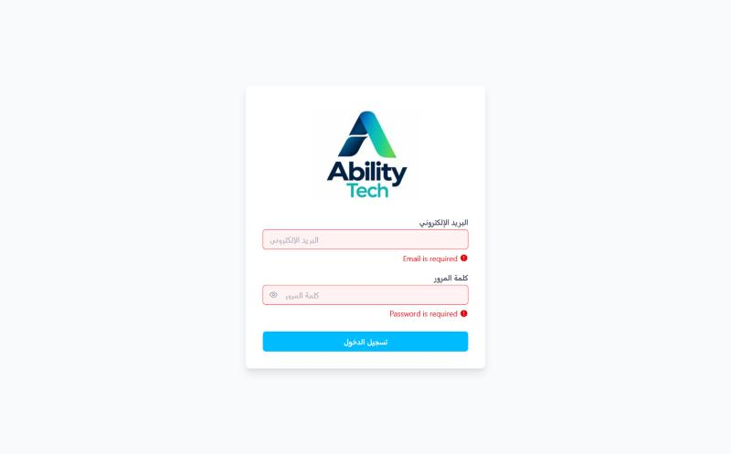

لو الإيميل أو الباسورد غلط، هتظهر رسالة حمرا: *"بيانات تسجيل الدخول غير صحيحة"*. راجع الإيميل والباسورد وجرّب تاني.

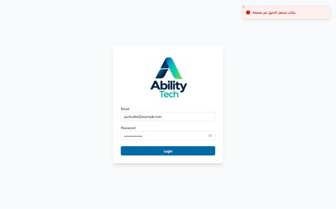

> مفيش رابط "نسيت كلمة المرور"؛ الأدمن يقدر يبعت إيميل إعادة تعيين من **إدارة المستخدمين**.

**أسئلة مرتبطة:** إزاي أغيّر الباسورد؟ · إزاي أعمل تسجيل خروج؟

---

### شكل الشاشة عامل إزاي؟

- **القائمة الجانبية:** القائمة الرئيسية. اضغط على أي قائمة فيها سهم عشان تفتح العناصر الفرعية. الزر اللي فوق بيصغّر أو يكبّر القائمة.
- **الهيدر:** البحث، الإشعارات (الجرس)، اللغة، واسم المستخدم والدور.
- **منطقة المحتوى:** الصفحة المختارة، غالباً صفحة بحث (فلاتر ونتائج) أو صفحة تفاصيل (بيانات وأزرار إجراءات).

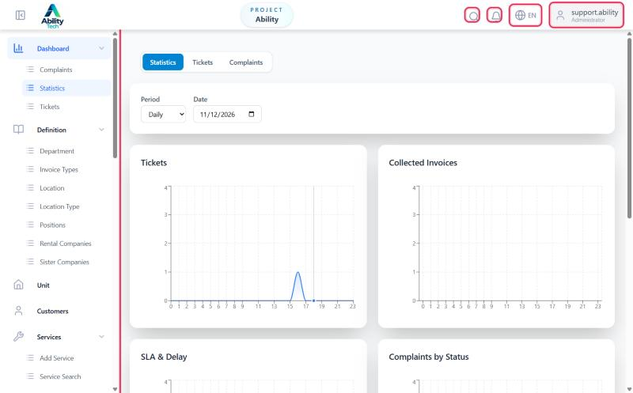

---

### إزاي أدوّر بسرعة على عميل برقم الموبايل؟

1. اضغط أيقونة البحث في الهيدر.
2. خلّيك على تبويب **By Phone**.
3. اكتب رقم الموبايل، والنتائج بتظهر وانت بتكتب.
4. اضغط على العميل عشان تفتح صفحة تفاصيله.

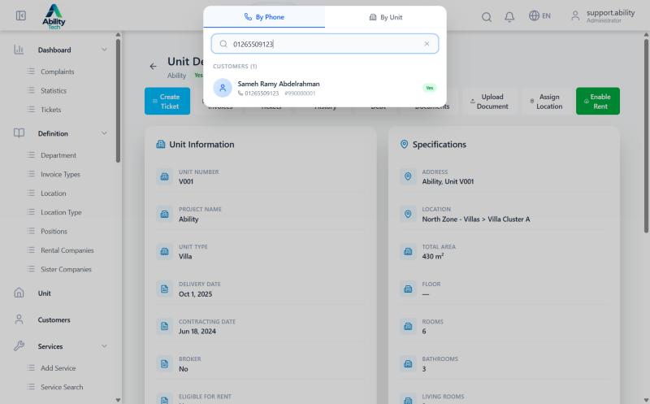

### إزاي أدوّر بسرعة على وحدة؟

1. اضغط أيقونة البحث في الهيدر واختار تبويب **By Unit**.
2. اكتب رقم الوحدة (مثلاً `V001`).
3. اضغط على الوحدة عشان تفتح صفحة **Unit Details**.

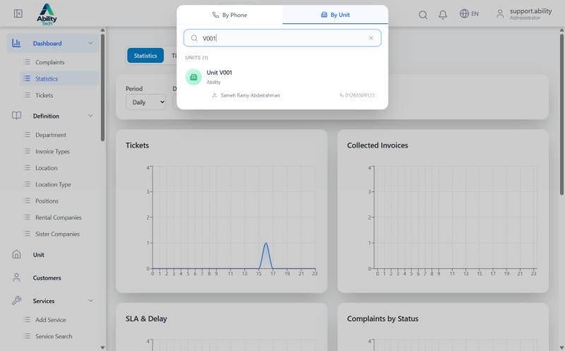

### إزاي أشوف الإشعارات؟

اضغط أيقونة الجرس. لو مفيش إشعارات هتظهر رسالة *No notifications right now*.

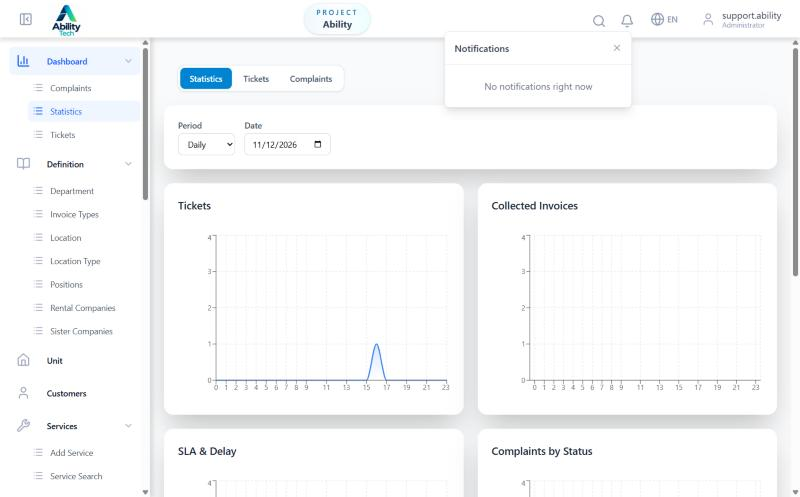

### إزاي أغيّر لغة الواجهة؟

اضغط أيقونة الكرة الأرضية واختار **EN - English** أو **ع - Arabic**. الواجهة العربية بتتعرض من اليمين للشمال.

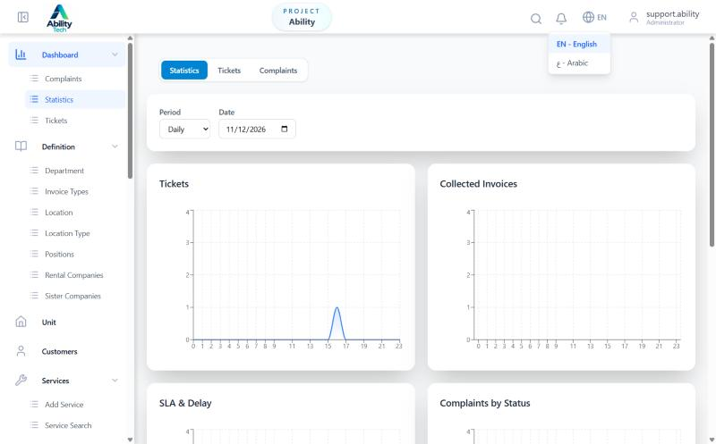

### إزاي أغيّر الباسورد أو أعمل تسجيل خروج؟

1. اضغط على اسمك فوق في الركن.
2. اختار **تغيير كلمة المرور** أو **تسجيل الخروج**.

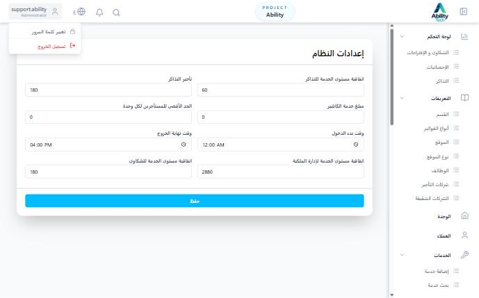

**تغيير كلمة المرور**

1. اضغط **تغيير كلمة المرور** من قائمة المستخدم.
2. املأ الخانات واضغط **حفظ** (أو **إلغاء**).

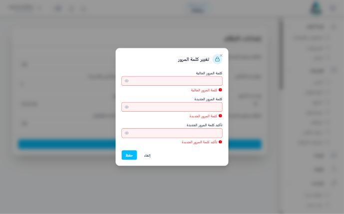

| الخانة | النوع | إجباري | الشرط |
|---|---|---|---|
| **كلمة المرور الحالية** | باسورد (أيقونة العين بتظهره/تخفيه) | أيوه | الباسورد الحالي |
| **كلمة المرور الجديدة** | باسورد | أيوه | 8 حروف على الأقل، فيها حرف كابيتال وحرف سمول وعلامة خاصة |
| **تأكيد كلمة المرور الجديدة** | باسورد | أيوه | لازم يطابق الباسورد الجديد |

**الرسائل:**
- لو ضغطت حفظ والخانات فاضية، كل خانة بتتعلّم بالأحمر وتحتها اسم الخانة بس.
- *Password must be at least 8 characters and include uppercase, lowercase, and a special character* (الباسورد الجديد ضعيف)
- *Passwords do not match* (التأكيد مش مطابق)

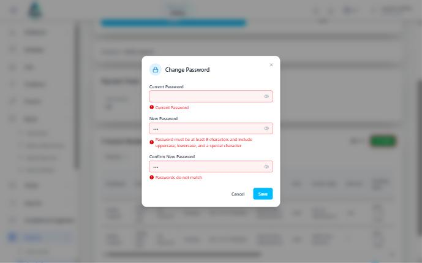

> التحقق اتجرّب من غير تغيير باسورد حقيقي، فرسالة النجاح ما اتسجلتش.

**تسجيل الخروج**

اضغط **تسجيل الخروج** من قائمة المستخدم، وهترجع لصفحة تسجيل الدخول.

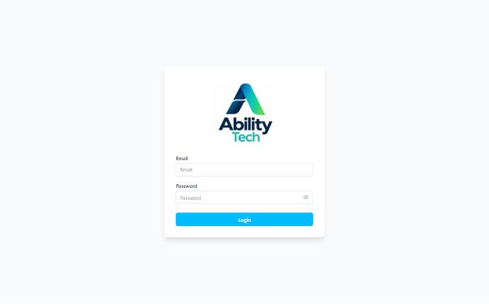

---

### صفحات البحث والقوائم بتشتغل إزاي؟

| العنصر | وظيفته |
|---|---|
| **بحث** | يطبّق الفلاتر. |
| **مسح** | يمسح كل الفلاتر. |
| **تصدير إلى إكسل** | ينزّل النتائج كملف Excel باسم `crm-export.xlsx`. |
| **الأعمدة** | يظهر أو يخفي أعمدة الجدول. |
| أسهم ↑↓ جنب عنوان العمود | ترتيب الجدول بالعمود ده. |
| عدد الصفوف في الصفحة | 10 / 25 / 50 / 100. |
| **الكل** / **نشطة** / **غير نشط** | (صفحات التعريفات) فلترة حسب الحالة. |

أغلب القوائم المنسدلة فيها بحث: اضغط على الخانة، اكتب في خانة البحث، واختار. علامة × جوه الخانة بتمسح الاختيار.

---

## 4. الشكاوى والمقترحات

**الهدف:** تسجيل شكاوى العملاء ومتابعتها لحد قفلها، بالردود والمرفقات.
**المستخدمين:** موظفي خدمة العملاء، مشرفي الأقسام، المديرين.
**القائمة:** **الشكاوى و الاقتراحات** ← **إضافة شكوى** / **بحث شكوى**، وكمان **لوحة التحكم** ← **الشكاوى**.

| الحقل | القيم |
|---|---|
| القسم | الإدارة، خدمة العملاء، التدبير المنزلي، الهندسة، الحدائق، الأمن، الترفيه، المالية، تكنولوجيا المعلومات |
| نوع الشكوى | MyPorto App, Staff Behavior, Late Response, Billing Issue, Cleaning Quality, Garbage Collection, Repeated Breakdown, Water Outage, Power Outage, Landscape Maintenance, Noise Disturbance, Unauthorized Access, Parking Violation, Pool Cleanliness, Beach Services |
| حالة الشكوى | Pending, In progress, Resolved |
| مصدر الطلب | CRM, MyPorto App, Walk-in |
| قناة التواصل | Call, WhatsApp |

---

### إزاي أسجّل شكوى جديدة؟

**كلمات بحث:** إضافة شكوى، شكوى جديدة، تسجيل شكوى

1. ادخل **الشكاوى و الاقتراحات** ← **إضافة شكوى**.
2. اكتب **رقم الوحدة** (أو **Unit ID**). علّم **مطابقة تامة** لو عايز تطابق كامل. اضغط **بحث**.

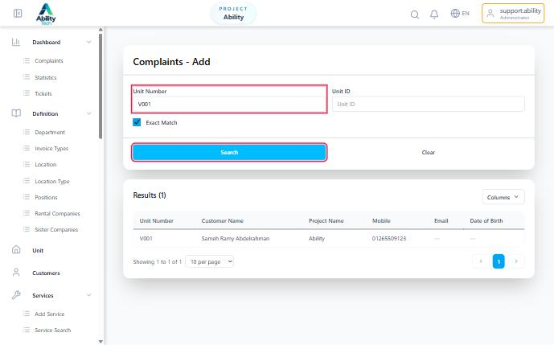

3. اضغط على صف الوحدة في النتائج.

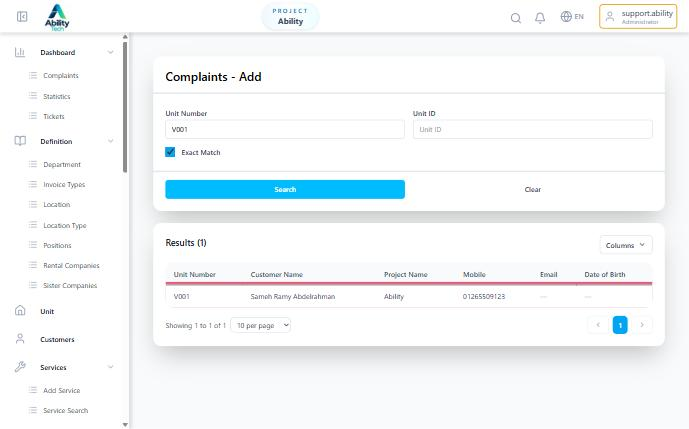

4. هتفتح شاشة إنشاء الشكوى وبيانات العميل والوحدة متعبّية (للقراءة فقط). الحقول الإجبارية عليها إطار.

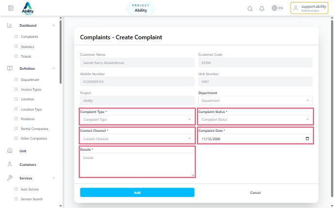

5. اختار **القسم** (اختياري)، و**نوع الشكوى**، و**حالة الشكوى**، و**قناة التواصل**.
6. راجع **تاريخ الشكوى** (افتراضياً النهارده) واكتب **التفاصيل**.
7. اضغط **إضافة**. هتظهر رسالة *Created successfully.* وهتروح لصفحة البحث والشكوى الجديدة أول صف.

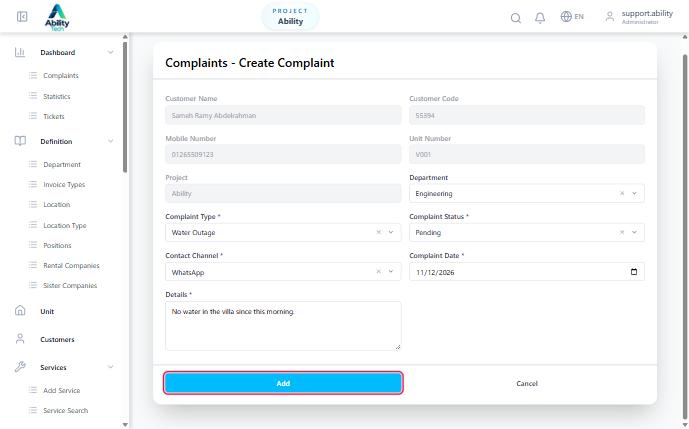

**لو في حقول ناقصة هتظهر الرسائل دي:**

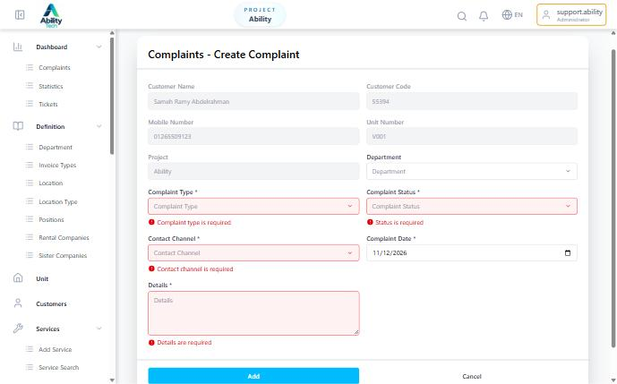

| الرسالة | الحل |
|---|---|
| Complaint type is required | اختار نوع الشكوى. |
| Status is required | اختار حالة الشكوى. |
| Contact channel is required | اختار Call أو WhatsApp. |
| Details are required | اكتب تفاصيل الشكوى. |

**أسئلة مرتبطة:** إزاي ألاقي شكوى؟ · إزاي أضيف رد؟ · إزاي أغيّر حالة الشكوى؟

---

### إزاي أدوّر على شكوى؟

1. ادخل **الشكاوى و الاقتراحات** ← **بحث شكوى**.
2. استخدم أي فلتر: القسم، نوع الشكوى، العميل، رقم الوحدة، الحالة، مصدر الطلب، قناة التواصل، من تاريخ، إلى تاريخ.
3. اضغط **بحث**.

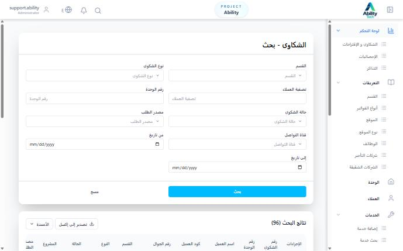

4. في النتائج اضغط على أي قيمة في الصف (مثلاً رقم الشكوى) عشان تفتحها. أيقونة الدبوس بتعرض المرفقات، وفي زر **تصدير إلى إكسل**.

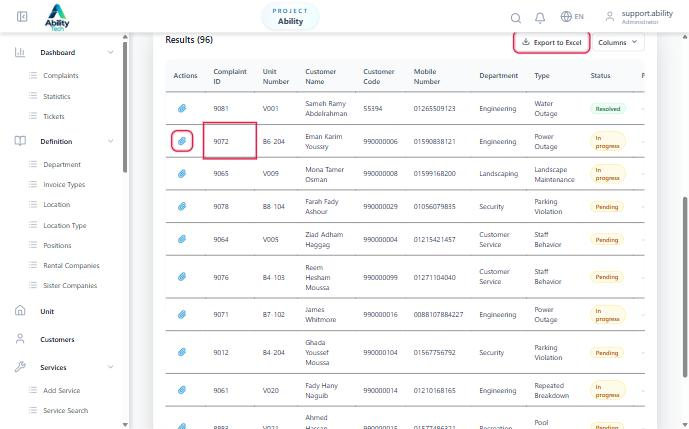

---

### إزاي أشوف مرفقات شكوى من صفحة البحث؟

اضغط أيقونة الدبوس في الصف. نافذة المرفقات بتعرض الملفات أو رسالة *No attachments*.

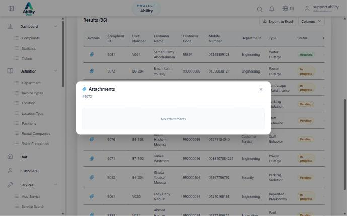

---

### إزاي أفتح تفاصيل شكوى؟

1. افتح الشكوى من صفحة البحث أو من **لوحة التحكم** ← **الشكاوى**.
2. فوق هتلاقي الحالة وأزرار **تغيير الحالة** و**إضافة رد** و**رفع مستند**.

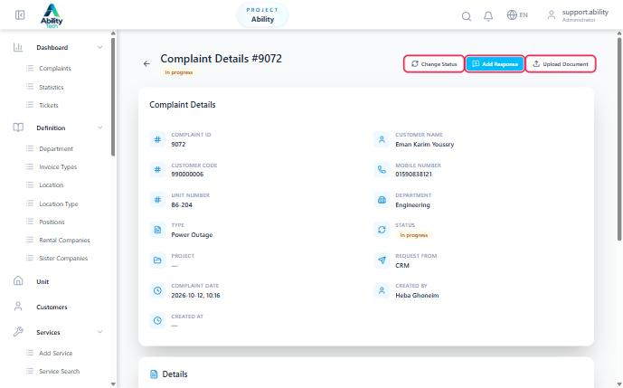

3. تحت هتلاقي التفاصيل والردود والمرفقات.

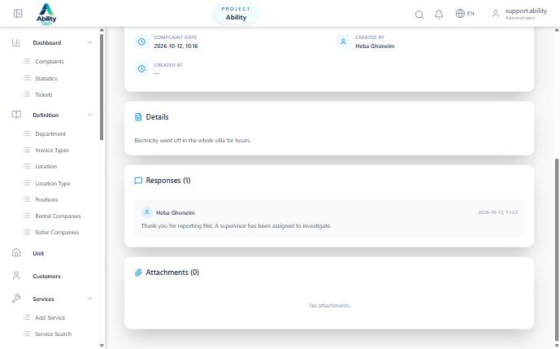

---

### إزاي أضيف رد على شكوى؟

1. افتح الشكوى واضغط **إضافة رد**.
2. اكتب الرد (إجباري).
3. اضغط **حفظ**. الرد بيظهر باسمك والوقت.

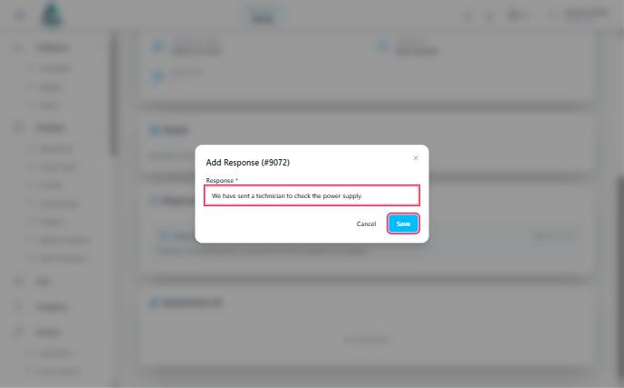

---

### إزاي أغيّر حالة الشكوى (مثلاً أقفلها)؟

1. افتح الشكوى واضغط **تغيير الحالة**.
2. افتح خانة **حالة الشكوى**.

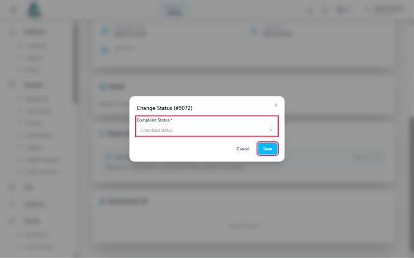

3. اختار Pending أو In progress أو Resolved.

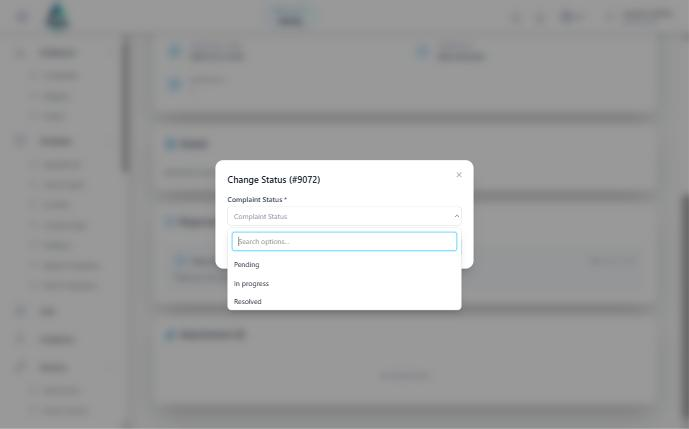

4. اضغط **حفظ**.

> **مهم:** لما الشكوى تبقى Resolved، زر **تغيير الحالة** بيختفي ومينفعش تتفتح تاني من الصفحة دي.

---

### إزاي أرفع مستند على شكوى؟

1. افتح الشكوى واضغط **رفع مستند**.
2. اسحب الملف أو اضغط لاختياره (ينفع أكتر من ملف).
3. اكتب وصف (اختياري) واضغط **Upload**.
4. هتظهر *File uploaded successfully.* وعدد المرفقات بيزيد (اعمل تحديث للصفحة لو ما اتغيرش).

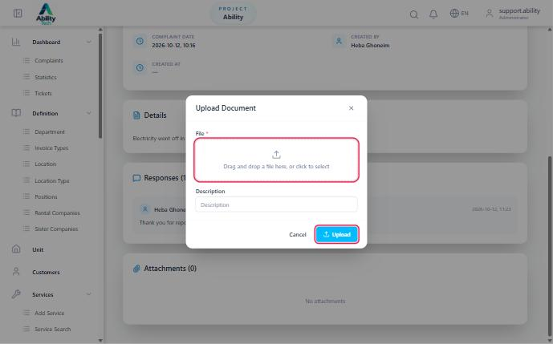

---

## 5. لوحة التحكم (Dashboard)

### فين أشوف الشكاوى المفتوحة؟

1. ادخل **لوحة التحكم** ← **الشكاوى**.
2. الجدول بيعرض الشكاوى اللي حالتها Pending أو In progress بس. الأعمدة اللي جنبها أسهم بتترتب.
3. اضغط على أي صف عشان تفتح الشكوى.

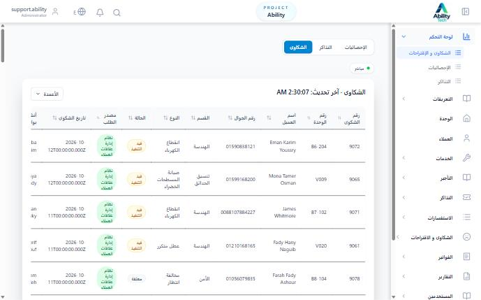

### فين أشوف التذاكر المفتوحة وحالة الـ SLA؟

1. ادخل **لوحة التحكم** ← **التذاكر**.
2. أعمدة المؤشرات:
   - **الحالة:** عين خضرا أو عين مشطوبة رمادي (التذكرة لسه محدش من الموظفين فتحها).
   - **SLA** و **Delayed:** علامة صح خضرا أو مثلث تحذير أحمر.
   - **Urgent:** مثلث رمادي، أو أحمر للتذاكر العاجلة.
3. اضغط على أي صف عشان تفتح التذكرة.

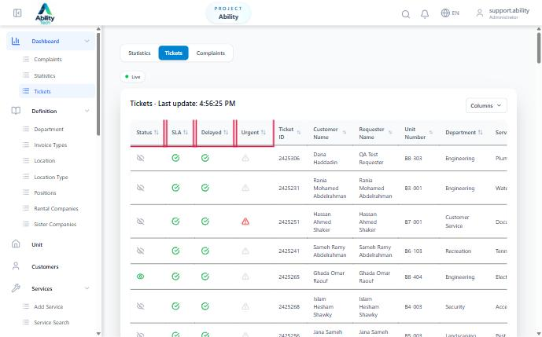

### إزاي أشوف الإحصائيات؟

1. ادخل **لوحة التحكم** ← **الإحصائيات**.
2. اختار الفترة (يومي، أسبوعي، شهري، سنوي) والتاريخ.
3. راجع الرسوم: التذاكر، الفواتير المحصّلة، SLA والتأخير، الشكاوى حسب الحالة، التذاكر حسب القسم.

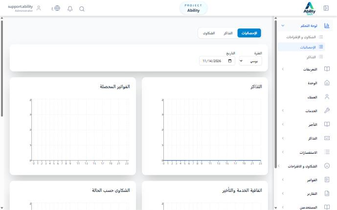

---

## 6. التذاكر و CTS

**الهدف:** متابعة طلبات الخدمة من الطلب للتنفيذ، مع التسعير والتحصيل والـ SLA.
**القائمة:** **التذاكر** ← **إضافة تذكرة** / **بحث التذاكر** / **نظام CTS** / **بحث نظام CTS**. وكمان من صفحة العميل (**إضافة تذكرة**) أو صفحة الوحدة (**إنشاء تذكرة**).

**مراحل التذكرة:** Created ← Paid ← Confirmed ← Inprogress ← Fulfilled ← Done (أو Rejected).

### إزاي أعمل تذكرة جديدة؟

1. ادخل **التذاكر** ← **إضافة تذكرة**، اكتب رقم الوحدة، اضغط **بحث**، واختار صف الوحدة.

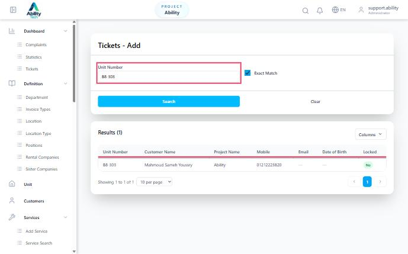

2. شاشة إنشاء التذكرة بتفتح وبيانات الوحدة والعميل متعبّية.
3. اكتب **اسم مقدم الطلب** و**جوال مقدم الطلب** (11 رقم بالظبط) واختار **القسم**.
4. اختياري: **قناة التواصل**، **تاريخ الوصول**، **وقت الوصول**، **ملاحظات**، وعلّم **كاشير متنقل** أو **عاجل**.

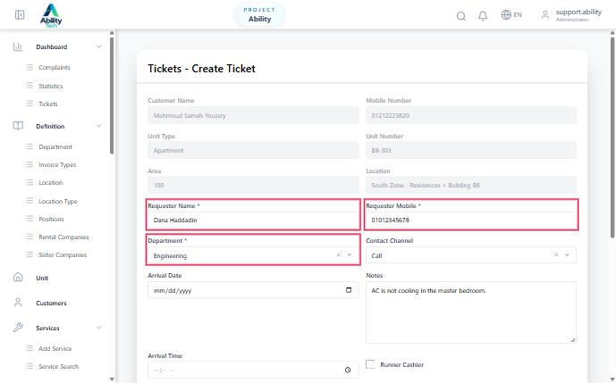

5. في الخدمات اختار خدمة من **اختر الخدمات** (القائمة بتعرض خدمات القسم بأسعارها) واضغط **إضافة خدمة**. كرر لو محتاج. غيّر الكمية بـ − / + أو امسح بأيقونة السلة.
6. اختياري: **إرفاق مستند**.
7. اضغط **إضافة** عشان تنشئ التذكرة (الفاتورة بتفضل Pending)، أو **إنشاء وتحصيل** عشان تنشئ وتحصّل في نفس الوقت.

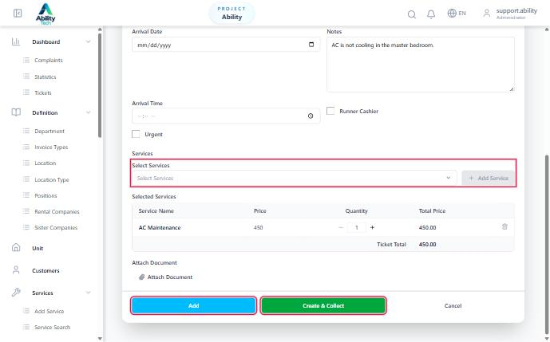

> زر **إضافة** ظهر لما إجمالي التذكرة أكبر من صفر، واختفى لما الخدمة الوحيدة سعرها صفر.

**لو في حقول ناقصة:**

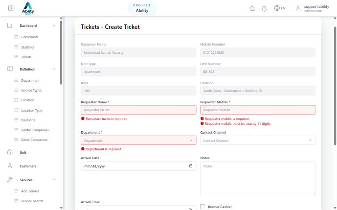

**الرسائل:** *Requester name is required* · *Requester mobile is required* · *Requester mobile must be exactly 11 digits* · *Department is required*.

---

### إزاي أدوّر على التذاكر؟

1. ادخل **التذاكر** ← **بحث التذاكر** واستخدم الفلاتر (رقم التذكرة، القسم، الخدمة، المستخدم، الإجراء، العميل، مقدم الطلب، الوحدة، التاريخ، المصدر، القناة). اضغط **بحث**.

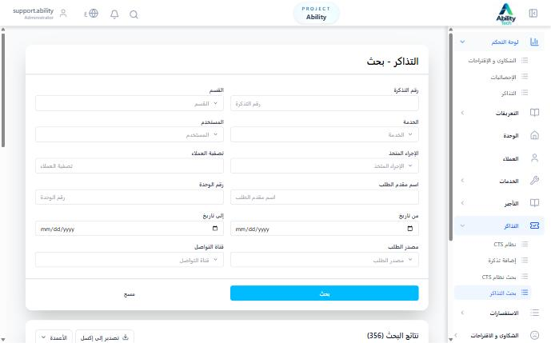

2. في النتائج اضغط على بيانات التذكرة عشان تفتحها، أو استخدم أيقونة القلم (تعديل) أو الطابعة.

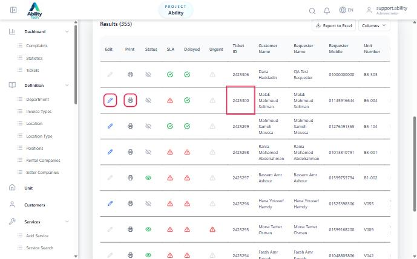

---

### أيقونات Status و SLA و Delayed و Urgent معناها إيه؟

في **بحث التذاكر** و Dashboard ← Tickets:

| العمود | علامة خضرا | علامة تحذير حمرا | علامة رمادي |
|---|---|---|---|
| Status | عين خضرا: حد من الموظفين شاف التذكرة (اسمه في Seen By) | — | عين عليها شرطة: لسه محدش شافها |
| SLA | التذكرة جوه وقت Tickets SLA (الإعدادات) | الوقت عدّى | — |
| Delayed | جوه وقت Tickets Delay (الإعدادات) | الوقت عدّى | — |
| Urgent | — | التذكرة اتعملت وعليها Urgent | مش عاجلة |

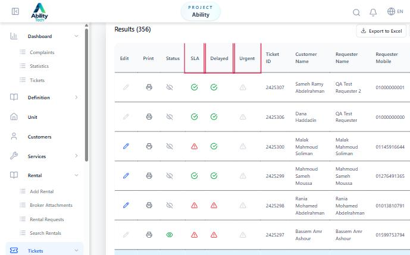

---

### إزاي أعدّل تذكرة؟

1. في صفحة البحث اضغط أيقونة القلم. **التعديل متاح بس لو آخر حالة للتذكرة Created.**
2. عدّل القسم أو وقت الوصول أو الملاحظات أو الخدمات.
3. اضغط **حفظ**. هتظهر *Updated successfully.* والتعديل بيتسجل في الـ Timeline.

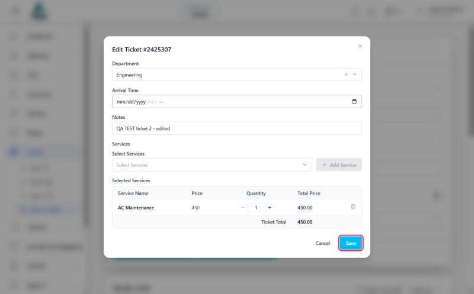

---

### إزاي أغيّر حالة التذكرة؟

1. افتح التذكرة.
2. اضغط زر المرحلة التالية فوق. المراحل اللي اتعملت بتبقى مقفولة.
3. التغيير بيحصل **فوراً من غير رسالة تأكيد**، وتظهر *Status changed successfully.* وبيتسجل في الـ Timeline.

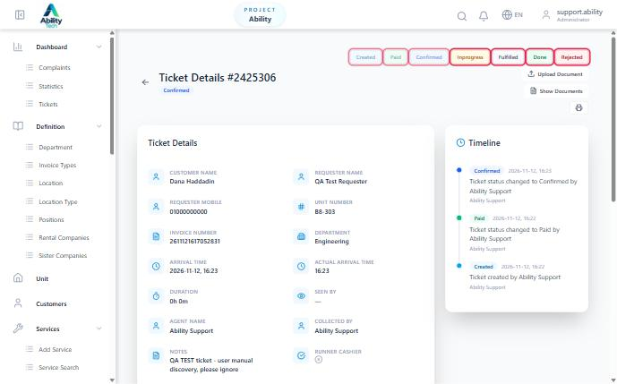

- من حالة Created المتاح بس Rejected. التذكرة بتبقى Paid تلقائي لما فاتورتها تتحصّل.
- المسار اللي اتجرّب: Paid ← Confirmed ← Inprogress ← Fulfilled ← Done.

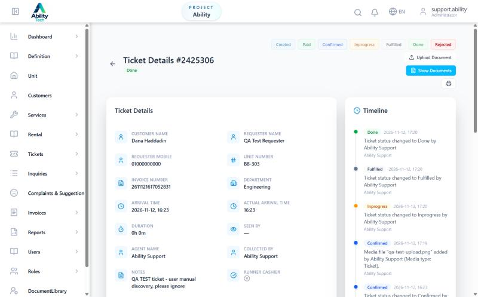

- زر Rejected بيفتح نافذة فيها سبب إجباري (*This field is required* لو فاضي)، وبعدين اضغط **Reject**.

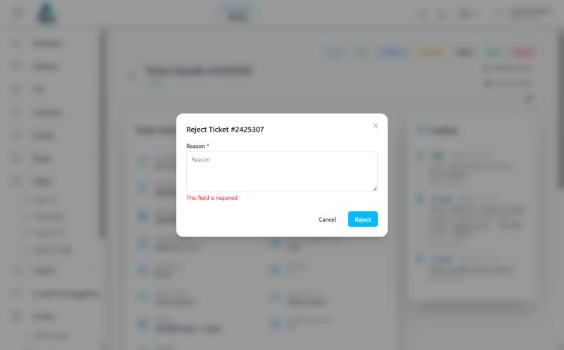

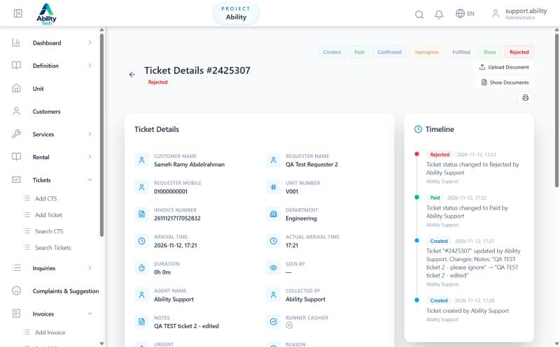

---

### إزاي أضيف تعليق على تذكرة؟

1. افتح التذكرة وانزل لقسم التعليقات.
2. اكتب التعليق (لحد 1000 حرف).
3. اضغط **إضافة تعليق**. هتظهر *Comment added successfully.*

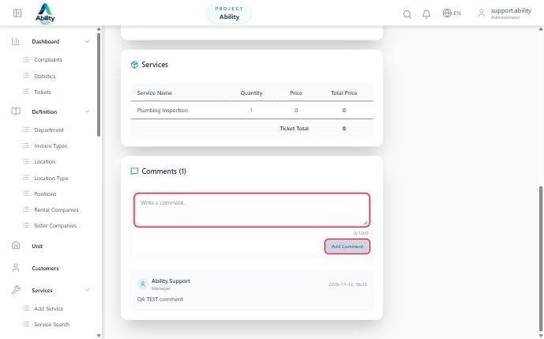

### إزاي أرفع مستند على تذكرة؟

اضغط **رفع مستند**، اختار الملف، اكتب وصف، واضغط **Upload**. الرفع بيتسجل في الـ Timeline، و**عرض المستندات** بيعرض الملفات.

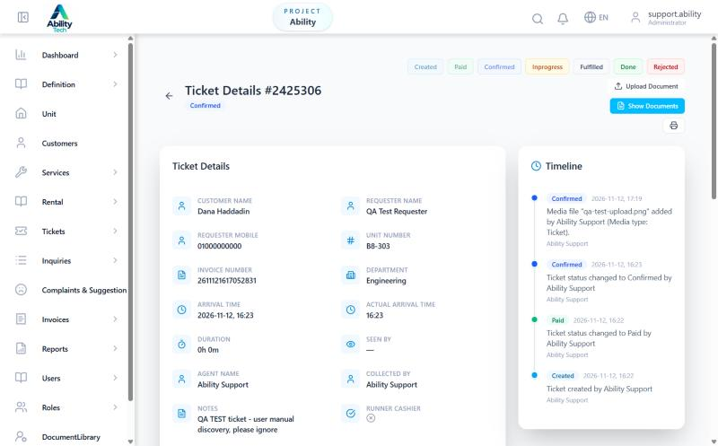

### إزاي أطبع تذكرة؟

اضغط أيقونة الطابعة في صفحة البحث أو في صفحة التذكرة، وهتفتح نافذة الطباعة من المتصفح.

---

### إزاي أعمل سجل CTS؟

1. ادخل **التذاكر** ← **نظام CTS**، دوّر على الوحدة واختارها.
2. املأ **الرسوم السنوية** و**أنواع الفواتير** (إجباري) وباقي الحقول حسب الحاجة.

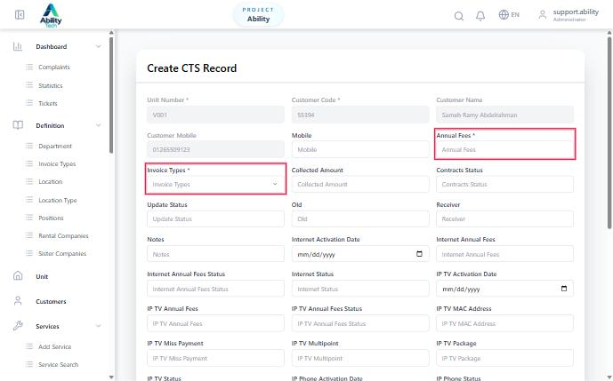

3. انزل تحت واضغط **إرسال** للحفظ، أو **إنشاء وتحصيل** للحفظ والتحصيل. هتظهر *Created successfully.*

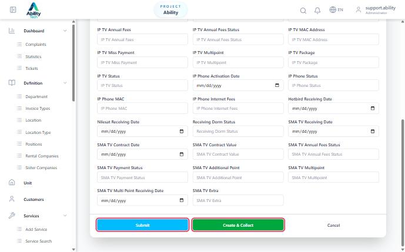

**الرسالة:** *Invoice type is required*.

### إزاي أدوّر على سجلات CTS وأعدّلها؟

1. ادخل **التذاكر** ← **بحث نظام CTS**، اكتب رقم الوحدة واضغط **بحث**.

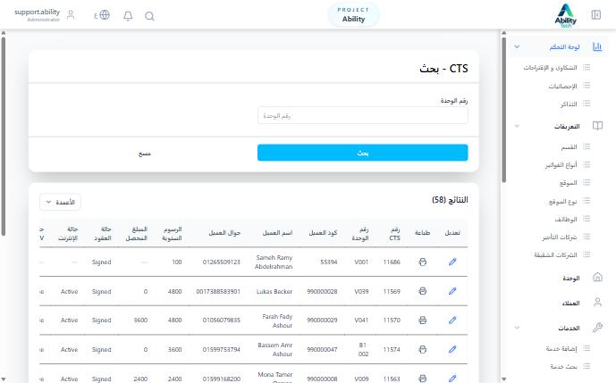

2. أيقونة القلم بتفتح صفحة تعديل السجل. عدّل واضغط **حفظ**، هتظهر *Updated successfully.*
3. أيقونة الطابعة بتفتح نافذة الطباعة.

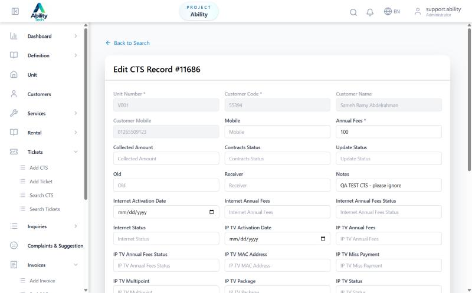

---

## 7. الاستفسارات

### إزاي أسجّل استفسار عميل؟

1. ادخل **الاستفسارات** ← **إضافة استفسار**، اكتب رقم الوحدة، اضغط **بحث**، واختار الصف.
2. نموذج الاستفسار بيظهر تحت واسم وموبايل مقدم الطلب متعبيين (تقدر تغيّرهم).
3. اختار **قناة التواصل**، اكتب **Inquiry** و**Response**.
4. اضغط **إضافة**.

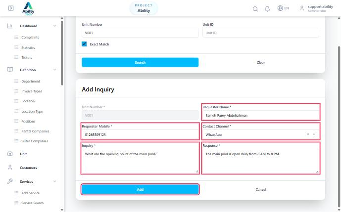

**الرسائل:** *Contact channel is required* · *Inquiry is required* · *Response is required*.

### إزاي أدوّر على الاستفسارات؟

1. ادخل **الاستفسارات** ← **بحث استفسار**، استخدم الفلاتر واضغط **بحث**.

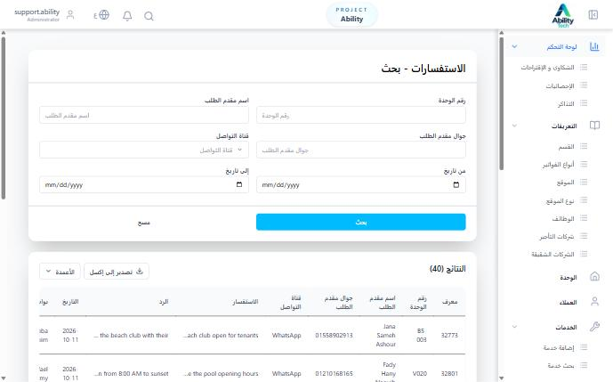

2. اضغط على الصف عشان تفتح التفاصيل.

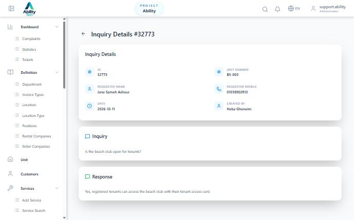

---

## 8. العملاء

### إزاي ألاقي عميل؟

1. ادخل **العملاء**.
2. فلتر بالاسم، الكود، رقم الهوية، التليفون، رقم الوحدة، أو نوع الملكية. اضغط **بحث**.
3. اضغط على صف العميل.

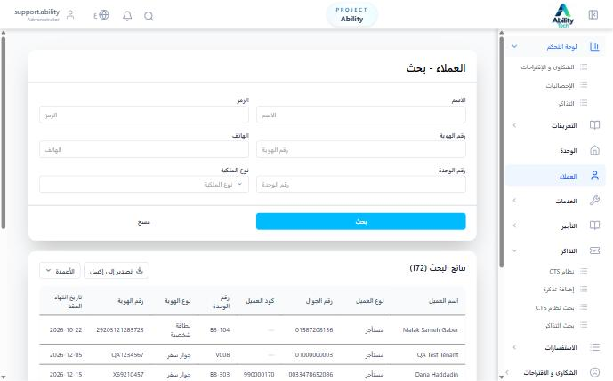

### صفحة تفاصيل العميل فيها إيه؟

أزرار: **تعديل العميل**، **عرض المستندات**، **رفع مستند**، **إضافة تذكرة**. وأقسام: البيانات الشخصية، بيانات التواصل، جهة اتصال الطوارئ، الملاحظات، الوحدات، العربيات.

### إزاي أعدّل بيانات تواصل عميل؟

1. افتح العميل واضغط **تعديل العميل**.
2. عدّل نوع الهوية، رقم الهوية (5 لـ 14 حرف)، الموبايل (11 رقم)، العنوان، الإيميل. كود العميل مقفول.
3. اضغط **حفظ**. الزر بيفضل مقفول لحد ما تغيّر حاجة.

**رسائل التحقق:** *ID number must be between 5 and 14 characters.* · *Mobile number must be exactly 11 digits.* · رسالة من المتصفح لو الإيميل مفيهوش @.

> لو الحفظ ظهرت معاه رسالة *Resource not found* والتعديل ما اتحفظش، بلّغ مسؤول النظام.

### إزاي أشوف أو أرفع مستندات عميل؟

1. للعرض: اضغط **عرض المستندات** واستخدم العرض (العين) أو التحميل (السهم).

2. للرفع: **رفع مستند** ← اختار الملف ← وصف ← **Upload**، هتظهر *File uploaded successfully.*

---

### إزاي أطلّع كل المستأجرين أو الملاك أو أقارب الملاك؟

1. ادخل **العملاء** وخلّي **Ownership** = Owner أو Renter أو Owner Relative.
2. اضغط **بحث**، واستخدم **تصدير إلى إكسل** لو عايز ملف.

---

### إزاي أراجع طلب قريب (قبول أو رفض)؟

1. ادخل **العملاء** ← **صلة القرابة**.
2. فلتر بـ رقم الطلب، Owner ID، رقم الوحدة، موبايل المالك، رقم بطاقة القريب، المشروع، الحالة. اضغط **بحث**.
3. راجع الطلب: اسم المالك، كود المالك، رقم الوحدة، اسم القريب، صلة القرابة، نوع الهوية، رقم هوية القريب، الموبايل، الإيميل. اضغط **Show Media** عشان تشوف المستندات المرفوعة.
4. اضغط **Accept** أو **Reject**.
5. **Cancel** بيلغي طلب اتقبل قبل كده (صلاحية **Delete Accept Request**).

---

## 9. الوحدات

### إزاي أدوّر على الوحدات؟

1. ادخل **الوحدة**.
2. فلتر برقم الوحدة، المشروع، نشطة، مقفولة، مفروشة، متاحة للإيجار، شركة الإيجار، تاريخ التسليم. اضغط **بحث**.
3. اضغط على صف الوحدة عشان تفتح **Unit Details**.

### إيه اللي أقدر أعمله في صفحة تفاصيل الوحدة؟

| الزر | وظيفته |
|---|---|
| **إنشاء تذكرة** | يفتح شاشة إنشاء تذكرة للوحدة. |
| **عرض الفواتير** | يعرض جدول الفواتير. |
| **عرض التذاكر** | يعرض جدول التذاكر. |
| **سجل الملكية** | يعرض الملاك السابقين. |
| **Show Debt** | يعرض المديونية والمدفوعات غير المسددة. |
| **عرض المستندات** | يعرض المستندات. |
| **رفع مستند** | يرفع ملف على الوحدة. |
| **تعيين الموقع** | يحدد موقع الوحدة. |
| **Enable Rent** / **إلغاء الإيجار** | يخلي الوحدة متاحة / مش متاحة للإيجار. |

الملاك الحاليين بيظهروا تحت، وتقدر تبدّل بين الملاك والمستأجرين وأقارب الملاك.

### إزاي أخلي الوحدة متاحة للإيجار (أو ألغيها)؟

1. افتح الوحدة واضغط **Enable Rent** ثم **Confirm**.

2. هتظهر *Unit marked as eligible for rent.* والزر بيتحول لـ **إلغاء الإيجار**.

3. للإلغاء: **إلغاء الإيجار** ← **Confirm** ← *Unit marked as not eligible for rent.*

### ليه مش قادر أضيف إيجار لوحدة؟

شاشة **اضافة مستإجر** بتعرض بس الوحدات اللي ينفع تتأجّر. لو ظهرت *"No units found"*:

1. ادخل **الوحدة** ودوّر على الوحدة وبص على **Eligible for Rent**. لو **No**، حد عنده صلاحية يفتح الوحدة ويضغط **Enable Rent**.
2. بص على **Locked**. الوحدة المقفولة مش بتظهر برضه (زي V048 في التجربة، متاحة للإيجار بس مقفولة).

---

### إزاي ألاقي الوحدات المقفولة؟

في بحث الوحدات خلّي **Locked** = **Yes** واضغط **بحث**. النتايج فيها **Locked** و **Locked By** (مين قفلها).

> القفل وفكّه بيتعملوا من شاشات الـ Block (Add Block و Search Block و Block History)، ودي صلاحيات مش ظاهرة في قايمة الحساب اللي اتعمل بيه الدليل.

---

### إزاي أشوف الملاك أو المستأجرين القدام لوحدة؟

1. افتح الوحدة واضغط **سجل الملكية**.
2. هيظهر **Past Owners** تحت **Current Owners**، وفيه تبويبات Owners و Renters و Owner Relatives، والأعمدة: Customer Name · Customer Code · ID Number · Ownership Type · Contract · Sign Date · End Date · Status (لو مفيش هتظهر *"No ownership history found"*).

---

### إزاي أرفع مستند على وحدة؟

1. اضغط **رفع مستند**، اسحب الملف، اكتب وصف، اضغط **Upload**.

2. هتظهر *File uploaded successfully.* واضغط **عرض المستندات** عشان تشوفه.

### إزاي أحدد موقع لوحدة؟

1. اضغط **تعيين الموقع**، اختار الموقع، واضغط **Confirm**.
2. هتظهر *Location assigned successfully.*

---

## 10. الخدمات

### إزاي أضيف خدمة جديدة؟

1. ادخل **الخدمات** ← **إضافة خدمة**.
2. املأ الحقول الإجبارية: الاسم بالإنجليزي، الاسم بالعربي، القسم، SAP Z Code، السعر، الحالة. واختياري الوصف وتاريخ البداية.

3. اختار الظهور في الموبايل (نعم / لا). لو نعم، اكتب اسم الخدمة في الموبايل بالعربي والإنجليزي.
4. اضغط **إضافة**. هتظهر *Created successfully.*

### إزاي أدوّر على خدمة أو أعدّلها أو أوقفها أو أمسحها؟

1. ادخل **الخدمات** ← **بحث خدمة**، استخدم الفلاتر واضغط **بحث**.

2. في الصف: القلم للتعديل، المفتاح لتفعيل/إيقاف، السلة للمسح.

- التعديل ← **حفظ** ← *Updated successfully.*
- إيقاف الخدمة بيطلب تأكيد (التغيير بيأثر على التذاكر الجديدة بس).

- المسح بيطلب تأكيد (مينفعش يترجع) ← *Deleted successfully.*

---

## 11. الإيجار

**حالات الإيجار:** Fees Collection Pending · Active · Finished · Canceled · Terminated.

### إزاي أعمل حجز إيجار؟

1. ادخل **التأجير** ← **اضافة مستإجر**، اكتب رقم الوحدة واضغط **بحث**.
2. في صف الوحدة اضغط **Add Reservation**. (**View Rental History** بيعرض الإيجارات السابقة للوحدة.)

3. فوق بيظهر نوع الوحدة والموقع والمساحة والحالة بعد الحفظ (Fees Collection Pending). املأ بيانات الحجز الإجبارية.

4. ارفع مستندات المستأجر الأساسي (إجباري).
5. اختياري: بيانات الأقارب (**Add Relative**) وبيانات العربيات (**Add Vehicle**).
6. اضغط **حفظ**.

**لو في بيانات ناقصة:**

**الرسائل:** *Rental company is required* · *Tenant name is required* · *ID type is required* · *ID number must be between 8 and 16 characters* · *Start date is required* · *End date is required* · *Upload the main tenant documents here before saving the rental.*

**بعد الحفظ بنجاح:**

هتظهر رسالة *"Rental created successfully."* والإيجار الجديد حالته **Fees Collection Pending** (اتجرّب على المستأجر التجريبي QA Test Tenant في الوحدة V008).

### إزاي أراجع طلب إيجار (قبول أو رفض)؟

1. ادخل **التأجير** ← **طلبات التأجير**، استخدم الفلاتر واضغط **بحث**.

2. افتح الطلب وراجع التفاصيل والمرفقات، وبعدين **تعديل** أو **Accept** أو **Reject**.

3. **القبول:** اضغط **Accept** وأكّد. هتظهر رسالة *"Rental request accepted successfully."* ويتعمل إيجار مصدره **Walk-in**.

4. **الرفض:** اضغط **Reject**، اكتب السبب (إجباري)، وأكّد. هتظهر رسالة *"Rental request rejected successfully."*.

> لو صفحة التفاصيل ظهرت فاضية بعد القبول، ارجع لـ **طلبات التأجير** وكمّل.

### إزاي أعدّل طلب إيجار قبل القبول؟

اضغط **تعديل**، عدّل الوحدة أو شركة الإيجار أو بيانات المستأجر أو التواريخ، واضغط **حفظ**.

> لو الحفظ أو القبول ظهرت معاه رسالة *"Total tenant count does not match number of tenants provided"*: لازم **Total Tenants Count** يساوي المستأجر الرئيسي + الأقارب المكتوبين في الطلب. صحّح العدد أو الأقارب وجرّب تاني، ولو فضلت، ارفض الطلب واطلب من البروكر يبعته تاني أو كلم الدعم الفني.

### إزاي أدوّر على الإيجارات؟

ادخل **التأجير** ← **بحث الإيجارات**، استخدم الفلاتر واضغط **بحث**.

**أعمدة النتائج:** Accept Request Date · Check-in Date · Check-out Date · Unit Number · Tenant Name · Tenant Mobile · Request Source · Status. زر **تصدير إلى إكسل** بينزّل القايمة. اضغط على الصف عشان تفتح الإيجار.

---

### صفحة تفاصيل الإيجار فيها إيه؟

1. من **بحث الإيجارات** اضغط على الإيجار، هتفتح **Rental Details • RNT-رقم**.
2. فوق هتلاقي الحالة (زي Fees Collection Pending) وتاريخ الطلب وبيانات المستأجر: الاسم، الموبايل، نوع الهوية، رقم الهوية، المشروع، شركة الإيجار، تاريخ البداية، تاريخ النهاية، رقم كارت الدخول، رقم الوحدة، عدد المستأجرين، الإيميل، والملاحظات.

3. تحت فيه المرفقات (عرض وتحميل)، والفواتير، والأقارب، والعربيات، و **Activity Timeline** (إنشاء الحجز، الفواتير، تفاصيل الخروج أو الإنهاء).

**الزراير بتختلف حسب الحالة:**

| الحالة | الزراير |
|---|---|
| Fees Collection Pending (قبل تاريخ البداية) | Print RC · Edit · Create Ticket · Issue Invoice · Change Reservation |
| Fees Collection Pending (من تاريخ البداية) | نفس الزراير + Check-in |
| Active (قبل تاريخ النهاية) | Print RC · Edit · Create Ticket · Issue Invoice · Change Reservation · Terminate |
| Active (من تاريخ النهاية) | نفس الزراير + Check-out |
| Terminated | Print RC · Edit · Create Ticket |

الصفحة بتكتب تنبيه زي *"Check-in becomes available on or after the rent start date."* أو *"Check-out becomes available on or after the end date."*

---

### إزاي أعدّل بيانات إيجار؟

1. افتح الإيجار واضغط **تعديل**.
2. عدّل أي حاجة من: اسم المستأجر*، الموبايل*، الإيميل، نوع الهوية*، رقم الهوية*، تاريخ البداية*، تاريخ النهاية*، رقم كارت الدخول، الملاحظات.
3. اضغط **حفظ**. هتظهر *"Rental details updated successfully."*

---

### إزاي أمدّ إيجار (Change Reservation)؟

1. افتح الإيجار واضغط **Change Reservation**.
2. غيّر رقم الوحدة* أو تاريخ النهاية* أو رقم الكارت أو الملاحظات.
3. اضغط **حفظ**. هتظهر *"Reservation updated successfully."*

> تاريخ النهاية الجديد لازم يكون بعد الحالي، وإلا هتظهر *"New end date must be later than the current end date"*. لو عايز تقصّر المدة استخدم **تعديل**، ولو عايز تنهيه بدري استخدم **Terminate**.

---

### إزاي أطلّع فاتورة على إيجار؟

1. افتح الإيجار واضغط **Issue Invoice**.
2. اختار نوع الفاتورة*: Rental Penalty أو Rental Service Fee أو Rental Penalty Invoice أو Rental File Invoice.

3. اكتب المبلغ* والملاحظات لو فيه.
4. اضغط **حفظ** عشان تطلع Pending، أو **إنشاء وتحصيل** عشان تتحصّل على طول. هتظهر *"Invoice added successfully."*

5. عشان تحصّل الفاتورة بعدين: افتحها من **بحث الفواتير** (فلتر برقم الوحدة)، واضغط **Add Payment Method**، واختار طريقة الدفع والمبلغ، واضغط **Collect**.

> الفاتورة بتظهر في الـ Activity Timeline بتاع الإيجار (Invoice Issued) وفي **بحث الفواتير**. لو خانة إجبارية فاضية هتظهر *"Please fill out this field."*

---

### إزاي أعمل Check-in للمستأجر؟

1. افتح الإيجار. زر **Check-in** بيظهر من تاريخ البداية.

2. اضغط **Check-in**. هتظهر *"Rental status updated successfully."* والحالة تبقى **Active**، ويظهر **Check-out** و **Terminate**.

> الـ Check-in بيتنفّذ على طول من غير رسالة تأكيد.

---

### إزاي أعمل Check-out للمستأجر؟

1. افتح إيجار **Active** من تاريخ النهاية أو بعده، واضغط **Check-out**.

2. املأ الخانات:

| الخانة | إجباري | ملاحظات |
|---|---|---|
| Penalty Amount | لأ | القيمة الافتراضية 0 |
| Invoice Type | لأ | الافتراضي Rental Penalty |
| Invoice Amount | لأ | مبلغ فاتورة الغرامة |
| Invoice Notes | لأ | |
| Tenant Rating | أيوه | Excellent · Good · Fair · Poor |
| Remarks | لأ | |

3. اضغط **حفظ**.

> لو ظهرت *"Invalid request data"* يبقى الـ Check-out ما اتحفظش؛ بلّغ الدعم الفني (شوف ملحق ج).

---

### إزاي أنهي إيجار بدري (Terminate)؟

1. افتح إيجار **Active** واضغط **Terminate**.
2. اكتب سبب الإنهاء* (إجباري، وإلا هتظهر *"This field is required"*). وممكن تضيف الغرامة ونوع الفاتورة ومبلغها وملاحظاتها.

3. اضغط **حفظ**. هتظهر *"Rental terminated successfully."* والحالة تبقى **Terminated**، وتاريخ النهاية يبقى تاريخ الإنهاء، والـ Timeline يسجّل Checked Out والسبب.

⚠️ الإنهاء مينفعش يترجع من الصفحة؛ بيفضل بس Print RC و Edit و Create Ticket.

---

### إزاي أطبع عقد الإيجار (Print RC)؟

افتح الإيجار واضغط **Print RC**. لو قالب العقد مش متظبط للمشروع هتظهر *"No print documents are configured for this project yet."*، كلّم مسؤول النظام يظبطه.

---

### إزاي أعمل تذكرة لمستأجر؟

افتح الإيجار واضغط **Create Ticket**. هتفتح شاشة إنشاء التذكرة وفيها اسم المستأجر وموبايله ونوع الوحدة ورقمها والمساحة والموقع جاهزين. كمّل زي خطوات إنشاء تذكرة جديدة.

---

### دورة حياة الإيجار ماشية إزاي؟

| الخطوة | الحالة بعدها | منين |
|---|---|---|
| حفظ الحجز (إضافة إيجار أو قبول طلب) | Fees Collection Pending | شاشة إضافة الإيجار أو طلبات التأجير |
| Check-in (من تاريخ البداية) | Active | صفحة الإيجار |
| Check-out (من تاريخ النهاية) | Finished | صفحة الإيجار |
| Terminate (في أي وقت وهو Active) | Terminated | صفحة الإيجار |
| — | Canceled | موجودة كفلتر، بس ما لقيناش الزرار اللي بيعملها في صفحة الإيجار |

> في التجربة، تحصيل فاتورة الإيجار ما غيّرش الحالة؛ الـ Check-in هو اللي بيخليه Active.

### إزاي أرفع إيجارات البروكر مرة واحدة؟

1. ادخل **التأجير** ← **مستندات الوسيط**.
2. اختار شركة الإيجار.
3. نزّل القوالب من **تحميل قالب الوحدات** و**تحميل قالب المندوبين**.
4. اختار ملف الوحدات (اسمه لازم `rental_company_units.xlsx`) وملف المندوبين (`rental_company_delegate.xlsx`).
5. اضغط **حفظ**.

**أعمدة القوالب**

| القالب | الأعمدة |
|---|---|
| `rental_company_units.xlsx` | unit_number, area, unit_id |
| `rental_company_delegate.xlsx` | delegate_national_id, delegate_phone_number, delegate_name |

لازم كل ملف يكون فيه صف بيانات واحد على الأقل تحت العناوين.

**الرسائل:**
- من غير اختيار شركة ← *"Please select a rental company."*
- ملف فيه العناوين بس ← *"Units file must contain at least one data row."*

> اتجرّب في بيئة التطوير بالقوالب الفاضية بس؛ الرفع الناجح محتاج أرقام وحدات وبيانات مندوبين حقيقية.

---

## 12. الفواتير

**الحالات:** Pending · Collected · Void · Under Payment Process · Void Requested · Partially Collected · Refunded · Refund Requested · Partially Refund.

### إزاي أعمل فاتورة يدوي؟

1. ادخل **الفواتير** ← **إنشاء فاتورة**، دوّر على الوحدة واختارها.
2. اختياري: اضغط **Show Debt** عشان تشوف المديونية.

3. اختار نوع الفاتورة، القناة (اختياري)، اكتب المبلغ والملاحظات.
4. اضغط **إضافة** (الفاتورة بتبقى Pending) أو **إنشاء وتحصيل**.

**الرسائل:** *Invoice type is required* · *Amount is required* · *Amount must be greater than 0*.

### إزاي أدوّر على فاتورة؟

ادخل **الفواتير** ← **بحث الفواتير**، استخدم الفلاتر واضغط **بحث**. زر الطباعة في الصف متاح بس للفواتير Collected أو Void.

### صفحة الفاتورة فيها إيه؟

الحالة، **طلب إلغاء**، **إلغاء الفاتورة**، **رفع مستند**، والطباعة. وأقسام: التفاصيل، الـ Timeline، الخدمات، طرق الدفع.

### إزاي أحصّل فاتورة Pending؟

1. افتح الفاتورة. الطباعة مقفولة طول ما هي Pending.

2. انزل لطرق الدفع واضغط **Add Payment Method**.
3. اختار نوع الدفع (Cash, Visa, Online, Sister Company, Cheque, Instapay, Total Estimated Cost Refund) واكتب المبلغ. ينفع تقسّم الدفع على أكتر من نوع.

4. اتأكد إن المتبقي 0.00 واضغط **Collect**.

5. هتظهر *Invoice collected successfully.* والفاتورة بتبقى Collected، ولو فاتورة تذكرة، التذكرة بتبقى Paid.

### إزاي أطلب إلغاء فاتورة؟

1. افتح الفاتورة واضغط **طلب إلغاء**.
2. اكتب السبب (الزر بيفضل مقفول لحد ما تكتب).
3. اضغط **طلب إلغاء**. هتظهر *Void request submitted successfully.* والحالة بتبقى Void Requested.

**رفض طلب الإلغاء:** **Reject Void Request** ← اكتب السبب ← تأكيد ← *Void request rejected successfully.* (الحالة بترجع Collected).

### إزاي ألغي فاتورة مباشرة؟

1. افتح الفاتورة واضغط **إلغاء الفاتورة**.
2. اكتب السبب وأكّد. (مينفعش يترجع)
3. هتظهر *Invoice voided successfully.* والحالة بتبقى Void.

### إزاي أراجع نهاية اليوم بتاعتي؟

1. ادخل **الفواتير** ← **نهاية اليوم**، اختار التاريخ واضغط **بحث**.
2. راجع ملخص التحصيل النقدي وإجمالي المدفوعات.

3. تحت هتلاقي قائمة الفواتير وأزرار **طباعة** و**تسوية**.

> زر **طباعة** بيفتح نافذة الطباعة.

**تسوية اليوم**

1. اختار **التاريخ** واضغط **بحث**. هيظهر الموظف، وإجماليات الكاش (المحصّل، الملغي، طلبات الإلغاء، المسترد، صافي الرصيد)، وإجمالي المعلّق، وقائمة الفواتير.

2. اضغط **تسوية**.

3. هتظهر نافذة **Confirm Settlement** بتسأل: *"Are you sure you want to settle the end of day? This action cannot be undone."* اضغط **تسوية** للتأكيد أو **إلغاء**.

4. هتظهر رسالة *"Settlement completed successfully."*. الفواتير المحصّلة والملغية بتختفي من القائمة، والفواتير المعلّقة (Pending) بتفضل، فزر **تسوية** بيفضل ظاهر.

> ⚠️ التسوية مينفعش تترجع. راجع الإجماليات قبل التأكيد.

### إزاي أراجع نهاية اليوم لكل الموظفين؟

ادخل **الفواتير** ← **نهاية اليوم الكاملة**، اختار التاريخ (والخزنة والموظف اختياري) واضغط **بحث**.

---

### إزاي أطلب استرداد (Refund) لفاتورة؟

1. ادخل **الفواتير** ← **استرداد**.
2. دوّر على الفاتورة: فلتر برقم الفاتورة أو رقم البند أو الحالة أو مراجع الـ ERP أو التواريخ، واضغط **بحث**.
3. في صف الفاتورة اضغط **Refund Request** (بيظهر للفواتير اللي لسه متستردتش).
4. هيسألك *"Are you sure you want to submit a refund request for this invoice?"* — اكتب السبب في خانة السبب.
5. اضغط **Refund Request** للتأكيد، أو **Cancel**.
6. حالة الاسترداد في الصف بتبقى **Refund Requested**، واسمك بيظهر في **Refund Requested By** وسببك في **Refund Request Reason**.

---

### إزاي أعمل استرداد مباشر لفاتورة؟

1. ادخل **الفواتير** ← **استرداد**، دوّر على الفاتورة واضغط **Refund** في صفها.
2. اقرا *"Are you sure you want to refund this invoice? This action cannot be undone."* واكتب السبب.
3. اضغط **Refund** للتأكيد، أو **Cancel**.
4. حالة الاسترداد بتبقى **Refunded**، واسمك في **Refunded By** وسببك في **Refund Reason**.

⚠️ الاسترداد المباشر مش بيترجع. لو الاسترداد محتاج مراجعة الأول، استخدم **Refund Request**.

---

### إزاي أراجع طلبات الاسترداد؟

1. ادخل **الفواتير** ← **استرداد**.
2. فلتر بـ رقم الفاتورة، رقم بند الفاتورة، الحالة، ERP Reference، ERP Refund Reference، من تاريخ، إلى تاريخ. اضغط **بحث**.
3. كل صف فيه رقم الفاتورة، رقم البند، العميل، الوحدة، المبلغ، طريقة الدفع، مراجع الـ ERP، حالة الاسترداد، طلبه مين، نفّذه مين، سبب الطلب، وسبب الاسترداد.
4. عمود **Actions** بيختلف حسب حالة الصف: فاتورة لسه متستردتش بيظهرلها **Refund Request** و **Refund** (شوف السؤالين اللي فوق)؛ وطلب الاسترداد المعلّق إجراءاته **Accept Refund Request** و **Reject Refund Request** (صلاحيات تبويب الاسترداد).

حالات الفاتورة المرتبطة: **Refund Requested** و **Refunded** و **Partially Refund**.

---

## 13. التقارير

### تقرير الفواتير اليومية

1. ادخل **التقارير** ← **الفواتير اليومية**.
2. اختار من تاريخ وإلى تاريخ (إجباري)، والفلاتر الاختيارية.
3. اضغط **بحث**، واستخدم **طباعة** أو **تصدير إلى إكسل**.

### تقرير خدمات الأقسام

ادخل **التقارير** ← **تقرير نهاية اليوم لخدمات الأقسام**، اختار التواريخ والقسم، واضغط **بحث**. هتلاقي ملخص لكل قسم وإجمالي عام، والنتائج بالخدمة والعدد والسعر والإجمالي.

### تقرير نهاية اليوم لفترة

ادخل **التقارير** ← **تقرير نهاية اليوم**، اختار التواريخ واضغط **بحث**. هتلاقي إحصائيات الدفع لكل موظف وقائمة الفواتير.

---

## 14. التعريفات (البيانات الأساسية)

كل صفحة فيها بحث بالاسم، وتبويبات الكل/نشط/غير نشط، وزر الإضافة، وفي كل صف تعديل ومسح ومفتاح تفعيل.

| الصفحة | الحقول (* إجباري) |
|---|---|
| **القسم** | الاسم بالإنجليزي*، الاسم بالعربي*، الظهور في الموبايل* |
| **أنواع الفواتير** | الاسم بالإنجليزي*، بالعربي*، SAP Z Code*، Rental، الوصف |
| **الموقع** | الاسم بالإنجليزي*، بالعربي*، نوع الموقع*، كود الموقع |
| **نوع الموقع** / **الوظائف** / **الشركات الشقيقة** | الاسم بالإنجليزي*، بالعربي* |
| **شركات التأجير** | الاسم بالإنجليزي*، بالعربي*، السجل التجاري*، البطاقة الضريبية*، الوصف، المرفقات |

### إزاي أضيف عنصر جديد في التعريفات؟

1. افتح الصفحة واضغط **إضافة**.
2. املأ الحقول واضغط **حفظ**. هتظهر *Created successfully.*

### إزاي أضيف موقع أو موقع فرعي؟

1. ادخل **الموقع**. اضغط **إضافة موقع رئيسي** لموقع رئيسي، أو افتح الموقع الرئيسي بالسهم واضغط **Add Sub-Location**.

2. املأ الحقول واضغط **حفظ**.

### إزاي أعدّل أو أوقف أو أمسح عنصر؟

- التعديل: **تعديل** ← غيّر ← **حفظ** ← *Updated successfully.*
- الإيقاف: المفتاح في الصف ← تأكيد **Deactivate** ← *Updated successfully.* وتلاقيه في تبويب غير نشط.

- المسح: **حذف** ← تأكيد ← *Deleted successfully.*

> ملاحظة: مينفعش تستخدم اسم عنصر اتمسح قبل كده، هتظهر رسالة *Record already exists*.

---

## 15. المستخدمين

### إزاي أضيف مستخدم جديد؟

1. ادخل **المستخدمين** ← **إضافة مستخدم**.
2. املأ الحقول الإجبارية والاختيارية.
3. اضغط **إضافة**.

| الحقل | إجباري | القيم |
|---|---|---|
| اسم المستخدم، الاسم الكامل | نعم | |
| المسمى الوظيفي | نعم | Manager, Assistant Manager, Supervisor, Engineer, Technician, Agent, Cashier, Income Auditor, Security Officer, IT Specialist |
| التليفون | نعم | من 7 لـ 11 حرف |
| القسم، نوع الموظف، الخزنة، النوع، الدور | نعم | |
| المدير، الإيميل | لا | |

**الرسائل:** *... is required* لكل حقل إجباري · *Phone number must be between 7 and 11 characters* · *Email, User Name, or Phone Number already exists*.

> لو ظهرت *Internal server error* بعد الإضافة، راجع **إدارة المستخدمين** قبل ما تعيد المحاولة؛ ممكن يكون المستخدم اتعمل فعلاً.

### إزاي ألاقي مستخدم أو أعدّله أو أوقفه؟

1. ادخل **المستخدمين** ← **إدارة المستخدمين**، فلتر واضغط **بحث**.
2. القلم للتعديل (**حفظ** ← *Updated successfully.*)، المفتاح لتفعيل/إيقاف (بيطلب تأكيد)، وأيقونة المفتاح الصغير لإرسال إيميل إعادة تعيين الباسورد.

### إزاي أبعت إيميل إعادة تعيين الباسورد؟

اضغط أيقونة **Send password reset email** في صف المستخدم.

> لو ظهرت *Internal server error*، اطلب من IT يتأكد إن إرسال الإيميلات شغال.

---

### إزاي أضيف مستخدم قانوني؟

1. ادخل **المستخدمين** ← **إضافة المستخدمين القانونيين**. عنوان الصفحة **Legal Employees - Add**.
2. اكتب **الاسم بالكامل** و**رقم الموبايل**.
3. اضغط **Add** (أو **Cancel**).

---

### إزاي ألاقي مستخدم قانوني أو أعدّله؟

1. ادخل **المستخدمين** ← **إدارة المستخدمين القانونيين** (**Legal Employees - Search**).
2. فلتر بـ الاسم بالكامل، رقم الموبايل، الحالة. اضغط **بحث**.
3. النتايج فيها الحالة، الاسم، الموبايل، والمشروع. اضغط **Edit** في الصف عشان تعدّل.

---

## 16. الأدوار والصلاحيات

### إزاي أعمل دور وأديله صلاحيات؟

1. ادخل **الأدوار** ← **إضافة دور** واكتب اسم الدور بالإنجليزي والعربي.
2. اختار الموديول، وبعدين الصلاحيات (بتختلف حسب الموديول، مثلاً Search Complaint فيه All و Read).

3. اضغط زر الإضافة الصغير جنب الصلاحيات، والصلاحية بتظهر في الجدول تحت.
4. كرر لباقي الموديولات، وبعدين اضغط **إضافة** الكبير. هتظهر *Created successfully.*

**الرسائل:** *English role name is required* · *Arabic role name is required* · *At least one module with permissions is required*.

### إزاي أعدّل دور أو أمسحه؟

1. ادخل **الأدوار** ← **إدارة الأدوار**. القلم للتعديل والسلة للمسح.

2. في صفحة التعديل غيّر الصلاحيات واضغط **حفظ**. هتظهر *Updated successfully.*

3. للمسح، اضغط أيقونة السلة وأكّد في النافذة. الدور بيختفي من **إدارة الأدوار** (اتجرّب على QA Test Role).

---

### الدور ممكن ياخد أنهي موديولات وصلاحيات؟

قايمة **Module** في شاشة إضافة دور فيها **All** والموديولات دي، وكل موديول فيه **All** والصلاحيات اللي جنبه (متقريّة من الشاشة):

| Module | Permissions |
|---|---|
| Positions | Add, Edit, Read |
| Location Type | Add, Delete, Edit, Read |
| Department | Add, Delete, Edit, Read |
| Location | Add, Delete, Edit, Read |
| Sister Companies | Add, Delete, Edit, Read |
| Invoice Types | Add, Delete, Edit, Export, Read |
| Rental Companies | Add, Delete, Read |
| SAP Z Codes | Add, Edit, Read |
| Legal Block Categories | Add, Delete, Edit, Export, Read |
| Search Unit | Edit, Export, Read |
| Service Search | Add, Delete, Edit, Export, Read |
| Add Service | Add |
| Search Customer | Export, Read |
| Relative Requests | Read, Accept, Reject, Delete Accept Request |
| Document Library | Add, Read |
| Add Rental | Add, Delete, Edit, Edit Price, History, Pending Tickets, Read, Read All |
| Search Rentals | Delete, Edit, Export, Read |
| Rental Requests | Edit, Read, Accept, Reject |
| Broker Attachments | Add |
| Add Ticket | Add |
| Search Tickets | Add, Edit, Export, Read |
| Add CTS | Add, Collect Invoice, Edit, Read, Read All |
| Search CTS | Edit, Read |
| Search Complaint | Read |
| Add Complaint | Add |
| Add Invoice | Add |
| Search Invoices | Collect Invoice, Export, Read, Void, Void Requests, Reject Void Request, Refund, Refund Requests, Reject Refund Request, Accept Refund Request, Accept Void Request |
| End Of Day | End Of Day |
| Full End Of Day | FullEnd Of Day |
| Refund | Edit, Read, Refund Requests, Reject Refund Request, Accept Refund Request, Accept Void Request |
| Daily Invoices | Current Work Orders, Read |
| End Of Day Report | Deprecated Assets, Read |
| Department Service End Of Day Report | Read |
| Manage Users | Add, Delete, Edit, Export, Read |
| Add User | Add |
| Add Legal Users | Add |
| Manage Legal Users | Edit, Export, Read |
| Manage Roles | Add, Assign Employee, Delete, Edit, Export, Read |
| Add Role | Add |
| System Settings | Edit |
| Tickets | Read |
| Complaints | Read |
| Statistics | Read |
| Search Inquiry | Read |
| Add Inquiry | Add |
| Search Request | Edit, Export, Read, Close Ownership Request, Invalid |
| Add Request | Add |
| Add Block | Add, Edit, Finance Block, Legal Block |
| Search Block | Edit, Export, Read, UnBlock |
| Block History | Edit, Export, Read, UnBlock |
| Search Logs | Export, Read |

> شوية موديولات (Legal Block Categories، SAP Z Codes، Relative Requests، Refund، Legal Users، Search/Add Request، Block، Search Logs) مالهاش مكان في قايمة الحساب اللي اتعمل بيه الدليل، فشاشاتها مش موثّقة.

---

### إزاي أدي حد صلاحية قراءة بس؟

اعمل دور، ولكل موديول محتاجه اختار **Read** بس (و **Export** لو مسموح له ينزّل قوايم). بعدين اختار الدور ده للمستخدم من **إدارة المستخدمين** ← تعديل. وينفع تستخدم دور **Viewer** الموجود.

### ليه مستخدم مش شايف قايمة أو زرار؟

دوره مفيهوش الموديول أو الصلاحية دي (زي **Accept** في Rental Requests أو **Void** في Search Invoices). الأدمن يضيفها من **إدارة الأدوار** ← تعديل، أو يدّي المستخدم دور تاني.

---

## 17. مكتبة المستندات

### إزاي ألاقي مستند اترفع على النظام؟

1. ادخل **مكتبة المستندات**.
2. فلتر بنوع المرفق، الوحدة، اسم الملف، العميل، رقم التذكرة، رقم الفاتورة، رقم الشكوى... واضغط **بحث**.

3. استخدم التحميل أو العرض في الصف.

4. العرض بيفتح نافذة معاينة فيها فتح في تبويب وتحميل.

> بعض أنواع الملفات مش بتتعرض (*Inline preview is not available for this file type*)؛ استخدم **Download**. لو المستند مش بيفتح ولا بيتحمّل، بلّغ IT.

---

## 18. الإعدادات

### إزاي أغيّر أوقات الـ SLA وباقي الإعدادات؟

1. ادخل **الاعدادات**.
2. عدّل القيم واضغط **حفظ**.

| الإعداد | القيمة (بيئة الاختبار) |
|---|---|
| Tickets SLA | 60 |
| Tickets Delay | 180 |
| Runner Cashier Price | 0 |
| Max Tenants Per Unit | 0 |
| Check-in Start Time | 12:00 AM |
| Check-out end Time | 04:00 PM |
| Ownership Management SLA | 2880 |
| Complains SLA | 180 |

**كل إعداد بيتستخدم في إيه** (من اسم الخانة ومكان ظهورها في السيستم؛ الشاشة مش بتكتب الوحدة، والأرقام توحي إنها دقايق):

| الإعداد | بيتستخدم في |
|---|---|
| Tickets SLA | الوقت قبل ما علامة SLA الحمرا تظهر على التذكرة |
| Tickets Delay | الوقت قبل ما علامة Delayed الحمرا تظهر |
| Runner Cashier Price | الرسوم اللي بتتضاف لما تعلّم Runner Cashier في التذكرة |
| Max Tenants Per Unit | أقصى عدد مستأجرين في الوحدة |
| Check-in Start Time | أول وقت للدخول في الإيجارات |
| Check-out end Time | آخر وقت للخروج في الإيجارات |
| Ownership Management SLA | الوقت المسموح لطلبات الملكية |
| Complains SLA | الوقت المسموح لحل الشكوى |

**التحقق:** كل الأرقام لازم تكون 1 أو أكتر (*Value must be greater than or equal to 1.*). لو أي خانة بصفر، الحفظ مش هيتم لحد ما تصححها.

---

## حظر الوحدات

**الغرض:** قفل وحدة لأسباب **مالية** أو **قانونية** عشان تبان مقفولة في النظام كله، وفك القفل لما المشكلة تتحل.
**القائمة:** **حظر الوحدات** ← **إضافة حظر** / **بحث عن حظر**.

### إزاي أحظر وحدة (حظر مالي أو قانوني)؟

1. ادخل **حظر الوحدات** ← **إضافة حظر**. عنوان الصفحة **Block Unit**.
2. اكتب **رقم الوحدة** (أو **Unit ID**). علّم **Exact Match** لو عايز الرقم بالظبط. اضغط **بحث**.
3. اضغط على صف الوحدة في النتايج. هتفتح صفحة **Unit Blocks - Block Details** وفيها رقم الوحدة، اسم المشروع، نوع الوحدة، اسم العميل، ورقم الموبايل.
4. اختار التاب حسب نوع الحظر: **Finance** (مالي) أو **Legal** (قانوني).
5. اكتب **السبب**، واختياري ترفع **مرفقات** (**Show Attachments** بيعرض الملفات المرفوعة قبل كده).
6. اضغط **Block Unit** (أو **Cancel**).

الوحدات المقفولة بتظهر بعد كده في **الوحدة** ← البحث بفلتر **مقفولة** (قسم 9).

---

### إزاي ألاقي الوحدات المحظورة؟

1. ادخل **حظر الوحدات** ← **بحث عن حظر**.
2. اختار التاب:
    - **All**: كل الوحدات وعلامات الحظر بتاعتها. الفلاتر: رقم الوحدة، Unit ID، نوع الحظر، Exact Match.
    - **Finance**: الحظر المالي. الفلاتر: رقم الوحدة، Unit ID، المشروع، اسم العميل، موبايل العميل، من تاريخ، إلى تاريخ، Exact Match.
    - **Legal**: الحظر القانوني. نفس فلاتر المالي وزيادة **Category** و **Assigned Lawyer**.
3. اضغط **بحث**. **مسح** بيرجّع الفلاتر، و**الأعمدة** بتظهر أو تخفي أعمدة.

---

### إزاي أفك الحظر عن وحدة؟

1. ادخل **حظر الوحدات** ← **بحث عن حظر** وافتح تاب **Finance** أو **Legal**.
2. دوّر على الوحدة ولاقي صف الحظر الشغال.
3. استخدم إجراء **UnBlock** في الصف وأكّد.
4. الصف هيظهر فيه **Unblocked By** و **Unblocked Date**، والوحدة مش هتبقى مقفولة.

---

## إدارة الملكية

**الغرض:** تسجيل ومتابعة طلبات الملكية على الوحدة، كل طلب بتصنيف ووصف ومرفقات، لحد ما يتقفل. الوقت المسموح هو **Ownership Management SLA** في **الإعدادات**.
**القائمة:** **إدارة الملكية** ← **إضافة طلب** / **البحث عن طلب**.

### إزاي أضيف طلب ملكية؟

1. ادخل **إدارة الملكية** ← **إضافة طلب**.
2. اكتب **رقم الوحدة** (أو **Unit ID**)، وعلّم **Exact Match** لو محتاج، واضغط **بحث**.
3. اضغط على صف الوحدة. هتفتح فورم **New Ownership Management Request**.
4. اختار **Category**، واكتب **Description**، واختياري ارفع **Attachments**.
5. اضغط **Add** (أو **Cancel**).

---

### إزاي ألاقي طلب ملكية أو أقفله أو ألغيه؟

1. ادخل **إدارة الملكية** ← **البحث عن طلب**.
2. فلتر بـ رقم الوحدة، Unit ID (مع Exact Match)، Category، Status، Created By، من تاريخ، إلى تاريخ. اضغط **بحث**.
3. النتايج فيها رقم الطلب، رقم الوحدة، Category، الوصف، الحالة، المرفقات، Created By، تاريخ الإنشاء، Closed By، تاريخ القفل.
4. لإنهاء الطلب استخدم **Close Ownership Request**. ولرفض طلب غلط أو متكرر علّمه **Invalid**. هيتسجل **Closed By** و **Closed Date**.

---

## الاستيراد

**الغرض:** إضافة أو تحديث عملاء أو أقارب ملاك أو وحدات كتير مرة واحدة من ملف إكسل، ومتابعة نتيجة كل استيراد.
**القائمة:** **الاستيراد** ← **استيراد العملاء** / **استيراد الأقارب** / **استيراد الوحدات** / **سجل الاستيراد**.

### إزاي أستورد عملاء أو أقارب أو وحدات من إكسل؟

1. ادخل **الاستيراد** واختار **استيراد العملاء** أو **استيراد الأقارب** أو **استيراد الوحدات**.
2. اختار ملف **Excel sheet**.
3. اضغط **Upload**.
4. تابع النتيجة في **الاستيراد** ← **سجل الاستيراد**.

---

### إزاي أتابع نتيجة الاستيراد؟

1. ادخل **الاستيراد** ← **سجل الاستيراد**.
2. كل استيراد بيظهر فيه ID، النوع، الملف، الحالة، Inserted، Updated، Skipped، رفعه مين، اترفع إمتى، و**Rejected rows**.
3. اضغط **Refresh** عشان تحدّث حالة استيراد لسه شغال.

---

## تصدير نتائج البحث

### إزاي أصدّر نتايج البحث لإكسل؟

1. اعمل بحث الأول عشان ليستة **النتائج** تعرض الصفوف اللي عايزها.
2. اضغط **تصدير إلى إكسل** (بيظهر جنب **بحث** / **مسح** لو دورك فيه صلاحية **Export**).
3. المتصفح بينزّل ملف إكسل اسمه `crm-export.xlsx` فيه النتايج.

الزرار بيشتغل بنفس الطريقة في كل صفحات البحث اللي بيظهر فيها (التذاكر، الفواتير، العملاء، الوحدات، الخدمات، الإيجارات، الشكاوى، المستخدمين، الأدوار...). و**الأعمدة** بتغيّر الأعمدة اللي الليستة بتعرضها.

---

## 19. حل المشكلات والأسئلة الشائعة

| المشكلة | الحل |
|---|---|
| مش شايف قائمة أو زرار زميلي شايفه | صلاحيات دورك مختلفة. كلم الأدمن يراجع **إدارة الأدوار**. |
| أيقونة تعديل التذكرة رمادي | التعديل متاح بس لو آخر حالة Created. |
| مش قادر أغيّر حالة الشكوى | الزر بيختفي لما الشكوى تبقى Resolved. |
| ضغطت حالة تذكرة بالغلط | التغيير فوري ومسجل في الـ Timeline. مفيش تراجع؛ كلم المشرف. |
| *Requester mobile must be exactly 11 digits* | اكتب 11 رقم من غير مسافات أو كود دولة. |
| قائمة الخدمات فاضية | اختار القسم الأول. |
| زر Void Request رمادي | اكتب السبب الأول. |
| *Amount must be greater than 0* | الفاتورة اليدوي مينفعش تبقى بصفر. |
| *Record already exists* | الاسم مستخدم قبل كده (حتى لو اتمسح). استخدم اسم تاني. |
| المستند مش بيفتح | جرّب **Download**، ولو ما اشتغلش بلّغ IT. |
| الإعدادات مش بتتحفظ | كل القيم لازم تكون 1 أو أكتر. |
| *بيانات تسجيل الدخول غير صحيحة* | الإيميل أو الباسورد غلط. راجعهم أو اطلب من الأدمن إيميل إعادة تعيين. |
| *Total tenant count does not match…* في طلب إيجار | خلّي العدد = المستأجر الرئيسي + الأقارب. لو فضلت، ارفض الطلب واطلب إعادة إرساله. |
| *Please select a rental company.* أو *Units file must contain at least one data row.* | اختار شركة الإيجار، واملأ صف واحد على الأقل تحت العناوين في الملفين. |
| *Passwords do not match* أو شرط الـ 8 حروف | 8 حروف على الأقل فيها كابيتال وسمول وعلامة خاصة، واكتب نفس القيمة في التأكيد. |
| عملت Settle بالغلط | التسوية مينفعش تترجع. كلم المشرف. |
| الوحدة مش ظاهرة في إضافة إيجار (*No units found*) | الوحدة مش متاحة للإيجار أو مقفولة. شوف "ليه مش قادر أضيف إيجار لوحدة؟" |
| *New end date must be later than the current end date* | Change Reservation بيمدّ بس. للتقصير استخدم Edit، وللإنهاء Terminate. |
| مش لاقي Check-in أو Check-out | Check-in بيظهر من تاريخ البداية، و Check-out من تاريخ النهاية والإيجار Active. |
| *Invalid request data* في الـ Check-out | الخروج ما اتحفظش. بلّغ الدعم الفني. |
| *No print documents are configured…* في Print RC | قالب العقد مش متظبط. كلّم مسؤول النظام. |

---

## 20. ملحق أ — رسائل التحقق

| الشاشة | الرسالة |
|---|---|
| تسجيل الدخول | Email is required / Password is required |
| إنشاء شكوى | Complaint type is required / Status is required / Contact channel is required / Details are required |
| إنشاء تذكرة | Requester name is required / Requester mobile is required / Requester mobile must be exactly 11 digits / Department is required |
| رفض تذكرة | This field is required |
| CTS | Invoice type is required |
| استفسار | Contact channel is required / Inquiry is required / Response is required |
| تعديل عميل | ID number must be between 5 and 14 characters. / Mobile number must be exactly 11 digits. |
| حجز إيجار | Rental company is required / Tenant name is required / ID type is required / ID number must be between 8 and 16 characters / Start date is required / End date is required / Upload the main tenant documents here before saving the rental. |
| فاتورة يدوي | Invoice type is required / Amount is required / Amount must be greater than 0 |
| مستخدم | ... is required / Phone number must be between 7 and 11 characters / Email, User Name, or Phone Number already exists |
| دور | English role name is required / Arabic role name is required / At least one module with permissions is required |
| تعريفات | Record already exists |
| إعدادات | Value must be greater than or equal to 1. |

**رسائل النجاح:** *Created successfully.* · *Updated successfully.* · *Deleted successfully.* · *Status changed successfully.* · *Comment added successfully.* · *File uploaded successfully.* · *Invoice collected successfully.* · *Void request submitted successfully.* · *Void request rejected successfully.* · *Invoice voided successfully.* · *Location assigned successfully.* · *Unit marked as eligible for rent.*

---

## 21. ملحق ب — حالة التحقق وبيانات الاختبار

**اتجرّب بالكامل في بيئة التطوير (12–14 نوفمبر 2026):** رسائل تسجيل الدخول (الخانات الفاضية والبيانات الغلط)، التنقل، البحث السريع، الإشعارات، اللغة، تسجيل الخروج؛ الشكاوى (إنشاء، بحث، رد، حالة، رفع)؛ التذاكر (إنشاء بـ Add و Create & Collect، تعديل، كل المراحل لحد Done، الرفض بسبب، تعليقات، رفع، طباعة)؛ CTS (إنشاء، تعديل، طباعة)؛ الاستفسارات؛ تعديل العميل والرفع؛ تفاصيل الوحدة (Assign Location، Enable/Disable Rent، رفع)؛ الخدمات والتعريفات (إضافة، تعديل، إيقاف، مسح)؛ الإيجار (حفظ حجز، قبول ورفض طلب، رسائل رفع ملفات البروكر)؛ الفواتير (يدوي، تحصيل، طلب إلغاء، رفض طلب الإلغاء، إلغاء، طباعة، تصدير Excel)؛ نهاية اليوم والتسوية والتقارير؛ المستخدمين؛ الأدوار (إضافة، تعديل، مسح)؛ تحقق تغيير الباسورد؛ تحقق الإعدادات؛ وفي 15 نوفمبر: صفحة تفاصيل الإيجار و Edit و Change Reservation و Issue Invoice والتحصيل و Check-in و Terminate و Print RC و Create Ticket من الإيجار ومحاولة Check-out، وظهور الوحدات في إضافة إيجار، وفلتر الوحدات المقفولة، و Ownership History، وفلتر Ownership للعملاء، وأيقونات التذاكر، وقايمة موديولات وصلاحيات الأدوار كاملة.

**مش متاح للحساب المستخدم:** شاشات الـ Legal والـ Block، وشاشة Refund، و Relative Requests، وطلبات الملكية، و Search Logs، و SAP Z Codes.

**ما اتعملش عن قصد:**
- تغيير باسورد حقيقي (كان هيقفل حساب الاختبار).
- رفع ملفات بروكر ببيانات حقيقية (محتاج أرقام وحدات وبيانات مندوبين حقيقية).

**بيانات اختبار اتعملت — ينفع تتمسح:**

| السجل | التفاصيل |
|---|---|
| شكوى 9081 | وحدة V001، Resolved، رد ومرفق تجريبي |
| تذكرة 2425306 | وحدة B8-303، Done، تعليق ومرفق؛ فاتورة 2611121617052831 (صفر جنيه) |
| تذكرة 2425307 | وحدة V001، اتعدلت، Paid ثم Rejected؛ فاتورة 2611121717052832 (450 جنيه، اتحصلت ثم Void) |
| فاتورة 2611121717052833 | يدوي، V001، 1 جنيه، Pending |
| فاتورة 2611121717052834 | V001، صيانة سنوية، 100 جنيه، Pending |
| CTS 11686 | وحدة V001، رسوم 100 |
| مستخدم `qa.test.user` | Viewer، موقوف |
| إيجار QA Test Tenant | وحدة V008، 1–5 ديسمبر 2026، Fees Collection Pending |
| طلب إيجار 15623 | اتقبل (عمل إيجار Walk-in) |
| طلب إيجار 15610 | اترفض بسبب تجريبي |
| نهاية يوم 12 نوفمبر 2026 | اتعملها Settle لـ Ability Support |
| ملف `qa-test-upload.png` | على الوحدة V001 والعميلة Dana Haddadin |
| اتمسح بعد التجربة | نوعين مواقع تجريبيين، خدمة QA Test Service، دور QA Test Role |
| إيجار RNT-83434 (QA Test Tenant، V008) | اتعدّل (10–15 نوفمبر 2026، كارت QA-CARD-01)، واتعمله Check-in فبقى Active؛ محاولات الـ Check-out فشلت |
| فاتورة 2611151217052839 | Rental File Invoice لـ RNT-83434، 300 جنيه، اتحصّلت كاش |
| إيجار RNT-83435 (Malak Sameh Gaber، B3-104) | من الطلب 15623؛ اتعمله Check-in وبعدين Terminate بسبب تجريبي |
| اترجع لأصله | إتاحة الإيجار للوحدة V001 |

---

## 22. ملحق ج — ملاحظات لفريق التطوير

الملاحظات دي ظهرت في **بيئة التطوير**. عمود "السبب المرجّح" بيوضح هل متوقع تظهر في production:
- **الكود:** السلوك من التطبيق نفسه، فمتوقع يظهر في production.
- **إعدادات البيئة:** بسبب إعدادات dev (زي الإيميل أو تخزين الملفات)؛ غالباً مش هيظهر في production.
- **بيانات الاختبار:** بسبب بيانات dev مش منطقية؛ غالباً مش هيظهر في production.
- **محتاج تأكيد:** لازم يتجرّب في production.

| # | المكان | الملاحظة | السبب المرجّح |
|---|---|---|---|
| 1 | تعديل العميل | الحفظ برسالة *Resource not found* والتعديل مش بيتحفظ. | محتاج تأكيد |
| 2 | المستندات | العرض والتحميل بيرجعوا خطأ 401، والمعاينة مش شغالة حتى للصور. | إعدادات البيئة |
| 3 | إضافة مستخدم | *Internal server error* مع إن المستخدم بيتعمل. | إعدادات البيئة |
| 4 | إعادة تعيين الباسورد | *Internal server error* (غالباً إرسال الإيميل مش متظبط). | إعدادات البيئة |
| 5 | الإعدادات | مش بتتحفظ لأن Runner Cashier Price و Max Tenants Per Unit بصفر والحد الأدنى 1. | بيانات الاختبار |
| 6 | التذاكر | التذكرة بتفضل Paid بعد إلغاء فاتورتها. | الكود |
| 7 | التذاكر | زر Rejected متاح حتى بعد Done. | الكود |
| 8 | التذاكر | تغيير الحالة من غير رسالة تأكيد. | الكود |
| 9 | التذاكر | زر Add بيختفي لو إجمالي التذكرة صفر. | الكود |
| 10 | التعريفات | اسم العنصر الممسوح مينفعش يتستخدم تاني. | الكود |
| 11 | الواجهة العربية | رسائل تحقق تسجيل الدخول بالإنجليزي. | الكود |
| 12 | العناوين | مفاتيح مش مترجمة: `tickets.detail.printTicket`، `invoices.detail.columns.print`. | الكود |
| 13 | حجز إيجار | رسالة تقنية لو الموبايل فاضي. | الكود |
| 14 | كود العميل | كود مختلف في شاشات الإنشاء عن صفحة العميل. | بيانات الاختبار |
| 15 | الشكاوى | نوع الشكوى مش متفلتر حسب القسم. | الكود |
| 16 | لوحة التحكم | التواريخ بتظهر بصيغة خام. | الكود |
| 17 | الإعدادات | وحدة الأرقام مش ظاهرة (دقائق؟). | الكود |
| 18 | طلبات الإيجار | الطلب 15610 مش بيتحفظ ولا بيتقبل: *Total tenant count does not match…* مع أي عدد. | بيانات الاختبار |
| 19 | طلبات الإيجار | صفحة التفاصيل بتظهر فاضية بعد القبول. | محتاج تأكيد |
| 20 | الواجهة الإنجليزية | رسائل من السيرفر بتظهر بالعربي (تسجيل دخول غلط، عدد المستأجرين). | الكود |
| 21 | تغيير الباسورد | رسالة الخانة الفاضية بتعرض اسم الخانة بس. | الكود |
| 22 | الواجهة العربية | قيم الحالة ونوع الدفع (Pending، No Payment) بالإنجليزي في نهاية اليوم. | الكود |
| 23 | Check-out الإيجار | الحفظ بيرجّع دايماً *Invalid request data* (بغرامة أو من غيرها)، فالإيجار مش بيوصل Finished. | محتاج تأكيد |
| 24 | فواتير الإيجار | الفاتورة اللي بتطلع من Issue Invoice بتظهر في البحث والـ Timeline، بس مش في قايمة فواتير الإيجار. | الكود |
| 25 | حالة الإيجار | تحصيل فاتورة الإيجار مش بيغيّر Fees Collection Pending؛ الـ Check-in بس هو اللي بيغيّرها حتى من غير دفع. | محتاج تأكيد |
| 26 | تفاصيل الإيجار | Request Creation Date بيمشي ورا تاريخ البداية (أو بيتغيّر بعد الإنهاء) بدل تاريخ الإنشاء. | الكود |
| 27 | العملاء | نوع هوية المستأجر مختلف بين الإيجار (Passport) وقايمة العملاء (National ID) والعكس. | الكود |
| 28 | تفاصيل الوحدة | Owner Type بيظهر بالعربي (*مالك*) في الواجهة الإنجليزية. | بيانات الاختبار |
| 29 | Print RC | *No print documents are configured for this project yet.* | إعدادات البيئة |
| 30 | الأدوار | أسماء صلاحيات غريبة: Current Work Orders (Daily Invoices)، Deprecated Assets (End Of Day Report)، FullEnd Of Day (من غير مسافة). | الكود |
| 31 | تعديل الإيجار | Edit بيغيّر تاريخ البداية والنهاية براحته، و Change Reservation بيقبل تاريخ نهاية أبعد بس. | محتاج تأكيد |

---

## 23. ملحق د — أسماء الواجهة بالعربي والإنجليزي

| الاسم في الواجهة الإنجليزية | الاسم في الواجهة العربية |
|---|---|
| Accept | قبول |
| Active | نشطة |
| Add | إضافة |
| Add Block | إضافة حظر |
| Add Comment | إضافة تعليق |
| Add Complaint | إضافة شكوى |
| Add CTS | نظام CTS |
| Add Inquiry | إضافة استفسار |
| Add Invoice | إنشاء فاتورة |
| Add Legal Users | إضافة المستخدمين القانونيين |
| Add Rental | اضافة مستإجر |
| Add Request | إضافة طلب |
| Add Response | إضافة رد |
| Add Role | إضافة دور |
| Add Root Location | إضافة موقع رئيسي |
| Add Service | إضافة خدمة |
| Add Ticket | إضافة تذكرة |
| Add User | إضافة مستخدم |
| All | الكل |
| Annual Fees | الرسوم السنوية |
| Arrival Date | تاريخ الوصول |
| Arrival Time | وقت الوصول |
| Assign Location | تعيين الموقع |
| Attach Document | إرفاق مستند |
| Block Unit | حظر الوحدة |
| Broker Attachments | مستندات الوسيط |
| Cancel | إلغاء |
| Cancel (relative request) | إلغاء القبول |
| Change Password | تغيير كلمة المرور |
| Change Status | تغيير الحالة |
| Clear | مسح |
| Columns | الأعمدة |
| Complaint Date | تاريخ الشكوى |
| Complaint Status | حالة الشكوى |
| Complaint Type | نوع الشكوى |
| Complaints | الشكاوى |
| Complaints & Suggestions | الشكاوى و الاقتراحات |
| Confirm New Password | تأكيد كلمة المرور الجديدة |
| Contact Channel | قناة التواصل |
| Create & Collect | إنشاء وتحصيل |
| Create Ticket | إنشاء تذكرة |
| Current Password | كلمة المرور الحالية |
| Customers | العملاء |
| Daily Invoices | الفواتير اليومية |
| Dashboard | لوحة التحكم |
| Date | التاريخ |
| Definition | التعريفات |
| Delegates Excel File | ملف إكسل المندوبين |
| Delete | حذف |
| Department | القسم |
| Department Service End Of Day Report | تقرير نهاية اليوم لخدمات الأقسام |
| Details | التفاصيل |
| Disable Rent | إلغاء الإيجار |
| DocumentLibrary | مكتبة المستندات |
| Download Delegates Template | تحميل قالب المندوبين |
| Download Units Template | تحميل قالب الوحدات |
| Edit | تعديل |
| Edit Customer | تعديل العميل |
| Email | البريد الإلكتروني |
| End Of Day | نهاية اليوم |
| End of Day | نهاية اليوم |
| End Of Day Report | تقرير نهاية اليوم |
| ERP Codes | اكواد الساب |
| Exact Match | مطابقة تامة |
| Export to Excel | تصدير إلى إكسل |
| Finance (block type) | مالي |
| Full End Of Day | نهاية اليوم الكاملة |
| Import Customers | استيراد العملاء |
| Import History | سجل الاستيراد |
| Import Relatives | استيراد الأقارب |
| Import Units | استيراد الوحدات |
| Imports | الاستيراد |
| Inactive | غير نشط |
| Inquiries | الاستفسارات |
| Invoice Types | أنواع الفواتير |
| Invoices | الفواتير |
| Legal (block type) | قانوني |
| Location | الموقع |
| Location Type | نوع الموقع |
| Login | تسجيل الدخول |
| Logout | تسجيل الخروج |
| Manage Legal Users | إدارة المستخدمين القانونيين |
| Manage Roles | إدارة الأدوار |
| Manage Users | إدارة المستخدمين |
| New Password | كلمة المرور الجديدة |
| Notes | ملاحظات |
| Notifications | الإشعارات |
| Ownership History | سجل الملكية |
| Ownership Managment | إدارة الملكية |
| Password | كلمة المرور |
| Positions | الوظائف |
| Print | طباعة |
| Refresh | تحديث |
| Refund | استرداد |
| Refund Request | طلب استرداد |
| Reject | رفض |
| Relative Requests | صلة القرابة |
| Rental | التأجير |
| Rental Companies | شركات التأجير |
| Rental Company | شركة الإيجار |
| Rental Requests | طلبات التأجير |
| Reports | التقارير |
| Requester Mobile | جوال مقدم الطلب |
| Requester Name | اسم مقدم الطلب |
| Roles | الأدوار |
| Runner Cashier | كاشير متنقل |
| Save | حفظ |
| Save Changes | حفظ التغييرات |
| Search | بحث |
| Search Block | بحث عن حظر |
| Search Complaint | بحث شكوى |
| Search CTS | بحث نظام CTS |
| Search Inquiry | بحث استفسار |
| Search Invoices | بحث الفواتير |
| Search Rentals | بحث الإيجارات |
| Search Request | البحث عن طلب |
| Search Tickets | بحث التذاكر |
| Select Services | اختر الخدمات |
| Service Search | بحث خدمة |
| Services | الخدمات |
| Settings | الاعدادات |
| Settle | تسوية |
| Show Attachments | عرض المرفقات |
| Show Documents | عرض المستندات |
| Show Invoices | عرض الفواتير |
| Show Media | عرض الوسائط |
| Show Tickets | عرض التذاكر |
| Sister Companies | الشركات الشقيقة |
| Statistics | الإحصائيات |
| Submit | إرسال |
| Tickets | التذاكر |
| Unit | الوحدة |
| Unit Block Categories | فئات حظر الوحدات |
| Unit Blocks | حظر الوحدات |
| Unit Number | رقم الوحدة |
| Units Excel File | ملف إكسل الوحدات |
| Upload | رفع |
| Upload Document | رفع مستند |
| Urgent | عاجل |
| Users | المستخدمين |
| Void Invoice | إلغاء الفاتورة |
| Void Request | طلب إلغاء |

---

## 24. ملحق هـ — الحالات وقيم القوايم

استخدم الجدول ده عشان تشرح أي حالة أو قيمة في قايمة (القيم متقريّة من الشاشات):

| المكان | الخانة | القيم |
|---|---|---|
| Rental Requests | Status | Pending, Accept, Reject |
| Rental Requests | Source | Broker, Tenant, MyPorto Mobile |
| Search Rentals | Status | Fees Collection Pending, Active, Finished, Canceled, Terminated |
| Check-out | Tenant Rating | Excellent, Good, Fair, Poor |
| Issue Invoice (الإيجار) | Invoice Type | Rental Penalty, Rental Service Fee, Rental Penalty Invoice, Rental File Invoice |
| Tickets | Action Taken | Created, Paid, Confirmed, Inprogress, Fulfilled, Done, Rejected |
| Tickets, Complaints, Invoices | Request From | CRM, MyPorto App, Walk-in |
| Tickets, Inquiries, Complaints, Invoices | Contact Channel | Call, WhatsApp |
| Complaints | Complaint Status | Pending, In progress, Resolved |
| Invoices | Status | Pending, Collected, Void, Under Payment Process, Void Requested, Partially Collected, Refunded, Refund Requested, Partially Refund |
| Invoices | Payment Type | Cash, Visa, Online, Sister Company, Cheque, Instapay |
| Customers | Ownership | Owner, Renter, Owner Relative |
| Customers, Rentals | ID Type | Passport, National ID |
| Unit | Active / Locked / Eligible for Rent / Furnished | Yes / No |
| Users | Status | Active, Inactive |
| Dashboard ← Statistics | Period | Daily, Weekly, Monthly, Yearly |
